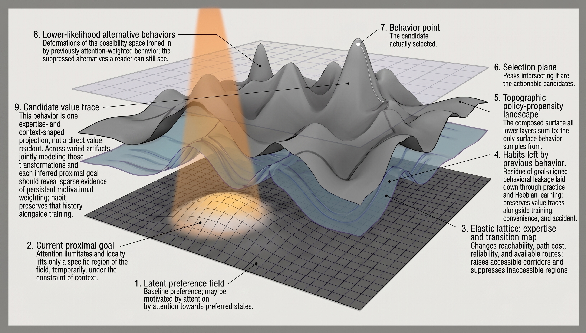

**Evidence navigation:** [Start here](docs/START_HERE_FOR_AGENTS.md) · [Reviewed claim scoreboard](SCOREBOARD.md). Check freshness before use; original evidence remains authoritative.

**Week 5 current execution:** [Verified source continuation](results/phase_2_4_stage_15/WEEK5/CH1_SOURCE_PREFIX_20261111.md). CPU-only Gear 2 is running the unchanged three-month chess source continuation after its planned first-five-percent checkpoint and actual-attempt repeat-play continuation, with native identities, counted leases, fresh progress and resource guards verified. All three completed appraisal extensions have full scientific write-through and internal theory-return records. The repeat-play cohort uses actual attempts 1, 2 and 3 and reports missing-record exclusions; unfinished panel scores remain unreported. Assigned builder implementations are delivered; owner admission review and the recorded source gaps remain. The ready buffer is deficient. Identity expansion is storage-held, reader 128 is memory-held, mood continuation awaits cost review and the original full comparison remains behind back-half priorities. July and MD3.m stay withdrawn. Events, four-hour inactivity and one pending wake remain unchanged.

**Prior execution snapshot (superseded by the back-half packet):** [Healing and expansion record](results/phase_2_4_stage_15/WEEK5/HEAL_EXPAND_COMFORT_MOOD_20261109.md). CPU-only Gear 2 remains selected; the full-scope comparison is safely paused after a Windows commit-memory guard (accounting recovery 19, authenticated checkpoint). No research worker is running: commit headroom remains below the unchanged admission floor. The complete June chess census and independent replay are authenticated. July source storage and downstream chess admissions remain gated. All three mood specification calibration cases have complete independent replay ([zero-effect record](results/phase_2_4_stage_15/WEEK5/MD3_S_NULL_COMPLETE_V4_20261110.md)). The original positive curvature-adjusted kink control [failed its frozen qualification gate](results/phase_2_4_stage_15/WEEK5/MD3_M_POSITIVE_GATE_FAILURE_V4_20261110.md) after full execution, before independent verification. Eight other original controls are unrun; every human mood descendant remains held under the all-twelve-control requirement. All thirteen appraisal and eleven comfort textures are recorded. The publication adapter now passes both complete native controls and all 16 focused checks; the [original-source comfort sensitivity and full replay](results/phase_2_4_stage_15/WEEK5/SP3_IC_HUMAN_COMPLETE_20261110.md) are complete and filed with their conditional limits. Original path failures, both repairs, calibration failure and all charges remain preserved. The sixteen-card ready buffer remains deficient; qualification and source-specific admission remain the bottleneck. Reader ordinals 126 and 127 have complete scoring, fresh verification and full write-through; original ordinal 128 remains unadmitted because Windows commit headroom is below the unchanged 26-GiB start gate. Comparison continuation 62 failed on a monitor file-rename race; its evidence and charges are retained, and the isolated repair passed targeted and native guard qualification. GPU, Ollama and paid calls remain off. Events plus four hours of owner inactivity and one pending wake remain unchanged. Both commissioned appraisal sensitivity calibrations and full independent replays are now complete and internally filed (S15-W5-IN3-IC-20261111; S15-W5-IN4-IC-20261111), after all three complete native compatibility cases and 22 focused checks. Their conditional scope and parent interpretations are retained in the Week 5 index. Earlier snapshots are historical.

**November 10 daily reconciliation:** [Internal digest](results/phase_2_4_stage_15/WEEK5/DIGEST_20261110.md). Completed evidence, retained failures, source anchors and current theory-file integrity reconcile. The interval records 37.59 occupied and 143.22 idle slot-hours; zero ready waiting cards against sixteen required remains an explicit defect. The full comparison is active; reader128 remains memory-held. The next operating pass prioritizes the existing idle-slot and qualification order. Events, four-hour inactivity and single-pending delivery remain unchanged.

**November 8 campaign reconciliation:** [Week 4 final packet](results/phase_2_4_stage_15/DRIVE/WEEK4_FINAL_DIGEST_20261108.md) and [drain addendum](results/phase_2_4_stage_15/DRIVE/WEEK4_DRAIN_20261108.md) are fully recorded. No additional Week 4 result or charge arrived during the drain; prior evidence and $1.12 paid settlement remain unchanged. Week 4 new starts and paid dispatch stay closed. Its [calendar has completed and exited](results/phase_2_4_stage_15/DRIVE/WEEK4_CALENDAR_COMPLETE_20261108.md); the drain addendum was filed before its deadline. [Week 5 daily digest](results/phase_2_4_stage_15/WEEK5/DIGEST_20261108.md) remains recorded; Week 5 continues separately with its November 15 cutoff.

**November 7 daily digests:** [Week 4](results/phase_2_4_stage_15/DRIVE/WEEK4_DIGEST_20261107.md) and [Week 5](results/phase_2_4_stage_15/WEEK5/DIGEST_20261107.md) reconcile completed evidence, corrections, paid closure and allocation-aware utilization. The current execution pointer above remains authoritative; final curator packets await their original closure checks.

**Theory-days closed:** [Final curator digest](results/phase_2_4_stage_15/THEORY_DAYS/DIGEST.md) and [drain reconciliation](results/phase_2_4_stage_15/THEORY_DAYS/FINAL_DRAIN_20261108.md). The original November 8, 07:00 PST drain is complete: all 55 attempts and declared outputs reconcile; unrun cards remain explicit and scientific claims unchanged. Week 5 continues separately in the gear shown above.

**November 7 Jangraw source release:** [Verified source and privacy projection](results/phase_2_4_stage_15/THEORY_DAYS/JANGRAW_LOCAL_SOURCE_20261107.md) (OPS-S15-TD-JANGRAW-LOCAL-SOURCE-20261107). The version-2 archive matches its pin; packaged notice, identifier removal and neutral filenames verify. The curator accepts the NIMH notice for B1 and later source use with citation, acknowledgement and derivative identification, dated November 7. **B1 source/licence hold released.** Scientific mapping, validation and cost admission remain pending. Rutledge TD1–TD3 retrieval remains released; other holds, CPU-only bounds and monitoring deadlines are unchanged.

**November 7 Rutledge source release:** [Verified local intake](results/phase_2_4_stage_15/THEORY_DAYS/RUTLEDGE_LOCAL_SOURCE_20261107.md) (OPS-S15-TD-RUTLEDGE-LOCAL-SOURCE-20261107). The supplied ZIP and README match both MD5 checksums and the registered Dryad SHA-256 pins; extraction and private provenance are complete. **TD1–TD3 retrieval hold released.** Field mapping, known-answer validation, controls and cost admission remain pending. The tools catalog is updated. CPU-only Gear 2 bounds, other holds and monitoring deadlines are unchanged; no new scientific worker was started. Earlier retrieval-blocked snapshots below are historical.

**November 7 morning health:** [Verified inspection](results/phase_2_4_stage_15/THEORY_DAYS/HEALTH_20261107_0706.md) (OPS-S15-TD-HEALTH-20261107-0706). Evidence, locks, resources and monitoring verify. CPU-only Gear 2 is idle: research 0/4, ready 0/8. No new result, orphan or recoverable runtime fault; existing source, control, cost and build holds remain. Paid dispatch stays closed at $1.12 reconciled. Theory-days freezes new starts today at 19:00 PST; both original campaign clocks and final-packet policies remain. Earlier snapshots are historical.

**November 7 publication and continuation:** [Verified record](results/phase_2_4_stage_15/THEORY_DAYS/PUBLICATION_CONTINUATION_20261107.md) (OPS-S15-TD-PUBLICATION-CONTINUATION-20261107). Completed results, theory errata and state were published in `9c74131af` before the grind resumed. Focused tests and evidence checks pass. CPU-only Gear 2 is idle, research 0/4 and ready 0/8; existing source, control, cost and build holds persist. No paid work is active. Next fixed health: November 7 at 07:06:23 PST. Original campaign windows remain; earlier snapshots are historical.

**November 7 queue health:** [Verified inspection](results/phase_2_4_stage_15/THEORY_DAYS/HEALTH_20261107_0101.md) (OPS-S15-TD-HEALTH-20261107-0101). Completed evidence, locks, resources and monitoring verify; no new result or recoverable runtime fault. CPU-only Gear 2 remains idle: research 0/4, ready 0/8. Source retrieval and other source, control, cost and build holds persist. Paid dispatch is closed at $1.12, fully reconciled. Six-hour health checks continue; both original campaign clocks and final-packet policies remain. Earlier snapshots are historical.

**November 6 daily reconciliation:** [Internal digest](results/phase_2_4_stage_15/DRIVE/WEEK4_DIGEST_20261106.md) (OPS-S15-W4-DIGEST-20261106). Week 4 records and paid closure verify; no new Week 4 scientific claim. CPU-only Gear 2 is idle, research 0/4 and ready 0/8. Separate theory-days evidence is recorded; remaining source, control, cost and build holds persist. Paid usage is $1.12, all reconciled. Next fixed health: November 7 at 01:01:47 PST. Both original campaign windows and final-packet policies remain. Earlier snapshots are historical.

**Current queue health:** [Verified inspection](results/phase_2_4_stage_15/THEORY_DAYS/HEALTH_20261106_1854.md) (OPS-S15-TD-HEALTH-20261106-1854). Completed evidence, locks, resources and monitoring verify. CPU-only Gear 2 is idle: research 0/4, ready 0/8. The registered texture grid is complete; remaining source, cost and build holds persist. The 12-hour source-access escalation threshold has been reached. Paid dispatch is closed, with $1.12 reconciled and none active. Original windows and final-packet policies remain; next campaign marker is the Week 4 20:00 PST digest. Earlier snapshots are historical.

**Week 4 paid cutoff:** [Verified closure](results/phase_2_4_stage_15/DRIVE/WEEK4_PAID_CUTOFF_20261106.md) (OPS-S15-W4-PAID-CUTOFF-20261106). Paid dispatch closed November 6 at 17:00 PST. All 15 recorded batches are reconciled at $1.12; none is active or unsettled. CPU-only Gear 2 remains idle, research 0/4 and ready 0/8; source, control, cost and build holds remain. The separate theory-days clock and both final-packet policies are unchanged. Next health inspection: 18:54:44 PST. Earlier snapshots are historical.

**Theory-days current execution:** [Complete descriptive texture](results/phase_2_4_stage_15/THEORY_DAYS/B2_TEXTURE_EXPOSURE_COHORT.md) (S15-TD-B2-TEXTURE-EXPOSURE-COHORT-20261106). The full eight-card family and independent replay are recorded internally, including the retained original cost hold and exact-cache recovery. CPU-only Gear 2 is idle after this finite grid: research 0/4, ready 0/8. TD1 to TD3 retrieval and B1/B3 source holds remain; further texture is unbuilt. All 26 theory errata edits remain applied. Original ceiling, freeze/drain and final-packet policy remain. Next fixed health inspection: November 6 18:54:44 PST. Earlier snapshots are historical.

**Theory-days current execution:** [Errata and verified continuation](results/phase_2_4_stage_15/THEORY_DAYS/ERRATA_CONTINUATION_20261106.md) (OPS-S15-TD-ERRATA-CONTINUATION-20261106). All 26 errata edits are applied and second-pass verified. One admitted descriptive texture job is running in CPU-only Gear 2, with eight ordered cards and the registered early stop; local research 1/4, additional ready jobs 0/8. Source-held primary/backlog work remains held. Native monitoring, accounting and prior records verify; the original ceiling, freeze/drain and final-packet policy remain. Earlier snapshots are historical.

**Theory-days current execution:** [Verified health inspection](results/phase_2_4_stage_15/THEORY_DAYS/HEALTH_20261106_1244.md) (OPS-S15-TD-HEALTH-20261106-1244). All registered eligible theory-days runs have terminal records and full internal landings. CPU-only Gear 2 is idle: local research 0/4, ready 0/8. The pinned setup README is restored; monitoring, outputs, locks and resources verify. TD1 to TD3 retrieval and B1/B3 source holds remain, and the wider ready buffer is unbuilt. No process restart is indicated. Original ceilings, freeze/drain and final-packet policy apply. Earlier snapshots are historical.

**Theory-days current execution:** [Complete B2 record](results/phase_2_4_stage_15/THEORY_DAYS/B2_REFUSALS.md) (S15-TD-B2-REFUSALS-20261106). Complete source and scientific write-through are recorded internally. Chess source preparation remains active in CPU-only Gear 2; inference awaits support and cost admission. Local research 1/4; ready 0/8. Source holds and unbuilt follow-ups remain explicit; one final curator packet follows drain. Earlier snapshots are historical.

**Week 4 current health:** [Verified inspection](results/phase_2_4_stage_15/DRIVE/WEEK4_HEALTH_20261106_0635.md) (OPS-S15-W4-HEALTH-20261106-0635). Completed records and monitoring verify; Gear 2 remains idle with an unbuilt ready buffer, and outdated preparation reminders are reconciled with completed work. Local research 0/4; ready 0/8. GPU parked; 112 campaign cents settled and no batch active. Existing admission holds and final-packet policy remain. Earlier snapshots are historical.

**Week 4 current health:** [Verified inspection](results/phase_2_4_stage_15/DRIVE/WEEK4_HEALTH_20261106_0028.md) (OPS-S15-W4-HEALTH-20261106-0028). Completed records and monitoring verify; Gear 2 remains idle with an unbuilt ready buffer, and stale running-job reminders are corrected. Local research 0/4; ready 0/8. GPU parked; 112 campaign cents settled and no batch active. Existing admission holds and final-packet policy remain. Earlier snapshots are historical.

**Week 4 current digest:** [November 5 integration](results/phase_2_4_stage_15/DRIVE/WEEK4_DIGEST_20261105.md) (OPS-S15-W4-DIGEST-20261105). The November 5 digest reconciles completed results, retained failures, corrections and settled spending; Gear 2 is idle and the ready buffer remains unbuilt. Local research 0/4; ready 0/8. GPU parked; campaign 112 cents settled, no batch active. Final-packet policy and all admission holds remain. Earlier snapshots are historical.

**Week 4 current health:** [Verified queue inspection](results/phase_2_4_stage_15/DRIVE/WEEK4_HEALTH_20261105_1820.md) (OPS-S15-W4-HEALTH-20261105-1820). Completed records, native exits, locks and monitoring verify; Gear 2 remains idle with no ready successors, and the campaign build is incomplete. Local research 0/4; ready 0/8. GPU parked; campaign 112 cents settled, no batch active. Existing admission holds remain. Earlier snapshots are historical.

**Week 4 current completion:** [Complete prompt-excluded comparison](results/phase_2_4_stage_15/DRIVE/WEEK4_D33_PROMPT_EXCLUDED_FULL_20261105.md) (S15-W4-D33-PROMPT-EXCLUDED-20261105). Full inference, both controls and independent replay are recorded, including invalid donor uncertainty. Local research0/4; ready0/8. GPU parked; campaign112 cents settled. Earlier snapshots are historical.

**Week 4 current execution:** [Prompt-excluded comparison](results/phase_2_4_stage_15/DRIVE/WEEK4_D33_PROMPT_INFERENCE_LAUNCH_20261105.md) (OPS-S15-W4-D33-PROMPT-INFERENCE-LAUNCH-20261105). The complete registered prompt-excluded-history comparison is running after full source, numerical and cost admission; its scientific result awaits every control and independent replay. Local research 1/4; ready 0/8. GPU parked; campaign 112 cents settled. Earlier snapshots are historical.

**Week 4 current validation:** [Prompt-excluded inference](results/phase_2_4_stage_15/DRIVE/WEEK4_D33_PROMPT_INFERENCE_COST_20261105.md) (OPS-S15-W4-D33-PROMPT-INFERENCE-COST-20261105). The complete prompt-excluded-history cost probe and all fixed block outputs independently replay; full scientific admission remains a separate cumulative-cost decision. Local research 0/4; ready 0/8. GPU parked; campaign 112 cents settled. Earlier snapshots are historical.

**Week 4 current validation:** [Prompt-excluded inference](results/phase_2_4_stage_15/DRIVE/WEEK4_D33_PROMPT_INFERENCE_NATIVE_20261105.md) (OPS-S15-W4-D33-PROMPT-INFERENCE-NATIVE-20261105). The unchanged prompt-excluded-history statistical consumer passes complete constructed signed-world and independent arithmetic checks; human analysis remains separately gated. Local research 0/4; ready 0/8. GPU parked; campaign 112 cents settled. Earlier snapshots are historical.

**Week 4 current preparation:** [Prompt-excluded history](results/phase_2_4_stage_15/DRIVE/WEEK4_D33_PROMPT_SOURCE_FULL_20261105.md) (OPS-S15-W4-D33-PROMPT-SOURCE-FULL-20261105). Complete prompt-excluded history preparation independently replays with every original row disposition retained; the registered statistical comparison remains uncomputed. Local research 0/4; ready 0/8. GPU parked; campaign 112 cents settled. Earlier snapshots are historical.

**Week 4 current execution:** [Prompt-excluded preparation](results/phase_2_4_stage_15/DRIVE/WEEK4_D33_PROMPT_SOURCE_LAUNCH_20261105.md) (OPS-S15-W4-D33-PROMPT-SOURCE-LAUNCH-20261105). The complete prompt-excluded history preparation is running under the original follow-up allowance with verified ownership and monitoring; statistical inference remains gated. Local research 1/4; ready 0/8. GPU parked; campaign 112 cents settled. Earlier snapshots are historical.

**Week 4 current preparation:** [Prompt-excluded history](results/phase_2_4_stage_15/DRIVE/WEEK4_D33_PROMPT_SOURCE_NATIVE_20261105.md) (OPS-S15-W4-D33-PROMPT-SOURCE-NATIVE-20261105). The prompt-excluded history preparation passes constructed support, provenance and native replay checks; complete corpus preparation and inference remain gated. Local research 0/4; ready 0/8. GPU parked; campaign 112 cents settled. Earlier snapshots are historical.

**Week 4 current control support:** [AUTH reference audit](results/phase_2_4_stage_15/DRIVE/WEEK4_AUTH_REFERENCE_SUPPORT_FULL_20261105.md) (OPS-S15-W4-AUTH-REFERENCE-SUPPORT-FULL-20261105). The rebuilt authorship reference requires text pairs absent from the original scored allocation; this proposed cache-reuse route is held, with human inference uncomputed. Local research 0/4; ready 0/8. GPU parked; campaign 112 cents settled. Earlier snapshots are historical.

**Week 4 current control support:** [AUTH reference audit](results/phase_2_4_stage_15/DRIVE/WEEK4_AUTH_REFERENCE_SUPPORT_NATIVE_20261105.md) (OPS-S15-W4-AUTH-REFERENCE-SUPPORT-NATIVE-20261105). The proposed authorship reference support checker passes constructed membership, role-preservation and native replay checks; corpus support and human inference remain untested. Local research 0/4; ready 0/8. GPU parked; campaign 112 cents settled. Earlier snapshots are historical.

**Week 4 current ruler validation:** [AUTH AUC ruler](results/phase_2_4_stage_15/DRIVE/WEEK4_AUTH_AUC_RULER_CALIBRATION_20261105.md) (OPS-S15-W4-AUTH-AUC-RULER-CALIBRATION-20261105). The complete constructed authorship uncertainty calibration passes its fixed numerical ruler gates; inherited scientific controls and human admission remain outstanding. Local research 0/4; ready 0/8. GPU parked; campaign 112 cents settled. Earlier snapshots are historical.

**Week 4 current execution:** [AUTH ruler calibration launch](results/phase_2_4_stage_15/DRIVE/WEEK4_AUTH_AUC_RULER_LAUNCH_20261105.md) (OPS-S15-W4-AUTH-AUC-RULER-LAUNCH-20261105). The complete constructed authorship uncertainty calibration is running after recorded numerical validation and measured cost admission; human scientific inference remains gated. Local research 1/4; ready 0/8. GPU parked; campaign 112 cents settled. Earlier snapshots are historical.

**Week 4 current ruler validation:** [AUTH AUC ruler](results/phase_2_4_stage_15/DRIVE/WEEK4_AUTH_AUC_RULER_TIMING_20261105.md) (OPS-S15-W4-AUTH-AUC-RULER-TIMING-20261105). The complete constructed timing prefix independently replays within its allowance; the full uncertainty calibration and human analysis remain separately gated. Local research 0/4; ready 0/8. GPU parked; campaign 112 cents settled. Earlier snapshots are historical.

**Week 4 current ruler validation:** [AUTH AUC ruler](results/phase_2_4_stage_15/DRIVE/WEEK4_AUTH_AUC_RULER_NATIVE_20261105.md) (OPS-S15-W4-AUTH-AUC-RULER-NATIVE-20261105). The candidate authorship AUC calculation passes exact constructed arithmetic and native replay; population uncertainty and human inference remain unadmitted. Local research 0/4; ready 0/8. GPU parked; campaign 112 cents settled. Earlier snapshots are historical.

**Week 4 current collection:** [AUTH collection verification](results/phase_2_4_stage_15/DRIVE/WEEK4_AUTH_COLLECTION_FULL_20261105.md) (OPS-S15-W4-AUTH-COLLECTION-FULL-20261105). The complete authorship collection independently replays every label and both writer roles against the frozen source; the scientific genre comparison remains uncomputed. Local research 0/4; ready 0/8. GPU parked; 112 campaign cents settled and no paid batch active. Build the commissioned FIC1 scientific consumer with validated writer dependence and applicable controls before computing the genre contrast. Earlier snapshots are historical.

**Week 4 current collection:** [AUTH collection verification](results/phase_2_4_stage_15/DRIVE/WEEK4_AUTH_COLLECTION_NATIVE_20261105.md) (OPS-S15-W4-AUTH-COLLECTION-NATIVE-20261105). The authorship collection adapter passes known-answer native and independent complete-row replay; human assembly and scientific inference remain separately gated. Local research 0/4; ready 0/8. GPU parked; 112 campaign cents settled and no paid batch active. Run the bounded complete original authorship collection. Earlier snapshots are historical.

**Week 4 current completion:** [Complete AUTH main verification](results/phase_2_4_stage_15/DRIVE/WEEK4_AUTH_MAIN_COMPLETE_20261105.md) (OPS-S15-W4-AUTH-MAIN-COMPLETE-20261105). The complete authorship main batch independently replays with valid responses and all usage settled; the fiction-versus-argument scientific comparison remains uncomputed. Local research 0/4; ready 0/8. GPU parked; 112 campaign cents settled and no paid batch active. Earlier snapshots are historical.

**Week 4 current execution:** [Verified AUTH main launch](results/phase_2_4_stage_15/DRIVE/WEEK4_AUTH_MAIN_LAUNCH_20261105.md) (OPS-S15-W4-AUTH-MAIN-LAUNCH-20261105). The approved authorship main batch is running with verified source, reservation and retrieval monitoring; local Gear 2 research remains idle and the wider ready buffer unfinished. Local research 0/4; ready 0/8. GPU parked. 85 campaign cents settled and 39 reserved. Complete main replay and scientific use remain gated. Earlier snapshots are historical.

**Week 4 current cost admission:** [Complete AUTH main cost](results/phase_2_4_stage_15/DRIVE/WEEK4_AUTH_MAIN_COST_20261105.md) (OPS-S15-W4-AUTH-MAIN-COST-20261105). Complete actual token counts and source verification admit the unchanged approved authorship main within existing caps; generation and scientific use remain pending. Local research 0/4; ready 0/8. GPU parked; 85 campaign cents settled and no paid batch active. Earlier snapshots are historical.

**Week 4 current cost task:** [Verified AUTH count launch](results/phase_2_4_stage_15/DRIVE/WEEK4_AUTH_MAIN_COUNT_LAUNCH_20261105.md) (OPS-S15-W4-AUTH-MAIN-COUNT-LAUNCH-20261105). The approved authorship main token-count task is progressing with verified source and terminal monitoring; generation remains gated and local Gear 2 research remains idle. Local research 0/4; ready 0/8. GPU parked; 85 campaign cents settled and no paid batch active. Earlier snapshots are historical.

**Week 4 current preparation:** [Verified AUTH main source](results/phase_2_4_stage_15/DRIVE/WEEK4_AUTH_MAIN_PREP_20261105.md) (OPS-S15-W4-AUTH-MAIN-PREP-20261105). The unchanged approved authorship main allocation passes source and software verification; both used calibration sets are excluded, and complete cost admission remains pending. Local research 0/4; ready 0/8. GPU parked; 85 campaign cents settled and no batch active. Earlier snapshots are historical.

**Week 4 current calibration:** [Complete fresh AUTH calibration](results/phase_2_4_stage_15/DRIVE/WEEK4_AUTH_H1_CALIBRATION_20261105.md) (OPS-S15-W4-AUTH-H1-CALIBRATION-20261105). The complete fresh authorship calibration meets the unchanged discrimination and format gates; original failure and source limits remain, and main requires separate source and cost admission. Local research 0/4; ready 0/8. GPU parked; 85 campaign cents settled and no batch active. Earlier snapshots are historical.

**Week 4 current calibration:** [Verified AUTH launch](results/phase_2_4_stage_15/DRIVE/WEEK4_AUTH_H1_LAUNCH_20261105.md) (OPS-S15-W4-AUTH-H1-LAUNCH-20261105). The single approved fresh authorship correction is running with verified source, budget and retrieval monitoring; local Gear 2 research remains idle and the wider ready buffer unfinished. Local research0/4; ready0/8. GPU parked. 84 campaign cents settled and three reserved. Complete calibration replay and main remain gated. Earlier snapshots are historical.

**Week 4 current correction preparation:** [Verified fresh AUTH admission](results/phase_2_4_stage_15/DRIVE/WEEK4_AUTH_H1_PREP_20261105.md) (OPS-S15-W4-AUTH-H1-PREP-20261105). The single approved authorship prompt correction has a verified fresh sample, unchanged scoring gates and complete cost admission; provider discrimination and main remain untested. Local research 0/4; ready 0/8; GPU parked. 84 campaign cents settled; no batch active. Earlier snapshots are historical.

**Week 4 current calibration:** [Complete AUTH calibration](results/phase_2_4_stage_15/DRIVE/WEEK4_AUTH_CALIBRATION_20261105.md) (OPS-S15-W4-AUTH-CALIBRATION-20261105). The complete authorship calibration fails its fixed discrimination gate despite valid format; main remains blocked, with one approved fresh prompt correction available. Local research 0/4; ready 0/8. GPU parked; 84 campaign cents settled and no paid batch active. Main and wider builds remain unfinished. Earlier snapshots are historical.

**Week 4 current calibration:** [Verified AUTH launch](results/phase_2_4_stage_15/DRIVE/WEEK4_AUTH_LAUNCH_20261105.md) (OPS-S15-W4-AUTH-LAUNCH-20261105). The approved authorship calibration is running with verified source, budget and retrieval monitoring; local Gear 2 research remains idle and the wider ready buffer unfinished. Local research0/4; ready0/8. GPU parked. 83 campaign cents settled and three reserved. Complete calibration replay and main remain gated. Earlier snapshots are historical.

**Week 4 current calibration preparation:** [Verified AUTH admission](results/phase_2_4_stage_15/DRIVE/WEEK4_AUTH_PREP_20261105.md) (OPS-S15-W4-AUTH-PREP-20261105). The approved authorship calibration has a verified fixed sample, recorded identity truth, tested bounded transport and complete cost admission; provider discrimination and scientific use remain untested. Local research0/4; ready0/8; GPU parked. 83 campaign cents settled; no batch active. Guarded initial calibration is next. Earlier snapshots are historical.

**Week 4 current pair preparation:** [Complete AUTH allocation verification](results/phase_2_4_stage_15/DRIVE/WEEK4_AUTH_PAIRS_FULL_20261105.md) (OPS-S15-W4-AUTH-PAIRS-FULL-20261105). The complete AUTH pair allocation independently replays with balanced truth, genre and prompt assignments; paid calibration and scientific use remain untested. Local research 0/4; ready successors 0/8. GPU parked; 83 campaign cents settled and no paid batch active. Implement the unchanged first-hundred argument calibration and admit its actual cost before any paid call. Earlier snapshots are historical.

**Week 4 current pair preparation:** [Complete AUTH allocation verification](results/phase_2_4_stage_15/DRIVE/WEEK4_AUTH_PAIRS_NATIVE_20261105.md) (OPS-S15-W4-AUTH-PAIRS-NATIVE-20261105). The AUTH pair allocator passes native matched-truth and complete replay checks after a recorded fixture correction; human allocation and calibration remain untested. Local research 0/4; ready successors 0/8. GPU parked; 83 campaign cents settled and no paid batch active. Run the bounded full original pair allocation. Earlier snapshots are historical.

**Week 4 current source preparation:** [Complete AUTH source verification](results/phase_2_4_stage_15/DRIVE/WEEK4_AUTH_SOURCE_FULL_20261105.md) (OPS-S15-W4-AUTH-SOURCE-FULL-20261105). The complete original AUTH cohort has an independently replayed final-surviving typed-text source; pair allocation, paid calibration and scientific use remain gated. Local research 0/4; ready successors 0/8. GPU parked; 83 campaign cents settled and no paid batch active. Build and verify the original balanced prompt-matched pair allocation and calibration before paid admission. Earlier snapshots are historical.

**Week 4 current source preparation:** [Complete AUTH source verification](results/phase_2_4_stage_15/DRIVE/WEEK4_AUTH_SOURCE_TIMING_20261105.md) (OPS-S15-W4-AUTH-SOURCE-TIMING-20261105). The fixed AUTH source timing prefix independently replays; full cohort coverage, pair allocation and paid admission remain separately gated. Local research 0/4; ready successors 0/8. GPU parked; 83 campaign cents settled and no paid batch active. Check the measured complete-source forecast before full admission. Earlier snapshots are historical.

**Week 4 current source preparation:** [Complete AUTH source verification](results/phase_2_4_stage_15/DRIVE/WEEK4_AUTH_SOURCE_NATIVE_20261105.md) (OPS-S15-W4-AUTH-SOURCE-NATIVE-20261105). The AUTH text source passes native known-answer and independent provenance replay; corpus coverage, pair allocation and paid admission remain untested. Local research 0/4; ready successors 0/8. GPU parked; 83 campaign cents settled and no paid batch active. Run the fixed source timing prefix before full measured admission. Earlier snapshots are historical.

**Week 4 current reader completion:** [Complete main verification](results/phase_2_4_stage_15/DRIVE/WEEK4_VAL_MAIN_COMPLETE_20261105.md) (OPS-S15-W4-VAL-MAIN-COMPLETE-20261105). The complete value-reader batch fails its all-valid collection gate because of a provider refusal; all usage is settled, and collection assembly and scientific use remain blocked. Local research 0/4; ready successors 0/8. GPU parked. Eighty-three campaign cents settled; no paid batch active. Independent AUTH preparation and wider builds remain unfinished. Earlier snapshots are historical.

**Week 4 current execution:** [Verified value-reader main launch](results/phase_2_4_stage_15/DRIVE/WEEK4_VAL_MAIN_LAUNCH_20261105.md) (OPS-S15-W4-VAL-MAIN-LAUNCH-20261105). The approved value-reader main batch is running with verified source, reservation and retrieval monitoring; local Gear 2 research remains idle and the wider build unfinished. Local research 0/4; ready successors 0/8. GPU parked. Twenty-one campaign cents settled and 84 reserved. Complete main replay, label assembly and V2 remain separately gated. Earlier snapshots are historical.

**Week 4 current cost admission:** [Complete main cost verification](results/phase_2_4_stage_15/DRIVE/WEEK4_VAL_MAIN_COST_20261105.md) (OPS-S15-W4-VAL-MAIN-COST-20261105). Complete actual token counts and source verification admit the unchanged approved value-reader main within existing caps; generation and scientific collection remain pending. Local research 0/4; ready successors 0/8. GPU parked. Twenty-one campaign cents settled; no paid batch active. V2 remains separately gated. Earlier snapshots are historical.

**Week 4 current cost task:** [Verified main count launch](results/phase_2_4_stage_15/DRIVE/WEEK4_VAL_MAIN_COUNT_LAUNCH_20261105.md) (OPS-S15-W4-VAL-MAIN-COUNT-LAUNCH-20261105). The approved main value-reader token-count task is progressing with verified source and terminal monitoring; generation remains gated and local Gear 2 research remains idle. Local research 0/4; ready successors 0/8. GPU parked. Twenty-one campaign cents settled; no paid batch active. Main generation and V2 remain separately gated. Earlier snapshots are historical.

**Week 4 current calibration:** [Complete value-reader calibration](results/phase_2_4_stage_15/DRIVE/WEEK4_VAL_H1_CALIBRATION_20261105.md) (OPS-S15-W4-VAL-H1-CALIBRATION-20261105). The complete fresh value-reader calibration meets the fixed pooled agreement and format gates; category weaknesses remain explicit, and main requires separate source and cost admission. Local research 0/4; ready successors 0/8. GPU parked. Twenty-one campaign cents settled; no paid batch active. The wider build remains unfinished. Earlier snapshots are historical.

**Week 4 current calibration:** [Verified value-reader launch](results/phase_2_4_stage_15/DRIVE/WEEK4_VAL_H1_LAUNCH_20261105.md) (OPS-S15-W4-VAL-H1-LAUNCH-20261105). The single approved fresh value-reader correction is running with verified source, budget and monitoring; local Gear 2 remains idle and its ready buffer is unfinished. Local research 0/4; ready successors 0/8. GPU parked. Twenty campaign cents settled and three reserved. Complete agreement and main remain gated; REV has stopped. Earlier snapshots are historical.

**Week 4 current calibration:** [Complete value-reader calibration](results/phase_2_4_stage_15/DRIVE/WEEK4_VAL_CALIBRATION_20261105.md) (OPS-S15-W4-VAL-CALIBRATION-20261105). The complete value-reader calibration fails agreement with the frozen blind agent reference despite valid format; main remains blocked, with one approved fresh prompt correction available. Local research 0/4; ready successors 0/8. GPU parked. Twenty campaign cents settled; no paid batch active. The wider build remains unfinished. Earlier snapshots are historical.

**Week 4 current calibration:** [Verified value-reader launch](results/phase_2_4_stage_15/DRIVE/WEEK4_VAL_LAUNCH_20261105.md) (OPS-S15-W4-VAL-LAUNCH-20261105). The approved explanation-only value calibration is running with verified source, budget and monitoring; local Gear 2 remains idle and its ready buffer is unfinished. Local research 0/4; ready successors 0/8. GPU parked. Nineteen campaign cents settled and three reserved. Complete agreement and main remain gated; REV has stopped. Earlier snapshots are historical.

**Week 4 current calibration:** [Complete fresh reader-format failure](results/phase_2_4_stage_15/DRIVE/WEEK4_REV_PROMPT_CALIBRATION_20261105.md) (OPS-S15-W4-REV-PROMPT-CALIBRATION-20261105). The complete fresh reader calibration fails the fixed format gate; REV stops with its single prompt correction exhausted, and process and planted-goal accuracy remain untested. Local research 0/4; ready successors 0/8. GPU parked. Nineteen campaign cents settled; no paid batch active. Independent VAL preparation and the wider build remain unfinished. Earlier snapshots are historical.

**Week 4 current calibration:** [Verified fresh reader launch](results/phase_2_4_stage_15/DRIVE/WEEK4_REV_PROMPT_LAUNCH_20261105.md) (OPS-S15-W4-REV-PROMPT-LAUNCH-20261105). The single approved fresh reader-format correction is running with verified source, budget and monitoring; local Gear 2 remains idle and its ready buffer is unfinished. Local research 0/4; ready successors 0/8. GPU parked. Seventeen campaign cents settled and four reserved. Original failure fully recorded; another failed rung stops REV. Earlier snapshots are historical.

**Week 4 current calibration:** [Complete reader-format failure](results/phase_2_4_stage_15/DRIVE/WEEK4_REV_CALIBRATION_20261105.md) (OPS-S15-W4-REV-CALIBRATION-20261105). The complete independent-reader calibration fails document row-count validity; no accuracy is evaluated, and main remains blocked pending the single approved fresh prompt correction. Local research 0/4; ready successors 0/8. GPU parked. Seventeen campaign cents settled; no paid batch active. The broader build remains unfinished. Earlier snapshots are historical.

**Week 4 current calibration:** [Verified reader launch](results/phase_2_4_stage_15/DRIVE/WEEK4_REV_LAUNCH_20261105.md) (OPS-S15-W4-REV-LAUNCH-20261105). The approved independent-reader format calibration is running with verified source, budget and monitoring; local Gear 2 remains idle and its ready buffer is unfinished. Local research 0/4; ready successors 0/8. GPU parked. Sixteen campaign cents settled and four reserved. Complete format replay precedes main admission; the broader build remains unfinished. Earlier snapshots are historical.

**Week 4 current corpus:** [Complete production and accounting](results/phase_2_4_stage_15/DRIVE/WEEK4_PLANT_MAIN_20261105.md) (OPS-S15-W4-PLANT-MAIN-20261105). The complete planted-text corpus independently replays with all usage settled; assigned-goal realization and reader recovery remain untested. Local research 0/4; ready successors 0/8. GPU parked. Sixteen campaign cents settled; no paid batch active. Independent REV preparation and the wider ready buffer remain unfinished. Earlier snapshots are historical.

**Week 4 current health:** [Final inspection and approved main launch](results/phase_2_4_stage_15/DRIVE/WEEK4_HEALTH_20261105_1149_CLOSE.md) (OPS-S15-W4-HEALTH-20261105-1149-CLOSE). Completed records and monitoring verify, and the approved full planted-text generation is running after calibration; local Gear 2 research remains idle and the wider ready buffer is unfinished. Local research 0/4; ready successors 0/8. GPU parked. Eight cents settled; 16 cents reserved for PLANT main. Complete corpus replay and independent REV preparation are next. Earlier snapshots are historical.

**Week 4 current health:** [Verified inspection and approved calibration launch](results/phase_2_4_stage_15/DRIVE/WEEK4_HEALTH_20261105_1149.md) (OPS-S15-W4-HEALTH-20261105-1149). Completed records and queue services verify, and the approved planted-text calibration is running; local Gear 2 research remains idle with the ready buffer and wider build unfinished. Local research 0/4; ready successors 0/8. GPU parked; six cents settled, five reserved for the active PLANT calibration. Complete format and blind check are next. Earlier snapshots are historical.

**Week 4 current health:** [Verified inspection and source preparation](results/phase_2_4_stage_15/DRIVE/WEEK4_HEALTH_20261105_0525.md) (OPS-S15-W4-HEALTH-20261105-0525). Completed records, locks and monitoring verify; authorized source preparation advanced, but Gear 2 is idle with no admissible ready cards and the remaining campaign build unfinished. Active research 0/4; ready successors 0/8. GPU parked; six paid cents settled and no batch active. PLANT preparation is next. Earlier snapshots are historical.

**Week 4 current calibration:** [Complete option-fit verification](results/phase_2_4_stage_15/DRIVE/WEEK4_PLAN_FIT_CALIBRATION_20261105.md) (OPS-S15-W4-PLAN-FIT-CALIBRATION-20261105). The complete option-fit calibration fails agreement with the frozen blind agent reference; PLAN stops with its correction allowance exhausted, and its predictive consumer remains instrument-held. Local research 0/4; ready successors 0/8; GPU parked. Six campaign cents settled; no paid batch active. Independent DRIVE preparation is next. Earlier snapshots are historical.

**Week 4 current calibration:** [Verified blind calibration launch](results/phase_2_4_stage_15/DRIVE/WEEK4_PLAN_FIT_LAUNCH_20261105.md) (OPS-S15-W4-PLAN-FIT-LAUNCH-20261105). The commissioned blind option-fit calibration is running with verified cost and monitoring; local Gear 2 research and its ready buffer remain idle and unfinished. Local research 0/4; ready successors 0/8; GPU parked. Three cents newly reserved, five cents previously settled. Full comparison and predictive use remain gated. Earlier snapshots are historical.

**Week 4 current calibration:** [Complete corrected format verification](results/phase_2_4_stage_15/DRIVE/WEEK4_PLAN_H1_FORMAT_20261105.md) (OPS-S15-W4-PLAN-H1-FORMAT-20261105). The corrected continuation-plan format rung passes complete replay and accounting; option-fit agreement remains untested and predictive admission remains blocked. CPU research 0/4; ready successors 0/8; GPU parked. Five campaign cents settled; no paid batch active. Blind fit calibration is next. Earlier snapshots are historical.

**Week 4 current calibration:** [Verified approved correction](results/phase_2_4_stage_15/DRIVE/WEEK4_PLAN_H1_LAUNCH_20261105.md) (OPS-S15-W4-PLAN-H1-LAUNCH-20261105). The single approved continuation-plan prompt correction is running on fresh calibration inputs with verified monitoring; local Gear 2 research and its ready buffer remain idle and unfinished. Local research 0/4; ready successors 0/8. GPU parked. Four cents newly reserved, four cents previously reconciled. Original format failure is fully recorded; semantic and predictive use remain gated. Earlier snapshots are historical.

**Week 4 current calibration:** [Verified approved launch](results/phase_2_4_stage_15/DRIVE/WEEK4_PLAN_FORMAT_LAUNCH_20261104.md) (OPS-S15-W4-PLAN-FORMAT-LAUNCH-20261104). The approved continuation-plan format calibration is running with verified retrieval and terminal monitoring; local Gear 2 research is idle and the ready buffer remains unfinished. Local research 0/4; ready successors 0/8. GPU parked. Four cents reserved, two cents previously reconciled. Format completion does not admit semantic or predictive use. Earlier snapshots are historical.

**Week 4 current source completion:** [Complete source verification](results/phase_2_4_stage_15/DRIVE/WEEK4_PLAN_SOURCE_H1_FULL_20261104.md) (OPS-S15-W4-PLAN-SOURCE-H1-FULL-20261104). The complete midpoint-text source census independently replays; paid PLAN calibration and the predictive consumer remain separately gated. CPU workers have exited; active slots 0/4 and ready successors 0/8. PLAN calibration preparation is next; GPU parked and no paid batch active. Earlier snapshots are historical.

**Week4 current health and execution:** [Verified source launch and inspection](results/phase_2_4_stage_15/DRIVE/WEEK4_HEALTH_20261104_2320.md) (OPS-S15-W4-HEALTH-20261104-2320). The complete midpoint-source census is running in verified Gear 2 after source validation and measured admission; completed records reconcile, while the wider campaign build and ready buffer remain unfinished. ActiveCPU1/4; ready0/8. GPU parked; no paid batch active. Earlier snapshots are historical.

**Week 4 current daily digest:** [November 4 reconciliation](results/phase_2_4_stage_15/DRIVE/WEEK4_DIGEST_20261104.md) (OPS-S15-W4-DIGEST-20261104). The November 4 digest reconciles completed results, corrections and spending; Gear 2 research remains idle, with the independent campaign build and eight-card ready buffer unfinished. Active research 0/4; ready successors 0/8; paid usage reconciled at two cents. GPU parked. Earlier snapshots are historical.

**Week 4 current health:** [Verified six-hour inspection](results/phase_2_4_stage_15/DRIVE/WEEK4_HEALTH_20261104_1650.md) (OPS-S15-W4-HEALTH-20261104-1650). Records, locks and monitoring verify; Gear 2 research is idle because no remaining built plan is admissible, while the independent campaign build and ready buffer are unfinished. Active research 0/4; ready successors 0/8. No paid batch active; GPU parked. Earlier snapshots are historical.

**Week 4 current build:** [Verified duration-stability preparation and cost hold](results/phase_2_4_stage_15/DRIVE/WEEK4_D7M_COST_HOLD_20261104.md) (OPS-S15-W4-D7M-COST-HOLD-20261104). The validated duration-stability implementation is cost-held before full calibration and human inference; completed preparation is recorded, while Gear 2 research is drained and the remaining ready buffer is unfinished. Active research 0/4; ready successors 0/8. PROC stopped under its completed validation; no paid batch active. GPU parked. Earlier snapshots are historical.

**Week 4 current execution:** [Complete corrected calibration and settlement](results/phase_2_4_stage_15/DRIVE/WEEK4_PROC_H1_CALIBRATION_20261104.md) (OPS-S15-W4-PROC-H1-CALIBRATION-20261104). The complete corrected sentence-role calibration fails centrality agreement; the single permitted prompt correction is exhausted, so PROC main and its dependent plan-role comparison remain stopped. No CPU research or paid batch active; ready successors 0/8. Remaining independent builds are unfinished. GPU parked. Earlier snapshots are historical.

**Week 4 current execution:** [Verified approved calibration launch](results/phase_2_4_stage_15/DRIVE/WEEK4_PROC_H1_LAUNCH_20261104.md) (OPS-S15-W4-PROC-H1-LAUNCH-20261104). The approved fresh sentence-role calibration is running with verified retrieval and terminal monitoring; Gear 2 CPU research remains drained and its ready buffer unfinished. CPU research 0/4; ready successors 0/8. GPU parked. Earlier snapshots are historical.

**Week 4 current build:** [Verified preparation and cost admission](results/phase_2_4_stage_15/DRIVE/WEEK4_D7S_COST_HOLD_20261104.md) (OPS-S15-W4-D7S-COST-HOLD-20261104). The validated duration specification implementation is cost-held before full calibration and human inference; completed preparation is recorded, but the ready buffer and remaining campaign build are unfinished. Active research 0/4; ready successors 0/8. GPU parked. Earlier snapshots are historical.

**Week 4 current health:** [Verified six-hour inspection](results/phase_2_4_stage_15/DRIVE/WEEK4_HEALTH_20261104_1041.md) (OPS-S15-W4-HEALTH-20261104-1041). Completed records and queue infrastructure verify; Gear 2 research has drained, and the remaining campaign build and ready buffer are unfinished. Active research 0/4; ready successors 0/8. GPU parked. Earlier snapshots are historical.

**Week 4 current execution:** [Verified human-comparison admission](results/phase_2_4_stage_15/DRIVE/WEEK4_S6M_HUMAN_LAUNCH_20261104.md) (OPS-S15-W4-S6M-HUMAN-LAUNCH-20261104). The complete interaction calibration is recorded and the gated human comparison is running in verified Gear 2; the ready buffer and remaining campaign build are unfinished. One counted CPU slot active; ready successors 0/8. GPU parked. Earlier snapshots are historical.

**Week 4 current build:** [Verified execution and records](results/phase_2_4_stage_15/DRIVE/WEEK4_BUILD_20261104_INTERACTION.md) (OPS-S15-W4-BUILD-20261104-INTERACTION). Completed specification evidence is fully recorded and the registered interaction calibration is progressing in verified Gear 2; the ready buffer and Friday build remain unfinished. One counted CPU slot active; ready successors 0/8. GPU parked. Earlier snapshots are historical.

**Week 4 current execution:** [Verified human-comparison admission](results/phase_2_4_stage_15/DRIVE/WEEK4_S6S_HUMAN_LAUNCH_20261104.md) (OPS-S15-W4-S6S-HUMAN-LAUNCH-20261104). The complete specification calibration is recorded and the gated human comparison is running in verified Gear 2; the ready buffer and remaining campaign build are unfinished. One counted CPU slot active; ready successors 0/8. GPU parked. Earlier snapshots are historical.

**Week 4 current build:** [Verified execution and records](results/phase_2_4_stage_15/DRIVE/WEEK4_BUILD_20261104_SPEC.md) (OPS-S15-W4-BUILD-20261104-SPEC). The complete specification-calibration bank is progressing in verified Gear 2; completed evidence and attribution corrections are recorded, while the ready buffer and Friday build remain unfinished. One counted CPU slot active; ready successors 0/8. GPU parked. Earlier snapshots are historical.

**Week 4 current build:** [Verified execution and records](results/phase_2_4_stage_15/DRIVE/WEEK4_BUILD_20261104_HEALING.md) (OPS-S15-W4-BUILD-20261104-HEALING). Completed duration evidence and cost failures are fully recorded; Gear 2 is running the validated fixed-effects follow-up pipeline, while the ready buffer and Friday build remain unfinished. 1 counted CPU slot active; ready successors 0/8. GPU parked. Earlier snapshots are historical.

**Week 4 current build:** [Verified execution and records](results/phase_2_4_stage_15/DRIVE/WEEK4_BUILD_20261104_D7.md) (OPS-S15-W4-BUILD-20261104-D7). The complete duration-calibration bank is running in verified Gear 2; completed records and cost failures are reconciled, while a human-reference correction and the remaining ready buffer still require construction. One counted CPU slot active; ready successors 0/8. GPU parked. Earlier snapshots are historical.

**Week 4 current build:** [Verified execution and records](results/phase_2_4_stage_15/DRIVE/WEEK4_BUILD_20261104_MORNING.md) (OPS-S15-W4-BUILD-20261104-MORNING). Gear 2 is running the validated Community Alignment encoding cost probe; the new conflict primary and preparation records verify, while the remaining consumers and ready buffer are still being built. One counted CPU slot active; ready successors 0/8. GPU parked. Earlier snapshots are historical.

**Week 4 current health:** [Verified six-hour inspection](results/phase_2_4_stage_15/DRIVE/WEEK4_HEALTH_20261104_0438.md) (OPS-S15-W4-HEALTH-20261104-0438). Queue infrastructure and completed records verify; Gear 2 is idle because no validated, admissible successor is ready, and the campaign build remains unfinished. Ready successors 0/8; GPU parked and paid holds unchanged. Records remain local. Earlier snapshots are historical.

**Week 4 current health:** [Verified six-hour inspection](results/phase_2_4_stage_15/DRIVE/WEEK4_HEALTH_20261103_2215.md) (OPS-S15-W4-HEALTH-20261103-2215). Queue infrastructure and completed records verify; Gear 2 is idle because no validated, admissible successor is ready, and the campaign build remains unfinished. Ready successors 0/8; GPU parked and paid holds unchanged. Records remain local. Earlier snapshots are historical.

**Week 4 current recovery:** [Verified failure and runtime repair](results/phase_2_4_stage_15/DRIVE/WEEK4_RUNTIME_V8_20261103.md) (OPS-S15-W4-RUNTIME-V8-20261103). The versioned byte-accounting repair passes native stress and refusal checks; source replay remains cost-held and Gear 2 research work is currently drained. Ready successors 0/8; campaign build remains unfinished. GPU parked; paid holds unchanged. Earlier snapshots are historical.

**Week 4 current execution:** [Verified source launch](results/phase_2_4_stage_15/DRIVE/WEEK4_S2_SOURCE_SAMPLE_LAUNCH_20261103.md) (OPS-S15-W4-S2-SOURCE-SAMPLE-LAUNCH-20261103). The validated whole-writer revision-source sample is progressing in monitored Gear 2 within its original allowance; full-source cost holds and the unfinished ready buffer remain. One of four CPU slots active; ready successors 0/8. GPU parked; paid holds unchanged. Earlier snapshots are historical.

**Week 4 current execution and daily digest:** [November 3 record](results/phase_2_4_stage_15/DRIVE/WEEK4_DIGEST_20261103.md) (OPS-S15-W4-DIGEST-20261103). The November 3 daily digest reconciles completed records and corrections; Gear 2 is running the validated revision-source cost probe, while the ready buffer and scientific consumers remain unfinished. One of four CPU slots active; ready successors 0/8. GPU parked; paid holds unchanged. Earlier snapshots are historical.

**Week 4 current execution:** [Complete calibration record](results/phase_2_4_stage_15/DRIVE/WEEK4_PP1_IC_COMPLETE_20261103.md) (S15-W4-PP1-IC-20261103). Calibration is fully replayed and recorded; no research worker remains. Ready successors 0/8: T4 consumer and S2 source are the next independent builds. Gear 2 remains authorized, but the queue is drained and not fully built. GPU parked; existing paid holds unchanged. Earlier snapshots are historical.

**Week 4 current execution:** [Verified calibration launch](results/phase_2_4_stage_15/DRIVE/WEEK4_PP1_IC_LAUNCH_20261103.md) (OPS-S15-W4-PP1-IC-LAUNCH). The full constructed pause calibration is running in Gear 2 with verified native progress and monitoring; the ready buffer and independent primary builds remain unfinished. One of four CPU slots occupied; ready successors 0/8. GPU parked and existing paid holds unchanged. Earlier snapshots are historical.

**Week 4 complete pause instrument:** [Full internal record](results/phase_2_4_stage_15/DRIVE/WEEK4_PP1_FULL_20261103.md) (S15-W4-PP1-FULL-20261103). Primary and separate profile controls fully recorded. Research queue drained; ready successors 0/8. PP1.ic validation/cost admission and independent primary builds are next. GPU parked and paid holds unchanged. Earlier snapshots are historical.

**Week 4 completed sensitivity run:** [Full validity record](results/phase_2_4_stage_15/DRIVE/WEEK4_WD1_INVALID_20261103.md) (S15-W4-WD1-INVALID-20261103). The completed sensitivity comparison is invalid because its reference changes writer support; it licenses no reliability, learning or competence claim. PP1 continues Gear 2 verification; 1/4 slots occupied and ready successors 0/8. GPU parked; existing paid and scientific holds remain. Older snapshots below are historical.

**Week 4 current health:** [Verified six-hour inspection](results/phase_2_4_stage_15/DRIVE/WEEK4_HEALTH_20261103_1610.md) (OPS-S15-W4-HEALTH-20261103-1610). Both Gear 2 CPU studies are advancing in independent verification within their limits; monitoring and recorded results verify, while the ready buffer and remaining commissioned builds are unfinished. Ready successors: 0/8; GPU parked and PROC main instrument-held. Records remain local. Older snapshots below are historical.

**Week 4 current health:** [Verified six-hour inspection](results/phase_2_4_stage_15/DRIVE/WEEK4_HEALTH_20261103_1005.md) (OPS-S15-W4-HEALTH-20261103-1005). Both Gear 2 CPU studies are advancing in independent verification within their limits; monitoring and recorded results verify, while the ready buffer and remaining commissioned builds are unfinished. Ready successors: 0/8; GPU parked and PROC main instrument-held. Records remain local. Older snapshots below are historical.

**Week 4 current build:** [Verified construction and execution](results/phase_2_4_stage_15/DRIVE/WEEK4_BUILD_20261103.md) (OPS-S15-W4-BUILD-20261103). The commissioned menu-comparison pipeline is complete and recorded; both existing Gear 2 studies continue with verified progress, while the ready buffer and remaining campaign builds are unfinished. Two CPU studies continue; ready successors 0/8. GPU parked; PROC main instrument-held. Records remain local. Older snapshots below are historical.

**Week 4 current health:** [Verified overnight inspection](results/phase_2_4_stage_15/DRIVE/WEEK4_HEALTH_20261103_0357.md) (OPS-S15-W4-HEALTH-20261103-0357). Both Gear 2 CPU studies progressed through the night within their limits; monitoring and records verify, while the ready buffer and remaining commissioned builds are unfinished. Ready successors: 0/8; GPU parked and PROC main instrument-held. Records remain local. Older snapshots below are historical.

**Week 4 current health:** [Verified inspection](results/phase_2_4_stage_15/DRIVE/WEEK4_HEALTH_20261102_2152.md) (OPS-S15-W4-HEALTH-2152). Both admitted Gear 2 CPU studies continue with fresh output and verified limits; no new failure requires recovery, while the ready buffer and remaining campaign builds stay unfinished. Ready successors: 0/8; GPU parked and PROC main instrument-held. Records remain local. Older snapshots below are historical.

**Week 4 daily digest:** [November 2 record](results/phase_2_4_stage_15/DRIVE/WEEK4_DIGEST_20261102.md) (OPS-S15-W4-DIGEST-20261102). The November 2 daily digest reconciles completed Week 4 records; two Gear 2 CPU studies continue within their limits, while the ready buffer and remaining campaign builds are unfinished. Ready successors: 0/8; GPU parked and PROC main instrument-held. Records remain local. Older snapshots below are historical.

**Week 4 current execution:** [Verified health and admission](results/phase_2_4_stage_15/DRIVE/WEEK4_HEALTH_20261102_1547.md) (OPS-S15-W4-HEALTH-1547). Two bounded Gear 2 CPU workers are progressing after the validated full pause study filled an idle slot; monitoring, locks and resource limits verify, while the ready buffer and remaining builds are unfinished. Two CPU slots are occupied; GPU remains parked and PROC main is instrument-held. Records remain local. Older snapshots below are historical.

**Week 4 current execution:** [Verified inspection](results/phase_2_4_stage_15/DRIVE/WEEK4_WD1_IDLE_LAUNCH_20261102.md) (OPS-S15-W4-WD1-IDLE-LAUNCH). The validated full population-relative sensitivity comparison is running in monitored Gear 2 under the Week 4 idle-slot allowance; the ready buffer and remaining commissioned builds are unfinished. One CPU worker; GPU remains parked and PROC main is instrument-held. Records remain local. Older snapshots below are historical.

**Week 4 current execution:** [Verified cost hold](results/phase_2_4_stage_15/DRIVE/WEEK4_PP3_PROJECT_COST_HOLD_20261102.md) (OPS-S15-W4-PP3-PROJECT-COST-HOLD). The minimum whole-project classifier sample is cost-held after complete independent timing replay; no scientific result is admitted. The probe has exited; ready successors remain 0/8 and the campaign is unfinished. GPU remains parked; PROC main is instrument-held. Records remain local. Older snapshots below are historical.

**Week 4 current execution:** [Verified inspection](results/phase_2_4_stage_15/DRIVE/WEEK4_PP3_PROJECT_COST_LAUNCH_20261102.md) (OPS-S15-W4-PP3-PROJECT-COST-LAUNCH). The validated whole-project classifier cost probe is progressing in monitored Gear 2; completed results are recorded, while the eight-card ready buffer and remaining Week 4 builds are unfinished. GPU remains parked; PROC main is instrument-held. Records remain local. Older snapshots below are historical.

**Week 4 current execution:** [Verified inspection](results/phase_2_4_stage_15/DRIVE/WEEK4_S1_GRAM_RECURRENCE_LAUNCH_20261102.md) (OPS-S15-W4-S1-GRAM-RECURRENCE-LAUNCH). The validated three-word recurrence comparison is running on its frozen whole-writer sample in monitored Gear 2; the ready buffer and remaining Week 4 builds are unfinished. GPU remains parked; PROC main is instrument-held. Records remain local. Older snapshots below are historical.

**Week 4 current execution:** [Verified inspection](results/phase_2_4_stage_15/DRIVE/WEEK4_S1_GRAM_SAMPLE_LAUNCH_20261102.md) (OPS-S15-W4-S1-GRAM-SAMPLE-LAUNCH). The three-word template variant is running cost-admitted whole-writer control preparation in monitored Gear 2; completed source and history records are filed, while matched-length scoring and the ready buffer remain unfinished. GPU remains parked; PROC main is instrument-held. Records remain local. Older snapshots below are historical.

**Week 4 current execution:** [Verified inspection](results/phase_2_4_stage_15/DRIVE/WEEK4_S1_GRAM_HISTORY_LAUNCH_20261102.md) (OPS-S15-W4-S1-GRAM-HISTORY-LAUNCH). The next declared template-length variant is running complete history preparation in monitored Gear 2; completed dictionary comparisons are recorded, while remaining controls, scoring and the ready buffer are unfinished. GPU remains parked; PROC main is instrument-held. Records remain local. Older snapshots below are historical.

**Week 4 current execution:** [Verified inspection](results/phase_2_4_stage_15/DRIVE/WEEK4_DICTIONARY_SAMPLES_LAUNCH_20261102.md) (OPS-S15-W4-DICTIONARY-SAMPLES-LAUNCH). Two cost-admitted whole-writer control preparations are progressing in monitored Gear 2; completed dictionary histories and cost records are filed, while scoring and the Week 4 ready buffer remain unfinished. GPU remains parked; PROC main is instrument-held. Records remain local. Older snapshots below are historical.

**Week 4 current execution:** [Verified inspection](results/phase_2_4_stage_15/DRIVE/WEEK4_DICTIONARY_HISTORIES_LAUNCH_20261102.md) (OPS-S15-W4-DICTIONARY-HISTORIES-LAUNCH). Two declared dictionary variants are running complete history matching in monitored Gear 2; completed comparisons and support failures are recorded, while the Week 4 ready buffer remains unfinished. GPU remains parked; PROC main is instrument-held. Records remain local. Older snapshots below are historical.

**Week 4 current execution:** [Verified inspection](results/phase_2_4_stage_15/DRIVE/WEEK4_S1_WINDOW_TEXTURE_RECURRENCE_LAUNCH_20261102.md) (OPS-S15-W4-S1-WINDOW-TEXTURE-RECURRENCE-LAUNCH). Both admitted sample-scoped template comparisons are progressing in monitored Gear 2; complete control preparation is recorded, while outcomes and the Week 4 ready buffer remain unfinished. GPU remains parked; PROC main is instrument-held. Records remain local. Older snapshots below are historical.

**Week 4 current execution:** [Verified inspection](results/phase_2_4_stage_15/DRIVE/WEEK4_S1_WINDOW_TEXTURE_SAMPLES_LAUNCH_20261102.md) (OPS-S15-W4-S1-WINDOW-TEXTURE-SAMPLES-LAUNCH). Two authorized whole-writer control-input samples are progressing in monitored Gear 2; completed preparation is fully recorded, while scoring and the Week 4 ready buffer remain unfinished. GPU remains parked; PROC main is instrument-held. Records remain local. Older snapshots below are historical.

**Week 4 current execution:** [Verified inspection](results/phase_2_4_stage_15/DRIVE/WEEK4_S1_WINDOW_TEXTURE_HISTORIES_LAUNCH_20261102.md) (OPS-S15-W4-S1-WINDOW-TEXTURE-HISTORIES-LAUNCH). Both declared template variants are running complete prior-history matching in monitored Gear 2; source and timing records are complete, while final controls and the ready buffer remain unfinished. GPU remains parked; PROC main is instrument-held. Records remain local. Older snapshots below are historical.

**Week 4 current execution:** [Verified inspection](results/phase_2_4_stage_15/DRIVE/WEEK4_S1_WINDOW_TEXTURE_LAUNCH_20261102.md) (OPS-S15-W4-S1-WINDOW-TEXTURE-LAUNCH). Two declared template-source variants are running in monitored Gear 2; completed numerical validations are recorded, while human scoring and the eight-card ready buffer remain unfinished. GPU remains parked; PROC main is instrument-held. Records remain local. Older snapshots below are historical.

**Week 4 current execution:** [Verified launch](results/phase_2_4_stage_15/DRIVE/WEEK4_T4_MATCHED_COST_LAUNCH_20261102.md) (OPS-S15-W4-T4-MATCHED-COST-LAUNCH). The full-feature generated-choice cost probe is running in monitored Gear 2; human scoring, remaining Week 4 builds and the eight-card ready buffer remain unfinished. GPU remains parked; PROC main is instrument-held. Records remain local. Older snapshots below are historical.

**Week 4 current execution:** [Verified launch](results/phase_2_4_stage_15/DRIVE/WEEK4_T4_VARIABLE_LAUNCH_20261102.md) (OPS-S15-W4-T4-VARIABLE-LAUNCH). The complete variable-menu validation bank is running in monitored Gear 2; human scoring, the remaining Week 4 build and the eight-card ready buffer remain unfinished. GPU remains parked; PROC main is instrument-held. Records remain local. Older snapshots below are historical.

**Week 4 current execution:** [Verified launch](results/phase_2_4_stage_15/DRIVE/WEEK4_T4_CHOICE_LAUNCH_20261102.md) (OPS-S15-W4-T4-CHOICE-LAUNCH). The complete T4 constructed model-validation bank is running in monitored Gear 2; human scoring, remaining Week 4 builds and the eight-card ready buffer remain unfinished. GPU remains parked; PROC main is instrument-held. Records remain local. Older snapshots below are historical.

**Week 4 current execution:** [Verified inspection](results/phase_2_4_stage_15/DRIVE/WEEK4_BUILD_20261102_1051.md) (OPS-S15-W4-BUILD-1051). Gear 2 is progressing through the full T4 CPU representation pass; completed S1 and source records are filed, while the remaining Week 4 models and eight-card ready buffer remain unfinished. Active snapshot: T4 full CPU encoding, one counted slot; three slots free. PROC main is instrument-held. GPU remains parked. Records remain local; earlier snapshots are historical.

**Week 4 current execution:** [Verified inspection](results/phase_2_4_stage_15/DRIVE/WEEK4_HEALTH_20261102_0937.md) (OPS-S15-W4-HEALTH-0937). Three bounded Gear 2 texture workers are progressing after the previous queue drained; monitoring, locks and resources verify, while primary builds and the eight-card ready buffer remain unfinished. Active snapshot: S4 texture 20/30, 80/30 and 40/60; one free CPU slot. Completed source records are filed. PROC main is instrument-held; other paid nodes remain unbuilt. GPU is parked. Earlier snapshots are historical.

**Week 4 build in progress:** [Verified execution snapshot](results/phase_2_4_stage_15/DRIVE/WEEK4_BUILD_20261102_0832.md) (OPS-S15-W4-BUILD-0832). Gear 2 has 3 verified active CPU jobs; completed Week 4 instrument and support records are filed, while the remaining tree and eight-card ready buffer are unfinished. Active snapshot: R1-full, R2-full-admitted, timing-ruler. S5 support and descriptive census are fully recorded; PROC main remains held after calibration. GPU remains parked. Earlier snapshots are historical.

**Week 4 handoff:** [The Week 4 execution window and seven-node paid approval are recorded; the new CPU runtime passes native replay, while scientific runners and the ready buffer remain under construction.](results/phase_2_4_stage_15/DRIVE/WEEK4_HANDOFF_20261102.md) (OPS-S15-W4-HANDOFF). New starts are authorized through November 8 at 20:00 PST; prior Week 3 closure snapshots below remain historical. GPU stays parked. No scientific worker is admitted yet.

**Week 3 drain complete:** [Drain addendum](results/phase_2_4_stage_15/DRIVE/DRAIN_20261101.md) (OPS-S15-W3-DRAIN-ADDENDUM). No new study results or active workers at the 22:00 PST drain. Final packet unchanged; research backlog remains unfinished. Start freeze, paid closure and GPU parking persist. Transition-only configuration restored; addendum filed before 23:00 PST. Later records remain local; earlier snapshots are historical.

**Week 3 final digest and start freeze:** [Final packet](results/phase_2_4_stage_15/DRIVE/FINAL_DIGEST_20261101.md) (OPS-S15-W3-FINAL-DIGEST-20261101). Completed scoped evidence, corrections and unfinished obligations are reconciled. No research worker remains; zero ready cards against eight required. New starts are frozen from November 1 at 20:00 PST. Paid dispatch is closed and GPU parking persists. Drain review at 22:00 PST and its addendum remain pending. Published through 0b449a457; this integration remains local. Older snapshots are historical.

**November 1 watcher repair and current queue:** [The watcher preserves completed acknowledgments across late delivery and cancellation; the tested repair is loaded with event history and the health deadline unchanged.](results/phase_2_4_stage_15/DRIVE/WATCH_ACK_FIX_20261101.md) (OPS-S15-W3-WATCH-ACK-FIX). Complete D5 reference validation is recorded and acknowledged (OPS-S15-W3-D5-IDENTICAL-CORPUS). Gear 2 is idle: zero ready cards against eight required. Remaining scientific calibration needs build and cost admission. GPU and paid holds persist; later records remain local. Earlier snapshots are historical.

**November 1 D5 identical-profile instrument:** [The complete identical-profile reference banks reproduce their analytic answers and independently replay; empirical scientific calibration and human scoring remain pending.](results/phase_2_4_stage_15/DRIVE/D5_IDENTICAL_CORPUS_20261101.md) (OPS-S15-W3-D5-IDENTICAL-CORPUS). Workers exited. Scientific calibration and human-data admission remain pending; Gear 2 is idle and its ready buffer remains unfinished. Existing holds persist. Records remain local.

**November 1 D5 complete-bank check running:** [The complete D5 identical-profile reference check is progressing in one monitored Gear 2 CPU slot; remaining scientific calibration and the ready-work buffer are unfinished.](results/phase_2_4_stage_15/DRIVE/D5_IDENTICAL_LAUNCH_20261101.md) (OPS-S15-W3-D5-IDENTICAL-LAUNCH). Native validation is fully recorded. Existing scientific holds, GPU parking and paid closure persist. Later records remain local; previous snapshots are historical.

**November 1 D5 identical-profile instrument:** [The exact identical-profile reference check passes small constructed native replay; complete-bank execution and scientific calibration remain pending.](results/phase_2_4_stage_15/DRIVE/D5_IDENTICAL_NATIVE_20261101.md) (OPS-S15-W3-D5-IDENTICAL-NATIVE). Workers exited. Scientific calibration and human-data admission remain pending; Gear 2 is idle and its ready buffer remains unfinished. Existing holds persist. Records remain local.

**November 1 D5 numerical cost evidence:** [The D5 numerical cost probe completes full-source layout and mask replay using constructed values; scientific calibration and human scoring remain unadmitted.](results/phase_2_4_stage_15/DRIVE/D5_NUMERICAL_COST_CORPUS_20261101.md) (OPS-S15-W3-D5-NUMERICAL-COST-CORPUS). Workers exited. Scientific calibration and human-data admission remain pending; Gear 2 is idle and its ready buffer remains unfinished. Existing holds persist. Records remain local.

**November 1 D5 numerical cost evidence:** [The constructed numerical cost instrument passes fresh native replay; full-source timing and scientific admission remain pending.](results/phase_2_4_stage_15/DRIVE/D5_NUMERICAL_COST_NATIVE_20261101.md) (OPS-S15-W3-D5-NUMERICAL-COST-NATIVE). Workers exited. Scientific calibration and human-data admission remain pending; Gear 2 is idle and its ready buffer remains unfinished. Existing holds persist. Records remain local.

**November 1 D5 numerical validation:** [The D5 numerical consumer passes constructed known-answer checks and fresh native replay; scientific calibration and human-data admission remain pending.](results/phase_2_4_stage_15/DRIVE/D5_NUMERICAL_20261101.md) (OPS-S15-W3-D5-NUMERICAL). Native workers exited. Constructed workload costing and scientific calibration are next; Gear 2 is idle and its ready buffer remains unfinished. Existing holds persist. Records remain local.

**November 1 D5 context support complete:** [Every frozen context-reference draw independently replays; support gaps remain explicit and no identification outcome is computed.](results/phase_2_4_stage_15/DRIVE/D5_CONTEXT_CORPUS_20261101.md) (OPS-S15-W3-D5-CONTEXT-CORPUS). Workers exited; all four Gear 2 CPU slots are idle. Final-document/process numerical scoring, scientific calibration and whole-workload admission are next and remain unbuilt. The ready buffer remains unfinished; GPU parking and paid closure persist. Records remain local.

**November 1 D5 context preparation:** [Complete context-source support checks pass constructed native replay; full-source eligibility and scientific scoring remain separate.](results/phase_2_4_stage_15/DRIVE/D5_CONTEXT_NATIVE_20261101.md) (OPS-S15-W3-D5-CONTEXT-NATIVE). No identification outcome exists. Native workers exited; complete source preparation is next.

**November 1 full reference collected:** [Complete result and limits](results/phase_2_4_stage_15/DRIVE/V4C_MC199_COMPLETE_20261101.md) (S15-V4C-MC199-20261101). The complete calibration and fresh replay are recorded, including the invalid zero-variance normal diagnostic. Original labels and downstream human holds remain. Workers exited; all four Gear 2 CPU slots are idle and the eight-card ready buffer remains unfinished. Independent D5 preparation is next. GPU parking and paid closure persist. Records remain local; earlier launch snapshots are historical.

**November 1 full collector running:** [Verified launch](results/phase_2_4_stage_15/DRIVE/V4C_COLLECTION_LAUNCH_20261101.md) (OPS-S15-W3-V4C-COLLECTION-LAUNCH). One counted Gear 2 CPU slot is active after full cost landing and explicit internal allocation; three slots remain free. All sources, native identities, monitoring and research locks verify. The original whole-card ceiling is unchanged. Complete scientific reporting and the eight-card ready buffer remain unfinished. GPU parking, paid closure and other holds persist. Records remain local; earlier snapshots are historical.

**November 1 collection cost complete:** [Full cost and replay](results/phase_2_4_stage_15/DRIVE/V4C_COLLECTION_COST_COMPLETE_20261101.md) (OPS-S15-W3-V4C-COLLECTION-COST-COMPLETE). Complete hashing and decoding replay passed, but the original collector reservation is too small. Scientific aggregation remains uncomputed pending a separately reviewed allocation inside the unchanged whole-card ceiling. Workers exited; Gear 2 is idle with four free slots and its ready buffer unfinished. GPU, paid and other holds persist. Later records remain local; earlier snapshots are historical.

**November 1 complete-source collection costing active:** [Verified launch](results/phase_2_4_stage_15/DRIVE/V4C_COLLECTION_COST_LAUNCH_20261101.md) (OPS-S15-W3-V4C-COLLECTION-COST-LAUNCH). All four reference shards are fully landed. One Gear 2 CPU slot now runs complete hashing/decoding cost measurement and fresh replay; three slots remain free. Scientific aggregation, collection-cost admission and the eight-card ready buffer remain unfinished. GPU parking, paid closure and existing holds persist. Later records remain local; earlier snapshots are historical.

**November 1 all reference shards complete:** [Verified final completion](results/phase_2_4_stage_15/DRIVE/V4C_STORAGE_SHARD0_COMPLETE_20261101.md) (OPS-S15-W3-V4C-STORAGE-SHARD0). All four shards completed full independent replay and integrity verification; their workers exited and leases were released. Gear 2 is idle with four CPU slots free. Combined scientific reporting, collection-cost admission and the eight-card ready buffer remain unfinished. GPU parking, paid closure and existing holds persist. This record remains local; earlier snapshots are historical.

**November 1 third reference shard complete:** [Verified completion](results/phase_2_4_stage_15/DRIVE/V4C_STORAGE_SHARD1_COMPLETE_20261101.md) (OPS-S15-W3-V4C-STORAGE-SHARD1). Shards 1, 2 and 3 have completed full independent replay and integrity verification; their workers exited and leases were released. Shard 0 remains active in Gear 2 verification and three CPU slots are free. The combined scientific result, collection-cost admission and eight-card ready buffer remain unfinished. GPU parking, paid closure and existing holds persist. This record remains local; earlier snapshots are historical.

**October 31 second reference shard complete:** [Verified completion](results/phase_2_4_stage_15/DRIVE/V4C_STORAGE_SHARD3_COMPLETE_20261031.md) (OPS-S15-W3-V4C-STORAGE-SHARD3). Shards 2 and 3 have completed full independent replay and integrity verification; their workers exited and leases were released. Two Gear 2 verification jobs remain active and two CPU slots are free. The combined scientific result, collection-cost admission and eight-card ready buffer remain unfinished. GPU parking, paid closure and existing holds persist. This record remains local; earlier snapshots are historical.

**October 31 first reference shard complete:** [Verified completion](results/phase_2_4_stage_15/DRIVE/V4C_STORAGE_SHARD2_COMPLETE_20261031.md) (OPS-S15-W3-V4C-STORAGE-SHARD2). Shard 2 completed full independent replay and integrity verification; its workers exited and lease was released. Three Gear 2 verification jobs remain active. The combined scientific result, collection-cost admission and eight-card ready buffer remain unfinished. One CPU slot is free. GPU parking, paid closure and existing holds persist. This record remains local; earlier snapshots are historical.

**October 31 daily integration:** [Complete digest](results/phase_2_4_stage_15/DRIVE/DIGEST_20261031.md) (OPS-S15-W3-DIGEST-20261031). Daily operational evidence and corrections reconcile; no study terminal landed in this window. All four Gear 2 jobs remain in independent verification within unchanged limits. The ready buffer and collection-cost admission remain unfinished. Paid dispatch is closed with one cent settled; GPU and other holds persist. Earlier approved pushes are verified through cc733d680; subsequent records remain local. Earlier snapshots are historical.

**October 30 daily integration:** [Complete digest](results/phase_2_4_stage_15/DRIVE/DIGEST_20261030.md) (OPS-S15-W3-DIGEST-20261030). Daily completed evidence, corrections and failures reconcile. Four Gear 2 CPU workers are advancing within unchanged limits. The eight-card ready buffer and final collection cost admission remain unfinished. Paid dispatch is closed with one cent settled; GPU parking and all scientific/support/cost holds persist. Both requested pushes are verified through cc733d680; later recovery and digest records remain local. Earlier snapshots are historical.

**October 30 afternoon health verified:** [Inspection](results/phase_2_4_stage_15/DRIVE/HEALTH_20261030_1548.md) (OPS-S15-W3-HEALTH-20261030-1548). Four Gear 2 workers have completed checkpoint conversion and are advancing through the original computation. Identities, progress, source pins, locks, limits and watcher delivery pass; no recovery or new terminal landing is required. Final aggregation, collector cost admission and the eight-card ready buffer remain open. GPU and paid holds persist. Both requested pushes are verified through cc733d680; later records remain local. Earlier snapshots are historical.

**October 30 storage recovery active:** [Verified recovery](results/phase_2_4_stage_15/DRIVE/V4C_STORAGE_RECOVERY_20261030.md) (OPS-S15-W3-V4C-STORAGE-RECOVERY). Four Gear 2 workers are converting authenticated checkpoints, then continuing the original computation and full replay within unchanged caps. Original failure, pauses and monitor alarms are fully recorded. Final aggregation, compressed-collector cost admission and the eight-card ready buffer remain open. GPU and paid holds persist. Both requested pushes are verified through cc733d680; subsequent records remain local. Earlier snapshots are historical.

**October 30 morning health verified:** [Inspection](results/phase_2_4_stage_15/DRIVE/HEALTH_20261030_0940.md) (OPS-S15-W3-HEALTH-20261030-0940). Four Gear 2 CPU workers are advancing within their limits; monitoring and locks verify, and no recovery or new result landing is needed. Thread wording is corrected: observed settings are one, below the ceiling of two. The eight-card ready buffer remains incomplete; scientific aggregation, GPU and paid holds persist. Both requested pushes are verified through cc733d680; later recovery and health records remain local. Earlier snapshots are historical.

**October 30 publication verified:** Both requested pushes are complete through commit [`cc733d680`](https://github.com/EmotiveAutomaton/sounding-line/commit/cc733d6808562d95cdb60cb0e711cb4ee50555b1). Remote `main` matches that exact approved commit. The later supervisor recovery and its records remain local and are not included in this publication.

**October 30 supervisor recovery; Gear 2 active:** [Verified recovery](results/phase_2_4_stage_15/DRIVE/V4C_MC_RUNTIME_RECOVERY_20261030.md) (OPS-S15-W3-V4C-MC-RUNTIME-RECOVERY). All four CPU slots are progressing again. The failed monitor attempt, validated separate supervisor and unchanged checkpoint continuation are fully recorded within the original allowance. Scientific aggregation and the eight-card ready buffer remain unfinished; GPU and paid holds persist. First push is verified; exact second-push approval remains pending. Earlier snapshots are historical.

**October 30 full reference running in Gear 2:** [Verified launch](results/phase_2_4_stage_15/DRIVE/V4C_MC_FULL_LAUNCH_20261030.md) (OPS-S15-W3-V4C-MC-FULL-LAUNCH). All four counted CPU slots are active after complete source, cost and independent replay admission. The full reference consumer and guarded collector are built. Completed evidence is recorded; the first requested push is verified at af1834c460b13e1ecfd4783765a863487cb3bdd2. The complete scientific result and eight-card ready buffer remain unfinished. GPU and paid holds persist. Earlier running/idle snapshots are historical.

**October 29 daily integration; October 30 inspection:** [Complete digest](results/phase_2_4_stage_15/DRIVE/DIGEST_20261029.md) (OPS-S15-W3-DIGEST-20261029). Completed evidence, corrections and failures are reconciled. The authorized Gear 2 allocation is idle; zero ready cards against eight required. Monitoring is healthy; the buffer deficit remains open. V4.c reference generation, known-answer validation and cost admission are the next build. Original scientific, support, cost, GPU and paid holds persist. Approved reader-cache commit 60f47b16c is verified on remote main; later preparation and digest changes remain local. Earlier snapshots are historical.

**October 29 D5 reference preparation complete:** [Full source and independent replay](results/phase_2_4_stage_15/DRIVE/D5_REFERENCE_PLANS_CORPUS_20261029.md) (OPS-S15-W3-D5-REFERENCE-PLANS-CORPUS). Every planned reference draw is retained. Required banks lack fixed-gallery support for every prepared human-text length, so that inference remains held and uncomputed. Final-text and process banks have support, but scientific calibration and scoring remain unbuilt. All workers exited; Gear 2 is idle and the eight-card ready buffer is incomplete. Original population gaps, GPU parking and paid holds persist. Next commissioned build is V4.c reference cost preparation; earlier snapshots are historical.

**October 29 D5 reader inputs complete:** [Full independent replay](results/phase_2_4_stage_15/DRIVE/D5_READER_CACHE_CORPUS_20261029.md) (OPS-S15-W3-D5-READER-CACHE-CORPUS). Every prepared session and text length is retained with explicit missing-evidence masks. Identification and its scientific controls remain uncomputed. All D5 workers exited; Gear 2 is idle and the eight-card ready buffer is incomplete. Next is the separately registered supported-writer diagnostic, retaining the original full-population gap. Existing GPU, paid, scientific and cost holds persist; earlier snapshots are historical.

**October 29 D5 gallery support complete:** [Verified support inventory](results/phase_2_4_stage_15/DRIVE/D5_GALLERY_CORPUS_20261029.md) (OPS-S15-W3-D5-GALLERY-CORPUS). All original sessions and writers remain recorded, but only 45 of 61 writers meet the inherited prompt split. The original complete-gallery comparison is unsupported. A separately registered supported-writer diagnostic is the next build; no identification result exists. Workers exited; Gear 2 is idle and the eight-card ready buffer is incomplete. Existing holds persist; earlier snapshots are historical.

**October 29 complete D5 features:** [Full preparation and replay](results/phase_2_4_stage_15/DRIVE/D5_FEATURE_CORPUS_20261029.md) (OPS-S15-W3-D5-FEATURE-CORPUS). Every prepared session is retained with separated text-length and process measurements. Writer identification and its scientific controls remain uncomputed. Workers exited; Gear 2 is currently idle. The ready buffer remains incomplete. Earlier running snapshots are historical.

**October 29 separated source complete:** [Full source and independent replay](results/phase_2_4_stage_15/DRIVE/D5_SOURCE_CORPUS_20261029.md) (OPS-S15-W3-D5-SOURCE-CORPUS). All prepared D5 sessions are retained and verified. Writer identification and scientific controls remain uncomputed. Workers exited; Gear 2 is idle during further commissioned build review. The ready buffer remains incomplete. Earlier running snapshots are historical.

**October 29 separated-source preparation running:** [Verified launch](results/phase_2_4_stage_15/DRIVE/D5_AUTHENTICATED_REUSE_LAUNCH_20261029.md) (OPS-S15-W3-D5-AUTHENTICATED-REUSE-LAUNCH). D5 source-view construction and fresh replay are running in Gear 2; completed D7/D19 records and their cost holds are reconciled. Writer identification remains uncomputed. The ready buffer is incomplete and all other holds persist. Earlier snapshots are historical.

**October 29 source cost stop:** [Retained cost-yield evidence](results/phase_2_4_stage_15/DRIVE/D5_EXACT_REUSE_COST_STOP_20261029.md) (OPS-S15-W3-D5-EXACT-REUSE-COST-STOP). D5 source preparation stopped on its forecast; partial outputs remain and no identification has run. Gear 2 is idle during exact-reuse validation; the ready buffer remains incomplete. Earlier running snapshots are historical.

**October 29 separated-source preparation running:** [Verified launch](results/phase_2_4_stage_15/DRIVE/D5_EXACT_REUSE_LAUNCH_20261029.md) (OPS-S15-W3-D5-EXACT-REUSE-LAUNCH). D5 source reconstruction and fresh replay are running in Gear 2; completed D7/D19 records and their cost holds are reconciled. Writer identification remains uncomputed. The ready buffer is incomplete and all other holds persist. Earlier snapshots are historical.

**October 29 source cost stop:** [Retained cost-yield evidence](results/phase_2_4_stage_15/DRIVE/D5_SOURCE_COST_STOP_20261029.md) (OPS-S15-W3-D5-SOURCE-COST-STOP). D5 source preparation stopped on its forecast; partial outputs remain and no identification has run. Gear 2 is idle during exact-reuse validation; the ready buffer remains incomplete. Earlier running snapshots are historical.

**October 29 separated-source preparation running:** [Verified launch](results/phase_2_4_stage_15/DRIVE/D5_SOURCE_LAUNCH_20261029.md) (OPS-S15-W3-D5-SOURCE-LAUNCH). D5 source reconstruction and fresh replay are running in Gear 2; completed D7/D19 records and their cost holds are reconciled. Writer identification remains uncomputed. The ready buffer is incomplete and all other holds persist. Earlier snapshots are historical.

**October 29 factorization cost complete:** [Full timing and replay](results/phase_2_4_stage_15/DRIVE/D19_COST_CORPUS_20261029.md) (OPS-S15-W3-D19-COST-CORPUS). All source/factor fits replay; the proposed full workload is cost-held and scientific controls remain unfinished. Workers exited; Gear 2 is idle during the next D5 build. The ready buffer is incomplete and other holds persist. Earlier snapshots are historical.

**October 29 duration cost hold:** [Complete timing and replay](results/phase_2_4_stage_15/DRIVE/D7_COST_CORPUS_20261029.md) (OPS-S15-W3-D7-COST-CORPUS). Source and predictor validation are recorded; the full comparison is cost-held and controls remain unfinished. Workers exited. D36 retains its full-P7 dependency; D19 is the next independent build. Gear 2 is idle during preparation, the ready buffer incomplete. Other holds persist; earlier snapshots are historical.

**October 29 duration source complete:** [Full reconstruction and replay](results/phase_2_4_stage_15/DRIVE/D7_SOURCE_CORPUS_20261029.md) (OPS-S15-W3-D7-SOURCE-CORPUS). Complete source validation is recorded. The predictive comparison remains unbuilt and uncomputed. Workers exited; Gear 2 is idle during that build. The ready buffer is incomplete and existing holds persist. Earlier snapshots are historical.

**October 29 word-event refinement complete:** [Full numerical validation](results/phase_2_4_stage_15/DRIVE/P7_REFINEMENT24_20261029.md) (S15-P7-REFINEMENT24-20261029). Complete fresh replay, predecessor parity and nested probability bounds verify. Full point precision and corpus admission remain unmet. Workers exited; Gear 2 is idle during the next commissioned D7 build. The ready buffer remains incomplete and existing holds persist. Earlier running snapshots are historical.

**October 29 word-event refinement running:** [Verified Gear 2 launch](results/phase_2_4_stage_15/DRIVE/P7_REFINEMENT_LAUNCH_20261029.md) (OPS-S15-W3-P7-REFINEMENT-LAUNCH). P7 is running under the Week 3 probe allowance, with original evidence and precision retained. D37 calibration is fully recorded and its human comparison scientifically held. The ready buffer remains incomplete; other holds persist. Earlier running and idle snapshots are historical.

**October 29 three-entry calibration complete:** [Full calibration and replay](results/phase_2_4_stage_15/DRIVE/D37_CALIBRATION_20261029.md) (S15-D37-CALIBRATION-20261029). D37 fails scientific admission; its human consumer remains held and uncomputed. Workers exited. Gear 2 remains authorized, with research slots idle during the next P7 build. The ready buffer is incomplete and existing holds persist. Earlier running snapshots are historical.

**October 29 three-entry calibration running:** [Verified Gear 2 launch](results/phase_2_4_stage_15/DRIVE/D37_CALIBRATION_LAUNCH_20261029.md) (OPS-S15-W3-D37-CALIBRATION-LAUNCH). D37 source, reader, cost and complete-reference validation are internally recorded. The full calibration is running; its human consumer is built and scientifically gated. The eight-card ready buffer remains incomplete. Existing holds persist; earlier snapshots are historical.

**October 29 supported-history comparison complete:** [Complete result and replay](results/phase_2_4_stage_15/DRIVE/D33_CALIBRATION_SUPPORTED_FULL_20261029.md) (S15-D33-CALIBRATION-SUPPORTED-20261029). All results through this completion are internally recorded; workers exited. Gear 2 is idle while the next bounded follow-ups are built. The ready buffer remains incomplete. Original population gaps and all unrelated holds persist. Earlier running snapshots are historical.

**October 29 supported-history execution:** [Verified launch and record reconciliation](results/phase_2_4_stage_15/DRIVE/D33_FULL_LAUNCH_20261029.md) (OPS-S15-W3-D33-FULL-LAUNCH). Full D33 inference and fresh replay are running in Gear 2 after measured admission. Completed DR1 controls and D33 preparation are fully recorded. The ready-card buffer remains incomplete; D37 is next build priority. Existing holds persist. Earlier running and idle snapshots are historical.

**October 29 effects timing cost stop:** [Complete failure and accounting record](results/phase_2_4_stage_15/DRIVE/WB1_H1_EFFECTS_COST_STOP_20261029.md) (OPS-S15-W3-WB1-H1-EFFECTS-COST-STOP). Independent replay reached its attempt CPU limit. Full effects remain cost-held; all workers exited and the research queue is idle. The next independent commissioned CPU work is being reviewed. The ready buffer remains incomplete; earlier running snapshots are historical.

**October 29 conditional comparison complete:** [Full calibration and human record](results/phase_2_4_stage_15/DRIVE/TR4_H1_HUMAN_20261029.md) (S15-TR4-H1-20261029). The complete conditional comparison and its independent replay are recorded, with original results retained. Effects timing continues in Gear 2; full effects require complete cost admission. The wider ready buffer remains incomplete; earlier snapshots are historical.

**October 29 correction continuation:** [Source landed and timing running](results/phase_2_4_stage_15/DRIVE/WB1_H1_EFFECTS_COST_LAUNCH_20261029.md) (OPS-S15-W3-WB1-H1-EFFECTS-COST-LAUNCH). The complete provenance census is recorded; corrected effects timing and independent calibration replay are running in Gear 2. Full effects and the human forecast comparison remain gated. Exact claim-source pointers are repaired. The wider ready buffer remains incomplete; earlier snapshots are historical.

**October 29 active corrections:** [Verified queue and records](results/phase_2_4_stage_15/DRIVE/ACTIVE_CORRECTIONS_20261029.md) (OPS-S15-W3-ACTIVE-CORRECTIONS-20261029). Two correction jobs are progressing in Gear 2; completed records reconcile. Guarded effects-cost and human-forecast continuations are prepared. The wider ready buffer remains incomplete, and prior scientific/resource holds persist. Earlier snapshots are historical.

**October 29 validity/healing pass:** [Verified Gear 2 launch](results/phase_2_4_stage_15/DRIVE/VALIDITY_HEALING_LAUNCH_20261029.md) (OPS-S15-W3-VALIDITY-HEALING-LAUNCH). Complete provenance reconstruction is running after validated correction and measured timing. Completed records reconcile. Effects consumers are built but source/cost-gated; the wider queue is not fully built. Earlier snapshots are historical.

**October 29 exact-cache validation:** [Complete engineering record](results/phase_2_4_stage_15/DRIVE/FIC1_H1_CACHE_NATIVE_20261029.md) (OPS-S15-W3-FIC1-H1-CACHE-NATIVE). Constructed outputs match the original in fresh native replay, but timings are mixed and no full-scale speedup is admitted. Workers exited. Full FIC1 corpus parity, scientific calibration and cost admission remain; the ready queue is still underbuilt. Existing holds persist; earlier snapshots are historical.

**October 28 daily integration:** [Complete digest](results/phase_2_4_stage_15/DRIVE/DIGEST_20261028.md) (OPS-S15-W3-DIGEST-20261028). Completed engineering and delivery records reconcile. No new scientific comparison is admitted. Research workers are idle and the ready queue remains underbuilt; full FIC1 calibration and cost admission remain. WB1 effects are unreturned despite the verified gap notice. Monitoring and existing holds persist; earlier snapshots are historical.

**October 28 FIC1 consumer validation complete:** [Complete constructed integration](results/phase_2_4_stage_15/DRIVE/FIC1_CONSUMER_NATIVE_20261028.md) (OPS-S15-W3-FIC1-CONSUMER-NATIVE). Both complete reference banks and fresh reconstruction/scoring replay pass. Workers exited. Full scientific calibration and whole-study cost admission remain; human identification is uncomputed. The wider ready queue is still underbuilt. Existing holds remain; earlier execution snapshots are historical.

**October 27 daily integration:** [Complete digest](results/phase_2_4_stage_15/DRIVE/DIGEST_20261027.md) (OPS-S15-W3-DIGEST-20261027). All daily terminal records, corrections and scope limits reconcile. FIC1 retained context construction independently replays; its workers exited. Full scientific calibration and cost admission remain, and the ready queue is underbuilt. The idle-capacity defect and other holds are explicit. Monitoring continues; earlier execution snapshots are historical.

**October 27 FIC1 context preparation complete:** [Verified retained construction](results/phase_2_4_stage_15/DRIVE/FIC1_CONTEXT_RECOVERY_COMPLETE_20261027.md) (OPS-S15-W3-FIC1-CONTEXT-RECOVERY-COMPLETE). Every original input and context gallery independently replays after the recorded component cost stop. Donor support gaps remain explicit. Workers exited. Full calibration and whole-study cost admission remain; human identification is uncomputed. The broader queue remains underbuilt. Other holds persist; earlier snapshots are historical.

**October 27 FIC1 context construction validated:** [Constructed validation](results/phase_2_4_stage_15/DRIVE/FIC1_CONTEXT_NATIVE_20261027.md) (OPS-S15-W3-FIC1-CONTEXT-NATIVE). Pooled context construction and independent writer rotations pass targeted checks and native replay. Validation workers exited. Complete-source timing, full calibration and whole-study cost admission remain; no human identification is computed. The wider queue remains underbuilt. All unrelated holds persist; earlier snapshots are historical.

**October 27 FIC1 scoring core validated:** [Constructed validation](results/phase_2_4_stage_15/DRIVE/FIC1_SCORING_NATIVE_20261027.md) (OPS-S15-W3-FIC1-SCORING-NATIVE). Fixed-support scoring, reference-bank refusal, paired arithmetic and the frozen raw length rule pass known-answer checks and fresh native replay. Workers exited. Pooled context reconstruction, full calibration and complete cost admission remain unfinished; no human identification is computed. The ready queue remains underbuilt. Other scientific, GPU, source/cost and transfer holds persist. Earlier snapshots are historical.

**October 27 FIC1 reconstruction timing complete:** [Full preparation and cost record](results/phase_2_4_stage_15/DRIVE/FIC1_REASSIGNMENT_TIMING_20261027.md) (OPS-S15-W3-FIC1-REASSIGNMENT-TIMING). Exact identity and single-shuffle reconstruction independently replay; FIC1 workers exited. Full scoring, consistent context controls and calibration remain unbuilt and lack complete cost admission. The reconstruction-only forecast nearly uses the remaining conservative allocation. The ready queue remains underbuilt; AUTH, failed scientific gates, GPU parking and other holds remain. Earlier snapshots are historical.

**October 27 FIC1 galleries complete:** [Full preparation record](results/phase_2_4_stage_15/DRIVE/FIC1_GALLERY_RECOVERY_COMPLETE_20261027.md) (OPS-S15-W3-FIC1-GALLERY-RECOVERY-COMPLETE). Original pooled features and gallery-only length adjustments independently replay; all support gaps remain explicit. Workers exited. Full identification controls, calibration and cost admission remain; the wider queue is underbuilt. AUTH, failed scientific gates, GPU parking and other holds remain. Earlier snapshots are historical.

**October 27 FIC1 prefix preparation complete:** [Full preparation record](results/phase_2_4_stage_15/DRIVE/FIC1_PREFIX_COMPLETE_20261027.md) (OPS-S15-W3-FIC1-PREFIX-COMPLETE). Complete production occurrences and fixed-length features independently replay; unsupported lengths remain explicit. Workers exited and released the lease. Calibrated identification, length adjustment and full-study cost admission remain; the wider ready queue is underbuilt. AUTH, failed scientific gates, GPU parking and other holds remain. Earlier snapshots are historical.

**October 27 FIC1 prefix preparation running:** [Verified Gear 2 dispatch](results/phase_2_4_stage_15/DRIVE/FIC1_PREFIX_LAUNCH_20261027.md) (OPS-S15-W3-FIC1-PREFIX-LAUNCH). Exact native owner/child identities, fresh session progress, counted lease and urgent terminal monitoring verify. Complete occurrence reconstruction, fixed word-length prefixes and independent replay are running after measured cost admission. Identification remains uncomputed; the wider queue is still underbuilt. AUTH, failed scientific gates, GPU parking and other holds remain. Earlier snapshots are historical.

**October 27 FIC1 features complete:** [Full feature record](results/phase_2_4_stage_15/DRIVE/FIC1_FEATURE_COMPLETE_20261027.md) (OPS-S15-W3-FIC1-FEATURE-COMPLETE). All original sessions and full-production/final-document features independently replay. Workers exited and released the lease. Exact prefix features, length adjustment, calibrated identification controls and full-design cost admission remain; the wider queue is not fully built. AUTH, failed P3c/TR3 calibration gates and GPU/source/cost/transfer holds remain. Earlier snapshots are historical.

**October 27 FIC1 source complete:** [Full source record](results/phase_2_4_stage_15/DRIVE/FIC1_INPUT_COMPLETE_20261027.md) (OPS-S15-W3-FIC1-INPUT-COMPLETE). The entire original cohort, prompt halves, full typed production and final documents independently replay. All source workers exited and released their lease. Feature/statistic construction, full controls and scientific/cost admission remain; the wider queue is not fully built. P3c and TR3 calibration limits, GPU parking, source/cost and transfer holds remain. Earlier snapshots are historical.

**October 27 P3c calibration complete:** [Full instrument record](results/phase_2_4_stage_15/DRIVE/P3C_CALIBRATION_COMPLETE_20261027.md) (S15-P3C-CALIBRATION-20261027). Complete execution, source coverage and fresh replay are verified, but the frozen agreement gate fails. Population edit-intent labels remain unadmitted; the second-labeler route still needs ordered concrete admission and its own calibration. All P3c workers exited and released their lease. The wider ready queue remains underbuilt, and this completion does not establish that all commissioned work is finished. TR3's failed calibration, GPU parking, source/cost and transfer holds remain. Earlier running snapshots are historical.

**October 27 P3c calibration running:** [Verified Gear 2 execution](results/phase_2_4_stage_15/DRIVE/P3C_CALIBRATION_LAUNCH_20261027.md) (OPS-S15-W3-P3C-CALIBRATION-LAUNCH). Native CPU validation and all targeted checks are recorded. Full source token coverage, timing and frozen blind-label calibration with independent replay are active; no unfinished score or downstream label admission is claimed. TR3 calibration failed its frozen sensitivity gate and its human comparison remains uncomputed. PR1 is reconciled. The wider queue remains underbuilt. Earlier snapshots are historical; GPU, paid-transfer and unrelated holds remain.

**October 27 TR3 calibration complete:** [Full instrument record](results/phase_2_4_stage_15/DRIVE/TR3_CALIBRATION_COMPLETE_20261027.md) (S15-TR3-CALIBRATION-20261027). Complete execution and independent replay are verified, but a frozen sensitivity gate fails. Human carryover remains uncomputed; no gate-healing retry is dispatched. All workers exited. P3c inputs, blind annotations and pinned model are ready for classifier validation; the wider queue remains underbuilt. Earlier running snapshots are historical. GPU, paid-transfer and unrelated holds remain.

**October 27 TR3 calibration running:** [Verified Gear 2 execution](results/phase_2_4_stage_15/DRIVE/TR3_CALIBRATION_LAUNCH_20261027.md) (OPS-S15-W3-TR3-CALIBRATION-LAUNCH). The corrected fixture passes with unchanged estimator/control bytes; the complete constructed calibration and independent replay are active under the original allocation. Human carryover remains uncomputed. P3c source preparation, blind annotations and pinned model intake are recorded, with model validation next. The wider queue remains underbuilt. Earlier holds and running snapshots are historical; GPU, paid-transfer and unrelated holds remain.

**October 27 P3c model intake complete:** [Full instrument record](results/phase_2_4_stage_15/DRIVE/P3C_MODEL_INTAKE_20261027.md) (OPS-S15-W3-P3C-MODEL-INTAKE). Pinned model bytes and blind agent annotations are ready; classifier execution and validity remain untested. Intake workers exited. The authorized TR3 fixture correction is next; wider queue buildout remains incomplete and GPU, paid-transfer and unrelated holds are unchanged. Earlier snapshots are historical.

**October 27 P3c source preparation complete:** [Full source record](results/phase_2_4_stage_15/DRIVE/P3C_INPUT_COMPLETE_20261027.md) (OPS-S15-W3-P3C-INPUT-COMPLETE). Every completed edit and the blinded calibration selection independently replay. Agent labels and classifier validation remain unfinished; no downstream effect is licensed. Native preparation workers exited. The wider ready queue remains underbuilt, with all TR3, source/cost, GPU and transfer holds preserved. Earlier execution snapshots are historical.

**October 27 PR1 support complete:** [Complete source-support record](results/phase_2_4_stage_15/DRIVE/PR1_SUPPORT_COMPLETE_20261027.md) (S15-PR1-SUPPORT-20261027). The commissioned comparison is unsupported under its unchanged event minimum, with no effect computed or follow-up opened. Native workers exited. No counted research worker is active at this cutoff; the wider ready-card backlog remains incomplete. TR3 and all source/cost, GPU and transfer holds persist. Earlier running snapshots are historical.

**October 27 TR4 instrument check complete:** [Full record](results/phase_2_4_stage_15/DRIVE/TR4_IC_COMPLETE_20261027.md) (S15-TR4-IC-20261027). Complete execution and fresh replay are authenticated; all workers exited and released their lease. The constructed check preserves the parent and its inference limits, with no descendants. No counted research worker is active at this cutoff. TR3 and source/cost, GPU and transfer holds persist; the ready-card backlog remains incomplete. Earlier running snapshots are historical.

**October 27 TR4 instrument recovery:** [Verified Gear 2 continuation](results/phase_2_4_stage_15/DRIVE/TR4_IC_RECOVERY_LAUNCH_20261027.md). The first bounded progress/checkpoint repair passes targeted and native validation. Five exact checkpoints are retained; the remaining matrix and fresh replay of every world are running under the original cumulative ceiling. The failed attempt remains recorded and no partial scores are admitted. TR3 and other holds persist; the ready-card backlog is incomplete. Earlier snapshots are historical.

**October 27 TR4 instrument interruption:** [Recorded progress-file failure](results/phase_2_4_stage_15/DRIVE/TR4_IC_PROGRESS_FAILURE_20261027.md). The main matrix stopped on Windows progress replacement; all workers exited and its five completed execution checkpoints are retained but unverified. The first bounded I/O/continuation repair is being prepared under the original cumulative ceiling. No partial scores are admitted. TR3 and the broader holds persist; earlier running snapshots are historical.

**October 27 full TR4 instrument check:** [Verified Gear 2 main dispatch](results/phase_2_4_stage_15/DRIVE/TR4_IC_MAIN_LAUNCH_20261027.md). Full cost admission is recorded; the unchanged twelve-world matrix and independent replay are now running under the original separate ceiling. No sensitivity result is admitted yet. TR3 and other source/cost, GPU and transfer holds persist; the wider ready-card backlog remains incomplete. Earlier snapshots are historical.

**October 27 TR4 instrument check:** [Verified Gear 2 timing dispatch](results/phase_2_4_stage_15/DRIVE/TR4_IC_COST_LAUNCH_20261027.md). The parent is complete and its inference limits are recorded. The bounded first-generation constructed check is built, native-verified and timing its complete controls; the twelve-world main awaits measured admission. Existing TR3, source/cost, GPU and transfer holds persist. The broader ready-card backlog remains incomplete. Earlier running snapshots are historical.

**October 27 TR4 complete:** [Full comparison and limits](results/phase_2_4_stage_15/DRIVE/TR4_MAIN_20261027.md). All models, controls and independent replay are complete; the temporal reference fails its bias gate and reliability uncertainty is unsupported. Workers exited. A bounded first-generation instrument check is registered; no corrected human claim is licensed. TR3 and other source/cost, GPU and transfer holds remain; the wider ready-card backlog is unfinished. Earlier running snapshots are historical.

**October 27 full TR4 execution:** [Verified live dispatch](results/phase_2_4_stage_15/DRIVE/TR4_MAIN_LAUNCH_20261027.md). The full prospective comparison is running in Gear 2 after all model and complete-consumer native checks and full-population cost admission. All reference banks and fresh replay remain; no scientific score is admitted. Both ordinary TR4 repairs are used. TR3 retains its scoped validation hold; other source/cost, GPU and transfer holds persist. The wider ready-card backlog remains unfinished. Earlier snapshots below are historical.

**October 27 TR3 validation hold:** [Retained validation failure](results/phase_2_4_stage_15/DRIVE/TR3_STATISTICS_VALIDATION_HOLD_20261027.md). The approved control correction is implemented, but a constructed missing-support example failed. TR3 is held under the zero-retry limit pending a scoped test-fixture decision; no human carryover has been computed. Complete source preparations remain valid. Independent TR4 forecasts and calibration remain unbuilt; the commissioned queue is not complete. GPU, source/cost and transfer holds persist.

**October 27 TR3 complete feature inputs:** [Verified preparation](results/phase_2_4_stage_15/DRIVE/TR3_OUTCOME_INPUT_COMPLETE_20261027.md). The discovery selector and complete selected-feature typing/offer counts pass independent replay; all preparation workers have exited. The comparison contract is frozen, while matched statistics and calibration remain implementation work. The curator authorized continuation within the original ceiling with no further automatic repairs; the prior breach and all failed attempts remain. Other source/cost, GPU and transfer holds persist. The commissioned queue is not fully built.

**October 27 TR3 selection complete:** [Complete preparation record](results/phase_2_4_stage_15/DRIVE/TR3_SELECTION_COMPLETE_20261027.md). Discovery selection and independent replay are complete without reading test-half payloads. Matched exposure construction, calibration and the carryover comparison remain unfinished. The original cumulative ceiling and zero further automatic repairs remain; the prior breach and all failures are retained. Other source/cost, GPU and transfer holds persist; the ready-card backlog is not complete.

**October 27 TR3 human counts complete:** [Complete instrument record](results/phase_2_4_stage_15/DRIVE/TR3_HUMAN_COMPLETE_20261027.md). All discovery human-production counts and independent replay are complete; the preparation workers exited. Feature selection, matched exposure and the carryover comparison remain unbuilt. The curator-authorized continuation keeps the original CPU ceiling and permits no additional automatic repairs. The prior breach and failed attempts remain. Other source/cost, GPU and transfer holds persist; the ready-card backlog remains unfinished.

**October 27 TR3 continuation authorized:** [Decision and limits](results/phase_2_4_stage_15/DRIVE/TR3_CONTINUATION_20261027.md). The curator approved continuing from verified preparation under the original CPU ceiling, with no additional automatic repairs. The earlier breach and failed attempts remain recorded. Remaining human features and carryover comparison are being built; no scientific result or active research worker is claimed by this permission alone. Other source/cost, GPU and transfer holds persist. Earlier TR3 hold snapshots are historical.

**October 27 TR4 input preparation complete:** [Complete instrument record](results/phase_2_4_stage_15/DRIVE/TR4_INPUTS_COMPLETE_20261027.md). All primary handling counts, exact writer splitting and strict chronology pass independent replay. Preparation workers exited. The six forecasts and calibration remain unbuilt; no predictive result is licensed. The ready-card deficit persists. TR3 remains continuation-held; shared-source, GPU, cost and receiving-copy holds remain. Earlier snapshots are historical.

**October 26 TR3 execution hold and correction:** [Repair-cap record](results/phase_2_4_stage_15/DRIVE/TR3_REPAIR_CAP_20261026.md). Source, typing and discovery suggestion counts pass independent replay, but the operator used four repairs against a two-repair card limit. Further TR3 execution awaits a continuation decision; all evidence and costs are retained. No research worker remains active after these completed preparations. Human counts and the carryover comparison remain unfinished; the ready-card deficit and existing GPU, source/cost and receiving-copy holds persist. Earlier status snapshots are historical.

**October 26 TR3 discovery candidate preparation complete:** [Complete instrument record](results/phase_2_4_stage_15/DRIVE/TR3_CANDIDATES_COMPLETE_20261026.md). All discovery suggestion counts and independent replay are complete; source workers exited. Both engineering failures and repairs are recorded. Human production counts, feature selection and the carryover comparison remain unbuilt. Ready-card deficit and existing GPU, source/cost and receiving-copy holds remain. Earlier launch snapshots are historical.

**October 26 TR3 typing source complete:** [Complete instrument record](results/phase_2_4_stage_15/DRIVE/TR3_TYPING_COMPLETE_20261026.md). All primary edit streams, final documents and insertion counts pass independent replay. Source workers exited. Discovery features and the carryover comparison remain unbuilt; the wider ready-card target and existing GPU, source/cost and receiving-copy holds remain.

**October 26 TR3 source complete:** [Complete instrument record](results/phase_2_4_stage_15/DRIVE/TR3_SOURCE_COMPLETE_20261026.md). All primary sessions, exact writer splitting and complete chronological-source replay are verified. Source workers exited. The carryover comparison and wider ready-card backlog remain unfinished; GPU, source/cost and receiving-copy approval holds persist. The daily digest and prior failures remain recorded.

**October 26 PP3.s complete:** [Full instrument record](results/phase_2_4_stage_15/DRIVE/PP3_S_MAIN_20261026.md). Complete population, both full reference banks and independent replay are recorded with scope limits. Workers exited; no descendants. The second classifier remains cost-held. Wider implementation and source, GPU and paid-transfer holds remain; earlier snapshots are historical.

**October 26 PP3.m complete:** [Full instrument record](results/phase_2_4_stage_15/DRIVE/PP3_M_MAIN_20261026.md). Complete population, both full reference banks and independent replay are recorded with scope limits. Workers exited; no descendants. The second classifier remains cost-held. Wider implementation and source, GPU and paid-transfer holds remain; earlier snapshots are historical.

**October 26 full PP3 follow-ups:** [Verified launch](results/phase_2_4_stage_15/DRIVE/PP3_FOLLOWUP_LAUNCH_20261026.md). Full sensitivity and edit-feature ablation comparisons are running in Gear 2 with all rows, both complete reference banks and independent replay. Native progress, counted leases and monitoring verify. The second classifier is cost-held; the wider implementation backlog and shared-source, GPU and paid-transfer holds remain. Earlier snapshots are historical.

**October 26 PP3 follow-up execution:** [Complete native validation and cost launch snapshot](results/phase_2_4_stage_15/DRIVE/PP3_FOLLOWUP_NATIVE_20261026.md). All three follow-ups are built and their native independent replays pass. Full-population cost runs are dispatched in Gear 2; full comparison admission remains gated. The parent is fully recorded; wider ready-card backlog, shared-source, GPU and paid-transfer holds remain. Earlier snapshots are historical.

**October 26 PP3 complete:** [Full instrument record](results/phase_2_4_stage_15/DRIVE/PP3_MAIN_20261026.md). Complete execution, both full reference banks and independent replay are recorded, with unrecovered planning and source limits explicit. Workers exited. Three bounded follow-ups are registered; their implementation/admission and the wider ready-card backlog remain. Existing shared-source, GPU and paid-transfer holds remain; earlier launch snapshots are historical.

**October 26 full PP3 dispatch:** [Verified launch](results/phase_2_4_stage_15/DRIVE/PP3_MAIN_LAUNCH_20261026.md). The complete PP3 process-label comparison is running in Gear 2 after ten targeted checks, native replay and full-population cost admission. All rows and both full reference banks remain; no scientific result is yet licensed. Native progress, lease and terminal monitoring verify. The ready-card backlog and existing shared-source, GPU and paid-transfer holds remain; earlier snapshots are historical.

**October 26 preference comparison complete:** [Complete record](results/phase_2_4_stage_15/DRIVE/CA5R_H1_PREFERENCE_20261026.md). Full approved Jester preference execution and independent replay are complete and recorded in the claim ledger, findings and theory. All 50,691 records and complete reference banks remain; original demographic-relative harm and archive-population gaps remain open. The worker exited and released its CPU slot. This finishes the third first-generation CA5 follow-up, with no descendants. Independent commissioned builds and the ready-card target remain unfinished; WB1/shared-span, GPU and paid-transfer holds remain. Earlier launch snapshots are historical.

**October 26 process-label preparation:** [Complete validation and retained repair](results/phase_2_4_stage_15/DRIVE/PP3_INPUTS_20261026.md). The complete released ScholaWrite source and process features pass independent reconstruction; the project-held-out classifier and its controls remain unrun. All workers exited. The ready-card target remains unmet; independent commissioned builds continue. Existing shared-source, full-design cost, GPU and paid-transfer holds remain. Earlier launch snapshots are historical.

**October 26 input preparation:** [Complete source-support record](results/phase_2_4_stage_15/DRIVE/CA5R_SUPPORT_20261026.md). Complete approved Jester input support and independent replay are recorded. The recurrence comparison awaits the requested population-relative scope choice and comparable feature freeze. No research worker is active after these completed preparations. WB1 remains held on the exhausted shared-span dependency; canonical action references remain valid. Other commissioned builds and the ready-card target remain unfinished. Watcher and calendar are healthy; GPU parking and paid-transfer holds remain.

**October 26 effects-source hold:** [Complete failure record](results/phase_2_4_stage_15/DRIVE/WB1_EFFECTS_SPAN_FAILURE_20261026.md). WB1 effects-cost execution stopped on a repeated acceptance origin. The same-source diagnosis reproduces the exhausted shared extractor defect; no third repair is dispatched. Canonical action-reference preparation remains valid, while WB1 effects and cost admission are held. No Sounding Line research worker is active at inspection. Independent commissioned CA5.r implementation is next; the ready-card backlog remains unfinished. GPU parking and paid-transfer holds remain.

**October 26 corrected-source cost probe:** [Verified launch](results/phase_2_4_stage_15/DRIVE/WB1_CANONICAL_COST_LAUNCH_20261026.md). Canonical WB1 source reconstruction and full independent replay are complete and recorded. The unchanged effects-cost probe is now running in Gear 2 against those corrected inputs. Its cumulative allocation uses the existing single S4 extension; scientific admission remains pending. Native ownership, CPU activity, terminal monitoring and ToMpathy's separate lease verify. Ready-card backlog, GPU parking and paid-transfer holds remain; earlier launch snapshots are historical.

**October 26 verification continuation:** [Verified live state](results/phase_2_4_stage_15/DRIVE/WB1_CANONICAL_VERIFY_LAUNCH_20261026.md). Complete canonical WB1 source verification is running in Gear 2 after a cost stop. Saved execution bytes are preserved; seven checks and full native continuation replay pass. Corpus verification and downstream cost/scientific admission remain open. Calendar, terminal monitoring and ToMpathy's separate lease verify. Ready-card backlog, GPU parking and source/paid-transfer holds remain. Earlier launch snapshots below are historical.

**October 25 daily integration:** [Complete digest](results/phase_2_4_stage_15/DRIVE/DIGEST_20261025.md). Completed Week 3 comparisons, instrument records and theory filing are reconciled, with corrections and scope limits explicit. No research worker is active; the ready queue is below target and commissioned builds remain unfinished. Source/cost and concrete-transfer holds remain, local GPU work stays parked, and Week 3 spending is one cent. The new-start freeze remains November 1 at 20:00 PST; this is not stage closure.

**October 25 Week 3 checkpoint:** Completed comparisons, source checks and the full retained-adapter sensitivity audit are recorded in the claim ledger and evidence records. Gear 2 has completed the pause source, native checks and full-design cost pilot; the complete pause study is cost-held. All three corrected-identification follow-ups are complete and fully recorded. Their native workers have exited; remaining execution needs separate build and admission. The shared event extractor exhausted both engineering healing attempts, blocking its dependent comparisons. The encoder and full sensitivity reference bank remain cost-held. The paid PROC format repair is prepared but its transfer remains approval-held. Local GPU work stays parked. The theory filing is applied. Remaining commissioned cards and the ready-queue target are unfinished. New starts freeze November 1 at 20:00 PST, drain at 22:00 PST; paid cutoff is October 30 at 17:00 PDT.

**October 24 daily integration:** [Complete digest](results/phase_2_4_stage_15/DRIVE/DIGEST_20261024.md).
No new scientific result; completed findings and failed-control limits are unchanged.
Monitoring is healthy, with no research worker active. SDT1 remains unimplemented;
GPU and cumulative cost holds remain, and paid dispatch is closed. Stage 15 stays
open; the final digest/start freeze is Sunday October 25 at 20:00 PDT, draining by 22:00.

**October 23 daily integration:** [Complete digest](results/phase_2_4_stage_15/DRIVE/DIGEST_20261023.md).
GEN1 is complete: the genre contrasts are null and genre-level fake controls fail;
equal weighting and the broader open play claim remain. Both approved feature-package
copies are verified. No research worker is active. SDT1 implementation, empirical-control
cost holds and the GPU resource hold remain; paid dispatch is closed. Stage 15 stays open.

**October 23 GEN1 complete:** [The full matched-genre comparison and independent replay are recorded](results/phase_2_4_stage_15/DRIVE/GEN1_COMPARISON_20261023.md). Descriptive genre contrasts are null and genre-level fake controls fail; equal weighting remains. All workers exited. Population-relative SDT1 remains implementation work; Stage 15 and other recorded holds remain open.

**October 23 feature delivery:** [Both approved repository copies are verified](results/phase_2_4_stage_15/DRIVE/EV4_DELIVERY_20261023.md). All 12 files per destination match the prepared aggregate package. The delivery hold is cleared; recipient adoption/deployment and literal dictionary terms remain unresolved. Earlier pending-delivery notes below describe their dated snapshots. Stage 15 and existing research holds remain open.

**October 22 daily integration:** [Complete digest](results/phase_2_4_stage_15/DRIVE/DIGEST_20261022.md).
The event census, full reading comparison, exact style parity and genre inputs are recorded.
Directed reading remains unresolved with missing empirical controls; routing stays unchanged.
No research worker is active at the digest inspection. Genre features/statistics and
population-relative sensitivity remain implementation work. Monitoring is live;
cost/resource holds, the paid cutoff and recipient-copy approval persist. Stage 15 remains open.

**October 22 post-talk work:** The [complete probe census](results/phase_2_4_stage_15/DRIVE/NP1_SOURCE_RECOVERY_20261022.md) and [full directed-reading comparison](results/phase_2_4_stage_15/DRIVE/DR1_MAIN_20261022.md) are verified and recorded. The reading comparison is unresolved and lacks required empirical controls; routing remains unchanged. Its workers exited and released their slot. An [exact style-parity check](results/phase_2_4_stage_15/DRIVE/DR1_STYLE_PARITY_20261022.md) also completed; the currently projected empirical controls are cost-held. [Genre input matching](results/phase_2_4_stage_15/DRIVE/GEN1_INPUTS_20261022.md) is now complete after a recorded source-join recovery. Exact matched features, genre statistics/controls and population-relative sensitivity remain implementation work. Gear 2 is authorized; no research worker is active at this receipt. GPU/resource and cost holds, the paid cutoff and recipient-copy approval persist. Stage 15 remains open.

**October 21 daily integration:** [Complete digest](results/phase_2_4_stage_15/DRIVE/DIGEST_20261021.md).
No new scientific result; the completed screen and controls are unchanged.
The scheduled freeze and noon drain are verified, with no research worker active.
Monitoring continues; eligible execution reopens Thursday October 22 at 07:00 PDT.
The census is prepared; reading-comparison timing admission and genre/sensitivity
implementation remain. Cost/resource holds and recipient-copy approval persist.
Stage 15 remains open.

<p align="center">

**October 20 daily integration:** [Complete digest](results/phase_2_4_stage_15/DRIVE/DIGEST_20261020.md).
No new scientific result; the completed screen and controls are unchanged.
The talk-page correction is recorded, and the [aggregate feature return](results/phase_2_4_stage_15/DRIVE/EV4_RETURN_20261020/README.md)
is prepared pending destination approval. The demo CPU reservation expired and
was archived. No science worker is active; cost/resource holds and the paid cutoff
remain. Wednesday freeze and Thursday corpus opening are unchanged. Stage 15 stays open.


  
</p>

<div align="center">
  <sub>◯ Ghost image and Readme. AI provenance is declared; the research question, evaluation criteria,
  interpretation, and claims are curator-owned. See <a href="#who-did-what">Who did what</a>.</sub>
</div>

# Sounding Line

**October 20:** [Plain-language talk summary](results/phase_2_4_stage_15/DRIVE/TALK_PAGE_20261020.md)
and [validated preparation for the next tests](results/phase_2_4_stage_15/DRIVE/POST_TALK_PREPARATION_20261020.md)
are filed. Completed results are pushed. Stage 15 remains open; the new census
and reading comparisons are scientifically unrun and retain Thursday's opening.

**October 19 daily integration:** [Complete digest](results/phase_2_4_stage_15/DRIVE/DIGEST_20261019.md).
Engine signature recurrence and departure-pause association pass their scoped checks;
habit identification is control-invalid. D24 is null; the crossed D30 primary remains
unresolved and its own-history controls are null. The shared-word variant is VOID.
Theory, instruments and TODO are current. No scientific worker is active: P7/D33 are
cost-held and P1 is GPU resource-held. Paid dispatch is closed; K/D31 remain deferred.
Stage 15 is open. Tuesday feature delivery and gated post-talk work remain.
Earlier dated launch/status snapshots below are historical.

**October 19, 09:32 PDT:** [D30 crossed recovery](results/phase_2_4_stage_15/DRIVE/D30.p-week-recovery.md) is verified complete and recorded. The primary is unresolved; the paired own-history advantage is null. All native workers exited and released their slot. No counted science worker is active at this cutoff; the remaining commissioned backlog is unfinished. The separate fixed-effect/word-list cards, P7 and conditional K/D31 intake remain; Gear 2 authorization, the demo reservation and GPU resource hold persist. Theory integration is due at the 20:00 digest.

**October 19, 08:32 PDT:** [D30 numerical recovery](results/phase_2_4_stage_15/DRIVE/D30_WEEK_FAILURE_RECOVERY_20261019.md) passes targeted and full native validation after the original main stopped on a non-converged fit. The [single engineering retry is now running](results/phase_2_4_stage_15/DRIVE/D30_WEEK_RETRY_LAUNCH_20261019.md) with original tolerances, exact saved blocks and cumulative costs retained. No corpus verdict follows; the demo reservation, GPU resource hold and other commissioned backlog remain.

**October 19, 08:14 PDT:** [Full D30 crossed comparison](results/phase_2_4_stage_15/DRIVE/D30_WEEK_MAIN_LAUNCH_20261019.md) is running in Gear 2 after the completed timing pilot passed source, numerical and cost admission. Both pilot charges are included in one unchanged cumulative ceiling; scientific code remains unchanged. Native execution and terminal monitoring verify. The demo reservation, GPU resource hold and unfinished commissioned backlog remain; Stage 15 is open.

**October 19, 07:58 PDT:** [D30 crossed-model timing pilot](results/phase_2_4_stage_15/DRIVE/D30_WEEK_PILOT_LAUNCH_20261019.md) is running in Gear 2 after ten checks and full native replay. The repaired estimator and current controls need this measured cost admission before the full scientific comparison. D24 is verified, filed and acknowledged; theory integration is due at the 20:00 digest. The demo reservation, GPU resource hold and remaining commissioned backlog persist. Terminal monitoring is healthy; this is not stage closure.

**October 19, 07:29 PDT:** [D24 closure comparison](results/phase_2_4_stage_15/DRIVE/D24-week-continuation.md) is verified complete and recorded. The primary is null; its conditional window extension is not admitted. Native workers exited and released the CPU slot. No counted science job is active at this cutoff; calendars and terminal monitoring are healthy. D30/P7 and conditional intake remain implementation work. GPU continuation remains below its unchanged start floor, and the ToMpathy reservation remains. This is not stage closure; theory integration follows the 20:00 digest.

**October 19, 06:44 PDT:** [D24 closure continuation](results/phase_2_4_stage_15/DRIVE/D24_WEEK_BUILD_20261019.md) is running in Gear 2 after eight targeted checks and native replay. Saved scores and prior costs are preserved within one cumulative allowance. EV1-EV3 are recorded, including EV3 control failures; the [feature table](results/phase_2_4_stage_15/DRIVE/ENGINE_FEATURE_TABLE.md) is prepared for Tuesday delivery. [Native health inspection](results/phase_2_4_stage_15/DRIVE/HEALTH_20261019_0644.md) verifies progress, locks, resources and monitoring. The demo reservation and GPU resource hold remain; D30/P7, conditional intake and other commissioned work remain unfinished. Earlier dated snapshots below retain their original cutoffs.

**October 19, 06:17 PDT:** [Departure-pause comparison](results/phase_2_4_stage_15/DRIVE/EV1_PAUSES_V1.md) is independently verified complete, with a positive conditional association and passing permutation reference. EV1–3 are recorded; EV3 remains control-invalid. Workers exited and released their slot. The feature table and other commissioned backlog remain unfinished. Gear 2 authorization, demo reservation and GPU resource hold remain.

**October 19, 06:13 PDT:** [Departure-pause comparison](results/phase_2_4_stage_15/DRIVE/EV1_BUILD_20261019.md) is running in a counted Gear 2 CPU slot after targeted and native validation. EV2 and EV3 results are recorded, including EV3 control failures. The feature table remains unfinished. Demo reservation, GPU resource hold and monitoring remain.

**October 19, 06:03 PDT:** [Habit identification](results/phase_2_4_stage_15/DRIVE/EV3_IDENTIFICATION_V1.md) is verified complete and recorded; both variants fail their fixed bias controls, so no validated habit badge is admitted. Workers exited and released their slot. Departure analysis and the final feature table remain implementation work. Gear 2 authorization, the demo reservation and GPU resource hold remain.

**October 19, 05:51 PDT:** [Habit identification](results/phase_2_4_stage_15/DRIVE/EV3_IDENTIFICATION_BUILD_20261019.md) is running in Gear 2 after targeted and native validation. Complete habit inputs and signature recurrence are recorded. Departure analysis and the feature table remain unfinished. The counted slot, demo reservation, resource limits and terminal monitoring verify.

**October 19, 05:38 PDT:** [Complete final and typed habit inputs](results/phase_2_4_stage_15/DRIVE/EV3_HABIT_INPUT_V1.md) are independently verified and recorded. The worker exited and released its slot; identification is the next build. The signature comparison is already complete. No science worker is active at this cutoff; calendars and watcher are healthy. Gear 2 remains authorized, with the GPU resource hold and ToMpathy reservation retained.

**October 19, 05:26 PDT:** [Final and typed habit preparation](results/phase_2_4_stage_15/DRIVE/EV3_HABIT_INPUT_BUILD_20261019.md) is running in Gear 2 after targeted and native validation. The signature comparison is complete and recorded. Habit identification and departure analysis remain unfinished; the GPU resource hold and ToMpathy reservation remain.

**October 19, 05:09 PDT:** The [signature-recurrence comparison](results/phase_2_4_stage_15/DRIVE/EV2_SIGNATURES_V1.md) is complete, independently verified and recorded with its full controls and support limits. Its workers exited and released their slot. Departure and habit comparisons remain implementation work; no science worker is active at this cutoff. Gear 2 authorization, the demo reservation and the guarded GPU resource hold remain.

**October19,04:57PDT:** The [signature-recurrence comparison](results/phase_2_4_stage_15/DRIVE/EV2_BUILD_20261019.md) is running after23 targeted checks and complete native replay. Full reader export is verified; departure-pause and habit consumers remain unfinished. No corpus result or badge is available. The demo reservation and GPU resource hold remain.

**October 19, 04:36 PDT:** [Full engine-reader export](results/phase_2_4_stage_15/DRIVE/EV_FULL_READER_V1.md) is verified complete, including exact reuse, uncached replay, original-row retention, cumulative cost and native shutdown. Scientific consumers remain unfinished; no science worker is active at this cutoff. Gear 2 authorization and the demo reservation remain; GPU work is resource-held.

**October 19, 02:12 PDT:** [Full source preparation](results/phase_2_4_stage_15/DRIVE/EV_FULL_SOURCE_V1.md) is verified complete; the [full engine-reader continuation](results/phase_2_4_stage_15/DRIVE/EV_FULL_READER_LAUNCH_20261019.json) is running in Gear 2 within the remaining combined allowance. The demo slot is preserved. Scientific comparisons remain unfinished; older dated snapshots below retain their cutoff times.

**October 18, 22:45 PDT:** The [engine reader timing pilot](results/phase_2_4_stage_15/DRIVE/EV_EXPORT_TIMING_V1.md)
is verified complete. The [required first-100 support export](results/phase_2_4_stage_15/DRIVE/EV_EXPORT_SUPPORT_V1_BUILD.md)
is running in Gear 2 with the demo reservation preserved. Full-population and
scientific admission remain separate; the dated snapshots below are history.

**October 18 daily integration:** [Current completed screen and next work](results/phase_2_4_stage_15/DRIVE/DIGEST_20261018.md). All canonical primaries are verified, the twelve-position theory filing is applied, and EV source preparation is validated. No science worker is active at the inspected cutoff: GPU continuation is resource-held and EV consumer/reader admission is being built. Earlier rollout snapshots below are historical.

**Mid-run errata applied:** [current status](CURRENT_STATUS.md) identifies new dispatches, environmental recoveries and source-validity holds. The [implementation record](results/phase_2_4_stage_15/DRIVE/MIDRUN_20261018.md) separates completed changes from studies still being built. Older dated snapshots below are historical.

**October 18:** Reviewed CPU comparisons are running and completed results are
recorded. [Current status](CURRENT_STATUS.md) and the [execution index](results/phase_2_4_stage_15/DRIVE/INDEX.md) distinguish active dispatches, tested successors and unfinished implementation.

**October 17 rollout:** [V4 calibration is complete](results/phase_2_4_stage_15/DRIVE/V4.md)
and fails the mandatory null check; personal taste/habit admission remains closed.
[D32 is verified complete](results/phase_2_4_stage_15/DRIVE/D32.md), with a marginal primary and marginal outcome shuffle; its [single examination extension](results/phase_2_4_stage_15/DRIVE/D32-examination.md) is verified null. The [D17 pause card](results/phase_2_4_stage_15/DRIVE/D17.md) is invalid after its second engineering failure, with retained evidence intact and no primary result. The [GPU suggestion pass stopped on its permitted retry](results/phase_2_4_stage_15/DRIVE/SUGGESTION_MAIN_V5_FAILED.md);
saved checkpoints validate, but the incomplete pass is invalid under the retry limit. Completed D30,
its extension and D35 are recorded with their controls and follow-up gates. [D30.s specification texture](results/phase_2_4_stage_15/DRIVE/D30.s.md) is verified complete after its measured continuation, with its original control warning retained.
[Current execution](results/phase_2_4_stage_15/DRIVE/INDEX.md)
separates verified results, active work and the unbuilt remainder. The
[October 17 theory errata](docs/design/archive/THEORY_ERRATA_20261017_APPLIED.json)
is applied; [incoming documents are filed](docs/archive/operations/DOCUMENT_RELOCATIONS_20261017.json).

**Theory walkthrough:** [October 17 handoff](results/phase_2_4_stage_15/WALKTHROUGH_HANDOFF_20261017.md) links the recorded evidence, applied errata and explicit unfinished work.

**Current commission:** the [October 17 drive amendment](docs/design/stage-15/drive/README.md)
is partly implemented and active in Gear 2. Full source replay and first paid
instrument admission and the complete outcome calibration are recorded. The
reader memory recovery is [verified complete](results/phase_2_4_stage_15/DRIVE/READER_PILOT_V6.md); the complete timing recovery preserves all compared scores and admitted the full suggestion pass; that pass is now invalid after its second GPU-safety stop, with saved evidence intact. Typed/history preparation remains open. No paid batch is active. See the [card-by-card execution index](results/phase_2_4_stage_15/DRIVE/INDEX.md)
for completed, waiting and unbuilt work, and [current status](CURRENT_STATUS.md)
for monitoring, spending and scientific gates. Earlier continuation queues stay closed.

[Stage 14 is closed](results/phase_2_4_stage_14/FINAL_PACKET_20261015.md), with
verified evidence and explicit unrun dispositions. [Stage 15](docs/design/stage-15/README.md)
is active: the local repairs and profile generation are complete. The numerical
convergence repair is recorded and does not rescue the saved-reader useful-gain
screen. The original local 8B literal-feature admission queue is complete and fully verified;
three questions pass constructed admission and five remain disabled. The trained
profile comparison is built with verified inputs but remains unrun after its
[Ghost admission witness failed](docs/design/stage-15/GHOST_RETURN_REVIEW.md).
Profile format admission passes; semantic faithfulness and predictive usefulness
remain unestablished. See [current status](CURRENT_STATUS.md) for execution,
shared costs, remaining prerequisites and the next six-hour inspection.

The curator-authorized [validity and exploration addendum](docs/design/stage-15/VALIDITY_EXPLORATION_ADDENDUM.md)
has a passing retained-evidence audit and a completed matched-writer history
analysis. The [complete target/context diagnostic](results/phase_2_4_stage_15/SCOPE_DIAGNOSTIC_PUBLIC.json)
does not establish a general prompt repair; original failed questions stay disabled.
Its worker exited normally; scientific comparisons retain their admission gates.

**Document map:** [all study stages](docs/design/README.md), [theory and applied errata](docs/theory/README.md), [cloud campaigns](docs/design/gear-3/README.md), and [workspace layout](docs/WORKSPACE_LAYOUT.md). Each stage has a visible folder and README; frozen source paths remain indexed exceptions.

The [October 16 theory errata](docs/design/archive/THEORY_ERRATA_20261016_APPLIED.json)
is applied across all five theory files. Incoming briefs are filed in their stage
or source shelf; the [filing ledger](docs/archive/operations/DOCUMENT_RELOCATIONS_20261016.json)
preserves their locations, hashes and status.

**Working environment:** Codex/GPT. Start with [AGENTS.md](AGENTS.md) and
[operations, tests, and rollback](docs/CODEX_OPERATIONS.md). The overview below describes
the event-recovery program; current experimental status is in
[STATE](docs/STATE.md), [TODO](TODO.md), and the latest entries in [FINDINGS](FINDINGS.md).

**A research instrument for testing which of a maker's recorded choices remain recoverable from a
finished artifact.**

A sounding line is a weighted cord lowered into water to find the bottom, the oldest depth
instrument there is. It returns a reading when there is a bottom, and runs out of line when there
is none. That is the design contract here: bounded readings, declared refusal conditions, and a
record that keeps the failures beside the survivors.

The early result was narrower than the ambition. On a corpus of 86 student essays with revision
purposes recorded per sentence by trained annotators, a bounded reader shown only the revision
delta picked the recorded purpose from matched candidate sets at 0.477 against a verified 0.232
floor, on 616 events ([the pilot chain](results/arg_recovery/)). After matching revisions on
size, rarity, position, and difficulty, most of that margin proved to ride the matched
covariates; a smaller delta-specific remainder survived (8.2 points, exact McNemar p = 4.5e-4),
and the raised matched floor was later shown to be label composition, not hidden signal
([`results/arg_recovery/floor_decomp.json`](results/arg_recovery/floor_decomp.json)). The correctly gated confirmatory battery subsequently replicated recovery at 0.4805,
with the matched draw at pilot power (FINDINGS L141; `prereg/g129b.py`).

**Closed September campaign, recorded October 1:** The admitted Stage 13 queues are drained and the
[final evidence packet](results/phase_2_4_stage_13/FINAL_PACKET_20260930.md) is assembled.
All 714 retained completed jobs pass integrity checks. Detector and memory healing are
complete; reader admission remains failed and no scientific work remains admitted.
Original failures and comparison limits are retained. The [October 1 endpoint](results/phase_2_4_stage_13/FINAL_ENDPOINT_20261001.json)
is reconciled, the checkpoint helper exited normally and its exact watch is retired.
The standing independent health cadence remains; science stays closed.
See [current status](CURRENT_STATUS.md) and
[final integrity](results/phase_2_4_stage_13/FINAL_INTEGRITY_20260930.json).
Stage 12 remains stopped with its [final evidence packet assembled](results/phase_2_4_stage_12/FINAL_PACKET_20260927.md)
and [final endpoint reconciled](results/phase_2_4_stage_12/FINAL_ENDPOINT_20260928.json).
Dated execution history remains in [the operating archive](docs/archive/operations/README.md).

Three things this does not establish: it is not a general intent detector, it is not a reader of
anyone's values, and it is not a tool for judging a person or their work. Nothing in this
repository should be used on a real person's writing to make a decision about them.

## The current research question

Given declared context and a bounded candidate family, can a finished artifact identify a choice
the maker independently recorded, better than context alone and better than matched false
alternatives?

The unit is a **decision event**: a target, the live alternatives, the selected change, its
dependencies, and the context it was made under. Depth is not a scalar read off an artifact. It
is a proposed summary of recoverable problem-directed choice structure, conditional on domain,
brief, medium, constraints, and evidence quality, and it is only defined after event recovery
works. Every scalar formulation this project tried before that definition died to length,
register, or vocabulary, and the record says so.

## What is being built now

Sounding Line is not defined by AI detection. The earlier product program asks whether an independently
validated representation of decision structure adds information to a conventional binary
AI-provenance classifier. The classifier is the public wedge and remains a target, not an
achieved result. Decision recovery is validated first, because a detector score cannot validate
the representation that produced it.

The two programs stay distinct:

- **Core program:** recover specified parts of a maker's recorded decision process under bounded
  conditions, with known-answer gates before any real corpus.
- **Product wedge:** test whether that representation improves AI-provenance classification over
  strong reproduced baselines, on a benchmark that varies provenance and delegated human choice
  independently.
- **Current evidence:** the narrow choice-event result above, its controls, and one null: the
  first naive feature-layering attempt did not improve its style-change substrate and doubled its
  seed variance ([FINDINGS L125](FINDINGS.md)).
- **Longer program:** test whether cross-artifact residual structure can support inference about
  persistent motivational weighting. Untested on people, by design, until the lower layers hold.

Low recoverable depth does not mean AI authorship. Hurried, constrained, expert, routine,
collaborative, or translated human work may leave little recoverable evidence, and
machine-assisted work may carry rich human decision structure. Provenance and recoverability are
separate targets that may correlate in a dataset; neither defines the other.

## Why the reader is bounded, and when it must refuse

An open-ended language model asked why an artifact was made will produce a coherent answer for
anything, including sludge. Free-form intent attribution is confident fabrication with good
grammar. So this instrument only ever answers closed questions:

- The brief, candidate family, comparison set, and scoring rule are declared before evaluation.
- The target choice must be independently recorded by the maker, or known by construction.
- Context-only and matched-false-alternative controls run beside every claim arm.
- Shuffled-truth arms must read at chance, or the run is void.
- The reader must abstain when the evidence does not discriminate among candidates. A
  fabrication-rate arm (no-op deltas with an explicit "no revision was made" option) measures how
  often it invents decisions that were not made.
- Evidence about a choice is never evidence about a person's character, worth, or moral status.

Embodiment, expertise, constraint, and time cost motivate hypotheses about why traces differ
between makers. They are motivation, not a demonstrated mechanism, and the record does not treat
them as one.

## Three projects, three jobs

| Project | Current job | Current authority | Does not establish |
|---|---|---|---|
| **Sounding Line** (this repo) | Recover specified recorded decisions from real artifacts under bounded conditions | Its own datasets, controls, preregistrations, and replayable verdicts | General human intent or values |
| [**Ghost Scale Sim**](https://github.com/EmotiveAutomaton/ghost-scale-sim) | Test inference mechanisms in constructed worlds with known latent variables | Behavior of the implemented simulator | Human value recovery or embodiment |
| [**Art: A Unifying Model**](https://abrahamhaskins.org/art) | State the broader hypothesis that artifacts carry compressed decision and motivational structure | A theory and research program | An implemented or validated reader |

## Relation to developmental active inference

The bridge is a sequence of unbuilt interfaces, not an equivalence. Notation first, because the
collision is real: active-inference literature uses `C` for the preferred-outcome distribution;
Sounding Line's own theory uses `C` for context. Here, `C_AIF` always means the active-inference
preference object and `C_context` always means declared making conditions.

| Layer | Object | Current status |
|---|---|---|
| Proximal artifact reading | Evidence about a recorded choice or purpose | Narrowly tested here, one corpus, confirmatory battery completed (L141) |
| Longitudinal maker inference | A posterior over a persistent latent profile after conditioning on task, expertise, constraints, and state | Constructed tests in Ghost Scale Sim and Sounding Line; Stage 8 accumulation remains diagnosis, not validation on people |
| Preference construction | A justified rule for using profile evidence to propose task-specific `C_AIF` | Not built |
| Normative adoption | A policy for whose inferred preferences influence an agent, under what trust, consent, and safety constraints | Not solved by inference |
| Embodied development | Learning across sensorimotor interaction and developmental stages | Outside the current software evidence |

A recoverable maker profile is not itself `C_AIF`. At most, calibrated profile evidence could
become one input to a separate process that constructs or updates task-specific preferred
outcomes. Inference does not determine adoption.

The long-range hypothesis, in restrained form: across multiple artifacts, after modeling proximal
goals, expertise, constraints, and temporary state, a persistent residual may support inference
about stable motivational weighting. That is an open hypothesis, not a current result.

<p align="center">
  
</p>

<div align="center">
  <sub>Notional map of the longer research program. It separates the latent preference field,
  attention lifting the current proximal goal, the expertise lattice, habit, and the composed
  policy-propensity surface a behavior is selected from. The reader's problem is inverting it
  from the selected point back down. None of the geometry shown here has been recovered from
  human data.</sub>
</div>

## Quick verification

Use the existing environment for maintenance checks (do not recreate a live venv):

```powershell
./.venv/Scripts/python.exe -B tools/verify_locks.py
./.venv/Scripts/python.exe -B -m pytest -q -o addopts= -p no:cacheprovider
./.venv/Scripts/python.exe -B tools/test_s7.py
./.venv/Scripts/python.exe -B tests/test_stage8_guards.py
```

The small event harness below is an earlier standalone demonstration. Environment creation is for a new checkout only:

```
python -m venv .venv
.venv/Scripts/pip install numpy        # Windows; use .venv/bin/pip elsewhere
.venv/Scripts/python runners/run_event_harness.py
```

This replays the event-recovery harness's five known-answer gates on synthetic ground truth
(runs in about a second):

```
40 makers x 12 events, maker-split train/test
  oracle     accuracy 0.796  (chance 0.25, n=240)
  shuffle    accuracy 0.225  (chance 0.25, n=240)
  unchanged  accuracy 0.282  (chance 0.25, n=1200)
  blind      accuracy 0.227  (chance 0.25, n=1200)
  >>> HARNESS-VALID
```

A reader with access beats chance; shuffled labels, unchanged passages, and a blinded reader all
fall to chance; decoys are picked symmetrically when there is nothing to read. Real-corpus
studies (the choice-recovery chain above) run through this same harness code and may not run
unless these gates pass. To inspect a committed real-text verdict without running anything:

```
python -m json.tool results/arg_recovery/matched_k4_recovery.json
```

Full model-side experiments need a local model server and hours of GPU time; they are queue work,
not a quickstart, and every runner opens with its own preregistration.

## Representative evidence

| Evidence | What survived | What it licenses |
|---|---|---|
| Recorded choice recovery ([`results/arg_recovery/`](results/arg_recovery/)) | 0.477 vs a verified 0.232 floor on 616 events; an 8.2-point delta-specific margin after covariate matching; the raised matched floor decomposed as label composition | The exact narrow claim in the opening, and nothing wider |
| Known-answer gating ([`results/event_harness/`](results/event_harness/)) | Five synthetic gates, including two catches of the harness's own build defects | Confidence that the ruler is validated before the signal, the project's standing rule |
| First detector-layering test (FINDINGS L125) | A preregistered null: naive late fusion of surface-change channels did not improve the style-change substrate and doubled seed variance | The first representation and fusion attempt added no usable signal; deeper fusion stays gated on validated decision recovery |
| Publication recreation ([FINDINGS](FINDINGS.md), L119 to L128) | Baker, Saxe and Tenenbaum Experiment 1 at printed precision on fourteen published values; a held-out 2025 style-change test gate matched at 0.8293 against a printed 0.830 on contamination-audited data | Implementation discipline at exact-value grade, not validation of the umbrella theory |
| Retired instruments (FINDINGS, known weaknesses) | Six criteria that could not fail their own data, caught by audit; every artifact-scalar measure dead to length, register, or vocabulary | The failure class the known-answer rule now guards against |

The recreation work also surfaced findings about the field itself: internal inconsistencies in
four of the five recreated works (at the base rate the meta-research literature predicts), a
shared-task recipe whose own augmentation leaked a sixth of its validation set, and an evaluation
metric whose shipped code contradicts its published description. These were checked by separate
AI-assisted adversarial verification passes within the project. That is internal review, not
external replication by an independent lab; no one outside this project has re-run these numbers.

## Current state

In brief, and stated conservatively. Some parts of a maker's recorded decision process are
recoverable from a finished text under bounded, preregistered conditions, and some parts are
not: executed content choices and long-form handling of mistakes have been recovered against
controls, while production route, negotiation, and approval history read at chance from the
artifact alone and are recoverable only from process records. Ongoing work tests candidate
mechanisms behind the recoverable half, with every claim gated on known-answer instruments,
declared baselines, and preregistered verdict bands. Programmatic tests measure model readers; a small curator reading record exists but is not
a population human-reader validation. The project keeps those evidence levels distinct.

The full running record lives in [`docs/STATE.md`](docs/STATE.md) (operational state, standing
rulings, phase end states) and [`FINDINGS.md`](FINDINGS.md) (every study, how it was run, what
came back). The governing brief and its approval status are indexed in
[`docs/design/`](docs/design/), with closed stages preserved in its archive; Phase 2.0's brief
remains the historical vertical-slice record, and the design index
([`docs/design/README.md`](docs/design/README.md)) maps every phase document with its
authority status.

## Theory map

[`docs/theory/`](docs/theory/) is the hypothesis store: over 130 numbered hypotheses, each
carrying its status and what would test it. Each file owns one question:

| | |
|---|---|
| [the triple inference](docs/theory/THE_TRIPLE_INFERENCE.md) | reconstructing process, interpreting departures and inferring preferences; the explaining goal constrains the artifact's decisions; the October 14 reading rules separate set points, drives, preferences and learned values |
| [three cognitive layers](docs/theory/THREE_COGNITIVE_LAYERS.md) | what architecture might support the inference, and the evidence from eleven model families |
| [decision traces](docs/theory/DECISION_TRACES.md) | what observable traces decisions leave: target, control, and terminal topology as independent axes |
| [reader heuristics](docs/theory/READER_HEURISTICS.md) | how a bounded reader finds and combines traces: priors, entry cues, calibration, refusal |
| [alignment](docs/theory/ALIGNMENT.md) | what objective should govern a system that can read them. Formally dormant, with a written wake condition |

## Repository map

| | |
|---|---|
| [`FINDINGS.md`](FINDINGS.md) | the method archive: every study, its numbers, its verdict |
| [`TODO.md`](TODO.md) | the live queue of studies, phase-ordered, same identifiers as the theory |
| [`docs/STATE.md`](docs/STATE.md) | operational state and standing rulings |
| [`docs/method/`](docs/method/) | lessons (trigger-indexed), controls, deviations, literature reviews |
| [`docs/design/`](docs/design/) | build blueprints, including the current phase brief and evaluation contract draft |
| [`docs/TOOLS.md`](docs/TOOLS.md) | instrument ledger, each tool with its validation state |
| [`prereg/`](prereg/) | preregistration cards, frozen before their runs |
| [`runners/`](runners/) | one file per experiment, each opening with its own preregistration |
| [`soundingline/`](soundingline/) | the analysis package: hypothesis family as data, probe schema, measures, locks |
| [`docs/sim/`](docs/sim/) | traffic with the parent simulation, both directions |
| [`run_first_gear.sh`](run_first_gear.sh) · [`run_second_gear.sh`](run_second_gear.sh) · [`runners/gear3.py`](runners/gear3.py) | queue engines: partial machine, whole machine, and rare cloud bursts behind hard spending guardrails |

## Who did what

The research question, the theory, the experimental criteria, all claim decisions, and final
scientific responsibility are the curator's (Abraham Haskins). Code generation, refactoring,
queue operation, adversarial checking, literature retrieval, and copy editing are largely done
by AI coding agents working under the repository's rules, with every landed result written
through a fixed hypothesis-method-verdict record. AI-assisted review passes are used
adversarially inside the project and are never represented as independent validation. The hero
image is AI-generated and is marked as such at the top of this file.

## Cautions

The instrument may not claim that a machine wrote something. It may not quote any one of its
quantities alone. It may not read low recoverability as low value: low recoverability is a joint
property of the artifact, the reader, and the declared conditions.

One curator, multiple model-reader families with study-specific coverage, English-dominant
corpora biased by which sources permit collection. No claim about prevalence, and none about any individual.

MIT licensed. Read [`docs/method/DEVIATIONS.md`](docs/method/DEVIATIONS.md) before quoting a
number.
