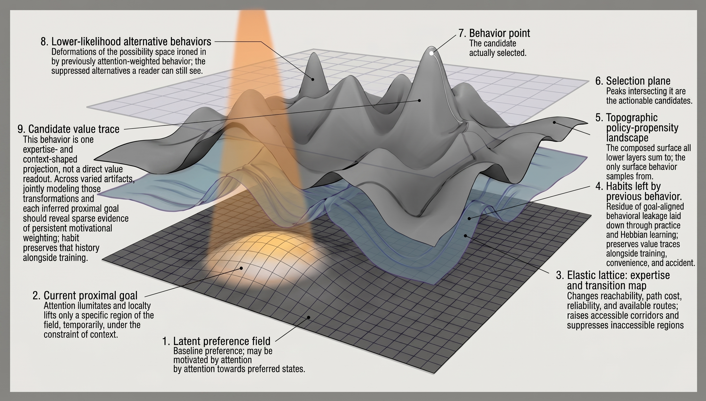

**October 25 Week 3 checkpoint:** Completed comparisons, source checks and the full retained-adapter sensitivity audit are recorded in the claim ledger and evidence records. Gear 2 has completed the pause source, native checks and full-design cost pilot; the complete pause study is cost-held. The block-removal and second-reader follow-ups are complete and fully recorded; the full partition-sensitivity comparison is still running. The shared event extractor exhausted both engineering healing attempts, blocking its dependent comparisons. The encoder and full sensitivity reference bank remain cost-held. The paid PROC format repair is prepared but its transfer remains approval-held. Local GPU work stays parked. The theory filing is applied. Remaining commissioned cards and the ready-queue target are unfinished. New starts freeze November 1 at 20:00 PST, drain at 22:00 PST; paid cutoff is October 30 at 17:00 PDT.

**October 24 daily integration:** [Complete digest](results/phase_2_4_stage_15/DRIVE/DIGEST_20261024.md).
No new scientific result; completed findings and failed-control limits are unchanged.
Monitoring is healthy, with no research worker active. SDT1 remains unimplemented;
GPU and cumulative cost holds remain, and paid dispatch is closed. Stage 15 stays
open; the final digest/start freeze is Sunday October 25 at 20:00 PDT, draining by 22:00.

**October 23 daily integration:** [Complete digest](results/phase_2_4_stage_15/DRIVE/DIGEST_20261023.md).
GEN1 is complete: the genre contrasts are null and genre-level fake controls fail;
equal weighting and the broader open play claim remain. Both approved feature-package
copies are verified. No research worker is active. SDT1 implementation, empirical-control
cost holds and the GPU resource hold remain; paid dispatch is closed. Stage 15 stays open.

**October 23 GEN1 complete:** [The full matched-genre comparison and independent replay are recorded](results/phase_2_4_stage_15/DRIVE/GEN1_COMPARISON_20261023.md). Descriptive genre contrasts are null and genre-level fake controls fail; equal weighting remains. All workers exited. Population-relative SDT1 remains implementation work; Stage 15 and other recorded holds remain open.

**October 23 feature delivery:** [Both approved repository copies are verified](results/phase_2_4_stage_15/DRIVE/EV4_DELIVERY_20261023.md). All 12 files per destination match the prepared aggregate package. The delivery hold is cleared; recipient adoption/deployment and literal dictionary terms remain unresolved. Earlier pending-delivery notes below describe their dated snapshots. Stage 15 and existing research holds remain open.

**October 22 daily integration:** [Complete digest](results/phase_2_4_stage_15/DRIVE/DIGEST_20261022.md).
The event census, full reading comparison, exact style parity and genre inputs are recorded.
Directed reading remains unresolved with missing empirical controls; routing stays unchanged.
No research worker is active at the digest inspection. Genre features/statistics and
population-relative sensitivity remain implementation work. Monitoring is live;
cost/resource holds, the paid cutoff and recipient-copy approval persist. Stage 15 remains open.

**October 22 post-talk work:** The [complete probe census](results/phase_2_4_stage_15/DRIVE/NP1_SOURCE_RECOVERY_20261022.md) and [full directed-reading comparison](results/phase_2_4_stage_15/DRIVE/DR1_MAIN_20261022.md) are verified and recorded. The reading comparison is unresolved and lacks required empirical controls; routing remains unchanged. Its workers exited and released their slot. An [exact style-parity check](results/phase_2_4_stage_15/DRIVE/DR1_STYLE_PARITY_20261022.md) also completed; the currently projected empirical controls are cost-held. [Genre input matching](results/phase_2_4_stage_15/DRIVE/GEN1_INPUTS_20261022.md) is now complete after a recorded source-join recovery. Exact matched features, genre statistics/controls and population-relative sensitivity remain implementation work. Gear 2 is authorized; no research worker is active at this receipt. GPU/resource and cost holds, the paid cutoff and recipient-copy approval persist. Stage 15 remains open.

**October 21 daily integration:** [Complete digest](results/phase_2_4_stage_15/DRIVE/DIGEST_20261021.md).
No new scientific result; the completed screen and controls are unchanged.
The scheduled freeze and noon drain are verified, with no research worker active.
Monitoring continues; eligible execution reopens Thursday October 22 at 07:00 PDT.
The census is prepared; reading-comparison timing admission and genre/sensitivity
implementation remain. Cost/resource holds and recipient-copy approval persist.
Stage 15 remains open.

<p align="center">

**October 20 daily integration:** [Complete digest](results/phase_2_4_stage_15/DRIVE/DIGEST_20261020.md).
No new scientific result; the completed screen and controls are unchanged.
The talk-page correction is recorded, and the [aggregate feature return](results/phase_2_4_stage_15/DRIVE/EV4_RETURN_20261020/README.md)
is prepared pending destination approval. The demo CPU reservation expired and
was archived. No science worker is active; cost/resource holds and the paid cutoff
remain. Wednesday freeze and Thursday corpus opening are unchanged. Stage 15 stays open.


  
</p>

<div align="center">
  <sub>◯ Ghost image and Readme. AI provenance is declared; the research question, evaluation criteria,
  interpretation, and claims are curator-owned. See <a href="#who-did-what">Who did what</a>.</sub>
</div>

# Sounding Line

**October 20:** [Plain-language talk summary](results/phase_2_4_stage_15/DRIVE/TALK_PAGE_20261020.md)
and [validated preparation for the next tests](results/phase_2_4_stage_15/DRIVE/POST_TALK_PREPARATION_20261020.md)
are filed. Completed results are pushed. Stage 15 remains open; the new census
and reading comparisons are scientifically unrun and retain Thursday's opening.

**October 19 daily integration:** [Complete digest](results/phase_2_4_stage_15/DRIVE/DIGEST_20261019.md).
Engine signature recurrence and departure-pause association pass their scoped checks;
habit identification is control-invalid. D24 is null; the crossed D30 primary remains
unresolved and its own-history controls are null. The shared-word variant is VOID.
Theory, instruments and TODO are current. No scientific worker is active: P7/D33 are
cost-held and P1 is GPU resource-held. Paid dispatch is closed; K/D31 remain deferred.
Stage 15 is open. Tuesday feature delivery and gated post-talk work remain.
Earlier dated launch/status snapshots below are historical.

**October 19, 09:32 PDT:** [D30 crossed recovery](results/phase_2_4_stage_15/DRIVE/D30.p-week-recovery.md) is verified complete and recorded. The primary is unresolved; the paired own-history advantage is null. All native workers exited and released their slot. No counted science worker is active at this cutoff; the remaining commissioned backlog is unfinished. The separate fixed-effect/word-list cards, P7 and conditional K/D31 intake remain; Gear 2 authorization, the demo reservation and GPU resource hold persist. Theory integration is due at the 20:00 digest.

**October 19, 08:32 PDT:** [D30 numerical recovery](results/phase_2_4_stage_15/DRIVE/D30_WEEK_FAILURE_RECOVERY_20261019.md) passes targeted and full native validation after the original main stopped on a non-converged fit. The [single engineering retry is now running](results/phase_2_4_stage_15/DRIVE/D30_WEEK_RETRY_LAUNCH_20261019.md) with original tolerances, exact saved blocks and cumulative costs retained. No corpus verdict follows; the demo reservation, GPU resource hold and other commissioned backlog remain.

**October 19, 08:14 PDT:** [Full D30 crossed comparison](results/phase_2_4_stage_15/DRIVE/D30_WEEK_MAIN_LAUNCH_20261019.md) is running in Gear 2 after the completed timing pilot passed source, numerical and cost admission. Both pilot charges are included in one unchanged cumulative ceiling; scientific code remains unchanged. Native execution and terminal monitoring verify. The demo reservation, GPU resource hold and unfinished commissioned backlog remain; Stage 15 is open.

**October 19, 07:58 PDT:** [D30 crossed-model timing pilot](results/phase_2_4_stage_15/DRIVE/D30_WEEK_PILOT_LAUNCH_20261019.md) is running in Gear 2 after ten checks and full native replay. The repaired estimator and current controls need this measured cost admission before the full scientific comparison. D24 is verified, filed and acknowledged; theory integration is due at the 20:00 digest. The demo reservation, GPU resource hold and remaining commissioned backlog persist. Terminal monitoring is healthy; this is not stage closure.

**October 19, 07:29 PDT:** [D24 closure comparison](results/phase_2_4_stage_15/DRIVE/D24-week-continuation.md) is verified complete and recorded. The primary is null; its conditional window extension is not admitted. Native workers exited and released the CPU slot. No counted science job is active at this cutoff; calendars and terminal monitoring are healthy. D30/P7 and conditional intake remain implementation work. GPU continuation remains below its unchanged start floor, and the ToMpathy reservation remains. This is not stage closure; theory integration follows the 20:00 digest.

**October 19, 06:44 PDT:** [D24 closure continuation](results/phase_2_4_stage_15/DRIVE/D24_WEEK_BUILD_20261019.md) is running in Gear 2 after eight targeted checks and native replay. Saved scores and prior costs are preserved within one cumulative allowance. EV1-EV3 are recorded, including EV3 control failures; the [feature table](results/phase_2_4_stage_15/DRIVE/ENGINE_FEATURE_TABLE.md) is prepared for Tuesday delivery. [Native health inspection](results/phase_2_4_stage_15/DRIVE/HEALTH_20261019_0644.md) verifies progress, locks, resources and monitoring. The demo reservation and GPU resource hold remain; D30/P7, conditional intake and other commissioned work remain unfinished. Earlier dated snapshots below retain their original cutoffs.

**October 19, 06:17 PDT:** [Departure-pause comparison](results/phase_2_4_stage_15/DRIVE/EV1_PAUSES_V1.md) is independently verified complete, with a positive conditional association and passing permutation reference. EV1–3 are recorded; EV3 remains control-invalid. Workers exited and released their slot. The feature table and other commissioned backlog remain unfinished. Gear 2 authorization, demo reservation and GPU resource hold remain.

**October 19, 06:13 PDT:** [Departure-pause comparison](results/phase_2_4_stage_15/DRIVE/EV1_BUILD_20261019.md) is running in a counted Gear 2 CPU slot after targeted and native validation. EV2 and EV3 results are recorded, including EV3 control failures. The feature table remains unfinished. Demo reservation, GPU resource hold and monitoring remain.

**October 19, 06:03 PDT:** [Habit identification](results/phase_2_4_stage_15/DRIVE/EV3_IDENTIFICATION_V1.md) is verified complete and recorded; both variants fail their fixed bias controls, so no validated habit badge is admitted. Workers exited and released their slot. Departure analysis and the final feature table remain implementation work. Gear 2 authorization, the demo reservation and GPU resource hold remain.

**October 19, 05:51 PDT:** [Habit identification](results/phase_2_4_stage_15/DRIVE/EV3_IDENTIFICATION_BUILD_20261019.md) is running in Gear 2 after targeted and native validation. Complete habit inputs and signature recurrence are recorded. Departure analysis and the feature table remain unfinished. The counted slot, demo reservation, resource limits and terminal monitoring verify.

**October 19, 05:38 PDT:** [Complete final and typed habit inputs](results/phase_2_4_stage_15/DRIVE/EV3_HABIT_INPUT_V1.md) are independently verified and recorded. The worker exited and released its slot; identification is the next build. The signature comparison is already complete. No science worker is active at this cutoff; calendars and watcher are healthy. Gear 2 remains authorized, with the GPU resource hold and ToMpathy reservation retained.

**October 19, 05:26 PDT:** [Final and typed habit preparation](results/phase_2_4_stage_15/DRIVE/EV3_HABIT_INPUT_BUILD_20261019.md) is running in Gear 2 after targeted and native validation. The signature comparison is complete and recorded. Habit identification and departure analysis remain unfinished; the GPU resource hold and ToMpathy reservation remain.

**October 19, 05:09 PDT:** The [signature-recurrence comparison](results/phase_2_4_stage_15/DRIVE/EV2_SIGNATURES_V1.md) is complete, independently verified and recorded with its full controls and support limits. Its workers exited and released their slot. Departure and habit comparisons remain implementation work; no science worker is active at this cutoff. Gear 2 authorization, the demo reservation and the guarded GPU resource hold remain.

**October19,04:57PDT:** The [signature-recurrence comparison](results/phase_2_4_stage_15/DRIVE/EV2_BUILD_20261019.md) is running after23 targeted checks and complete native replay. Full reader export is verified; departure-pause and habit consumers remain unfinished. No corpus result or badge is available. The demo reservation and GPU resource hold remain.

**October 19, 04:36 PDT:** [Full engine-reader export](results/phase_2_4_stage_15/DRIVE/EV_FULL_READER_V1.md) is verified complete, including exact reuse, uncached replay, original-row retention, cumulative cost and native shutdown. Scientific consumers remain unfinished; no science worker is active at this cutoff. Gear 2 authorization and the demo reservation remain; GPU work is resource-held.

**October 19, 02:12 PDT:** [Full source preparation](results/phase_2_4_stage_15/DRIVE/EV_FULL_SOURCE_V1.md) is verified complete; the [full engine-reader continuation](results/phase_2_4_stage_15/DRIVE/EV_FULL_READER_LAUNCH_20261019.json) is running in Gear 2 within the remaining combined allowance. The demo slot is preserved. Scientific comparisons remain unfinished; older dated snapshots below retain their cutoff times.

**October 18, 22:45 PDT:** The [engine reader timing pilot](results/phase_2_4_stage_15/DRIVE/EV_EXPORT_TIMING_V1.md)
is verified complete. The [required first-100 support export](results/phase_2_4_stage_15/DRIVE/EV_EXPORT_SUPPORT_V1_BUILD.md)
is running in Gear 2 with the demo reservation preserved. Full-population and
scientific admission remain separate; the dated snapshots below are history.

**October 18 daily integration:** [Current completed screen and next work](results/phase_2_4_stage_15/DRIVE/DIGEST_20261018.md). All canonical primaries are verified, the twelve-position theory filing is applied, and EV source preparation is validated. No science worker is active at the inspected cutoff: GPU continuation is resource-held and EV consumer/reader admission is being built. Earlier rollout snapshots below are historical.

**Mid-run errata applied:** [current status](CURRENT_STATUS.md) identifies new dispatches, environmental recoveries and source-validity holds. The [implementation record](results/phase_2_4_stage_15/DRIVE/MIDRUN_20261018.md) separates completed changes from studies still being built. Older dated snapshots below are historical.

**October 18:** Reviewed CPU comparisons are running and completed results are
recorded. [Current status](CURRENT_STATUS.md) and the [execution index](results/phase_2_4_stage_15/DRIVE/INDEX.md) distinguish active dispatches, tested successors and unfinished implementation.

**October 17 rollout:** [V4 calibration is complete](results/phase_2_4_stage_15/DRIVE/V4.md)
and fails the mandatory null check; personal taste/habit admission remains closed.
[D32 is verified complete](results/phase_2_4_stage_15/DRIVE/D32.md), with a marginal primary and marginal outcome shuffle; its [single examination extension](results/phase_2_4_stage_15/DRIVE/D32-examination.md) is verified null. The [D17 pause card](results/phase_2_4_stage_15/DRIVE/D17.md) is invalid after its second engineering failure, with retained evidence intact and no primary result. The [GPU suggestion pass stopped on its permitted retry](results/phase_2_4_stage_15/DRIVE/SUGGESTION_MAIN_V5_FAILED.md);
saved checkpoints validate, but the incomplete pass is invalid under the retry limit. Completed D30,
its extension and D35 are recorded with their controls and follow-up gates. [D30.s specification texture](results/phase_2_4_stage_15/DRIVE/D30.s.md) is verified complete after its measured continuation, with its original control warning retained.
[Current execution](results/phase_2_4_stage_15/DRIVE/INDEX.md)
separates verified results, active work and the unbuilt remainder. The
[October 17 theory errata](docs/design/archive/THEORY_ERRATA_20261017_APPLIED.json)
is applied; [incoming documents are filed](docs/archive/operations/DOCUMENT_RELOCATIONS_20261017.json).

**Theory walkthrough:** [October 17 handoff](results/phase_2_4_stage_15/WALKTHROUGH_HANDOFF_20261017.md) links the recorded evidence, applied errata and explicit unfinished work.

**Current commission:** the [October 17 drive amendment](docs/design/stage-15/drive/README.md)
is partly implemented and active in Gear 2. Full source replay and first paid
instrument admission and the complete outcome calibration are recorded. The
reader memory recovery is [verified complete](results/phase_2_4_stage_15/DRIVE/READER_PILOT_V6.md); the complete timing recovery preserves all compared scores and admitted the full suggestion pass; that pass is now invalid after its second GPU-safety stop, with saved evidence intact. Typed/history preparation remains open. No paid batch is active. See the [card-by-card execution index](results/phase_2_4_stage_15/DRIVE/INDEX.md)
for completed, waiting and unbuilt work, and [current status](CURRENT_STATUS.md)
for monitoring, spending and scientific gates. Earlier continuation queues stay closed.

[Stage 14 is closed](results/phase_2_4_stage_14/FINAL_PACKET_20261015.md), with
verified evidence and explicit unrun dispositions. [Stage 15](docs/design/stage-15/README.md)
is active: the local repairs and profile generation are complete. The numerical
convergence repair is recorded and does not rescue the saved-reader useful-gain
screen. The original local 8B literal-feature admission queue is complete and fully verified;
three questions pass constructed admission and five remain disabled. The trained
profile comparison is built with verified inputs but remains unrun after its
[Ghost admission witness failed](docs/design/stage-15/GHOST_RETURN_REVIEW.md).
Profile format admission passes; semantic faithfulness and predictive usefulness
remain unestablished. See [current status](CURRENT_STATUS.md) for execution,
shared costs, remaining prerequisites and the next six-hour inspection.

The curator-authorized [validity and exploration addendum](docs/design/stage-15/VALIDITY_EXPLORATION_ADDENDUM.md)
has a passing retained-evidence audit and a completed matched-writer history
analysis. The [complete target/context diagnostic](results/phase_2_4_stage_15/SCOPE_DIAGNOSTIC_PUBLIC.json)
does not establish a general prompt repair; original failed questions stay disabled.
Its worker exited normally; scientific comparisons retain their admission gates.

**Document map:** [all study stages](docs/design/README.md), [theory and applied errata](docs/theory/README.md), [cloud campaigns](docs/design/gear-3/README.md), and [workspace layout](docs/WORKSPACE_LAYOUT.md). Each stage has a visible folder and README; frozen source paths remain indexed exceptions.

The [October 16 theory errata](docs/design/archive/THEORY_ERRATA_20261016_APPLIED.json)
is applied across all five theory files. Incoming briefs are filed in their stage
or source shelf; the [filing ledger](docs/archive/operations/DOCUMENT_RELOCATIONS_20261016.json)
preserves their locations, hashes and status.

**Working environment:** Codex/GPT. Start with [AGENTS.md](AGENTS.md) and
[operations, tests, and rollback](docs/CODEX_OPERATIONS.md). The overview below describes
the event-recovery program; current experimental status is in
[STATE](docs/STATE.md), [TODO](TODO.md), and the latest entries in [FINDINGS](FINDINGS.md).

**A research instrument for testing which of a maker's recorded choices remain recoverable from a
finished artifact.**

A sounding line is a weighted cord lowered into water to find the bottom, the oldest depth
instrument there is. It returns a reading when there is a bottom, and runs out of line when there
is none. That is the design contract here: bounded readings, declared refusal conditions, and a
record that keeps the failures beside the survivors.

The early result was narrower than the ambition. On a corpus of 86 student essays with revision
purposes recorded per sentence by trained annotators, a bounded reader shown only the revision
delta picked the recorded purpose from matched candidate sets at 0.477 against a verified 0.232
floor, on 616 events ([the pilot chain](results/arg_recovery/)). After matching revisions on
size, rarity, position, and difficulty, most of that margin proved to ride the matched
covariates; a smaller delta-specific remainder survived (8.2 points, exact McNemar p = 4.5e-4),
and the raised matched floor was later shown to be label composition, not hidden signal
([`results/arg_recovery/floor_decomp.json`](results/arg_recovery/floor_decomp.json)). The correctly gated confirmatory battery subsequently replicated recovery at 0.4805,
with the matched draw at pilot power (FINDINGS L141; `prereg/g129b.py`).

**Closed September campaign, recorded October 1:** The admitted Stage 13 queues are drained and the
[final evidence packet](results/phase_2_4_stage_13/FINAL_PACKET_20260930.md) is assembled.
All 714 retained completed jobs pass integrity checks. Detector and memory healing are
complete; reader admission remains failed and no scientific work remains admitted.
Original failures and comparison limits are retained. The [October 1 endpoint](results/phase_2_4_stage_13/FINAL_ENDPOINT_20261001.json)
is reconciled, the checkpoint helper exited normally and its exact watch is retired.
The standing independent health cadence remains; science stays closed.
See [current status](CURRENT_STATUS.md) and
[final integrity](results/phase_2_4_stage_13/FINAL_INTEGRITY_20260930.json).
Stage 12 remains stopped with its [final evidence packet assembled](results/phase_2_4_stage_12/FINAL_PACKET_20260927.md)
and [final endpoint reconciled](results/phase_2_4_stage_12/FINAL_ENDPOINT_20260928.json).
Dated execution history remains in [the operating archive](docs/archive/operations/README.md).

Three things this does not establish: it is not a general intent detector, it is not a reader of
anyone's values, and it is not a tool for judging a person or their work. Nothing in this
repository should be used on a real person's writing to make a decision about them.

## The current research question

Given declared context and a bounded candidate family, can a finished artifact identify a choice
the maker independently recorded, better than context alone and better than matched false
alternatives?

The unit is a **decision event**: a target, the live alternatives, the selected change, its
dependencies, and the context it was made under. Depth is not a scalar read off an artifact. It
is a proposed summary of recoverable problem-directed choice structure, conditional on domain,
brief, medium, constraints, and evidence quality, and it is only defined after event recovery
works. Every scalar formulation this project tried before that definition died to length,
register, or vocabulary, and the record says so.

## What is being built now

Sounding Line is not defined by AI detection. The earlier product program asks whether an independently
validated representation of decision structure adds information to a conventional binary
AI-provenance classifier. The classifier is the public wedge and remains a target, not an
achieved result. Decision recovery is validated first, because a detector score cannot validate
the representation that produced it.

The two programs stay distinct:

- **Core program:** recover specified parts of a maker's recorded decision process under bounded
  conditions, with known-answer gates before any real corpus.
- **Product wedge:** test whether that representation improves AI-provenance classification over
  strong reproduced baselines, on a benchmark that varies provenance and delegated human choice
  independently.
- **Current evidence:** the narrow choice-event result above, its controls, and one null: the
  first naive feature-layering attempt did not improve its style-change substrate and doubled its
  seed variance ([FINDINGS L125](FINDINGS.md)).
- **Longer program:** test whether cross-artifact residual structure can support inference about
  persistent motivational weighting. Untested on people, by design, until the lower layers hold.

Low recoverable depth does not mean AI authorship. Hurried, constrained, expert, routine,
collaborative, or translated human work may leave little recoverable evidence, and
machine-assisted work may carry rich human decision structure. Provenance and recoverability are
separate targets that may correlate in a dataset; neither defines the other.

## Why the reader is bounded, and when it must refuse

An open-ended language model asked why an artifact was made will produce a coherent answer for
anything, including sludge. Free-form intent attribution is confident fabrication with good
grammar. So this instrument only ever answers closed questions:

- The brief, candidate family, comparison set, and scoring rule are declared before evaluation.
- The target choice must be independently recorded by the maker, or known by construction.
- Context-only and matched-false-alternative controls run beside every claim arm.
- Shuffled-truth arms must read at chance, or the run is void.
- The reader must abstain when the evidence does not discriminate among candidates. A
  fabrication-rate arm (no-op deltas with an explicit "no revision was made" option) measures how
  often it invents decisions that were not made.
- Evidence about a choice is never evidence about a person's character, worth, or moral status.

Embodiment, expertise, constraint, and time cost motivate hypotheses about why traces differ
between makers. They are motivation, not a demonstrated mechanism, and the record does not treat
them as one.

## Three projects, three jobs

| Project | Current job | Current authority | Does not establish |
|---|---|---|---|
| **Sounding Line** (this repo) | Recover specified recorded decisions from real artifacts under bounded conditions | Its own datasets, controls, preregistrations, and replayable verdicts | General human intent or values |
| [**Ghost Scale Sim**](https://github.com/EmotiveAutomaton/ghost-scale-sim) | Test inference mechanisms in constructed worlds with known latent variables | Behavior of the implemented simulator | Human value recovery or embodiment |
| [**Art: A Unifying Model**](https://abrahamhaskins.org/art) | State the broader hypothesis that artifacts carry compressed decision and motivational structure | A theory and research program | An implemented or validated reader |

## Relation to developmental active inference

The bridge is a sequence of unbuilt interfaces, not an equivalence. Notation first, because the
collision is real: active-inference literature uses `C` for the preferred-outcome distribution;
Sounding Line's own theory uses `C` for context. Here, `C_AIF` always means the active-inference
preference object and `C_context` always means declared making conditions.

| Layer | Object | Current status |
|---|---|---|
| Proximal artifact reading | Evidence about a recorded choice or purpose | Narrowly tested here, one corpus, confirmatory battery completed (L141) |
| Longitudinal maker inference | A posterior over a persistent latent profile after conditioning on task, expertise, constraints, and state | Constructed tests in Ghost Scale Sim and Sounding Line; Stage 8 accumulation remains diagnosis, not validation on people |
| Preference construction | A justified rule for using profile evidence to propose task-specific `C_AIF` | Not built |
| Normative adoption | A policy for whose inferred preferences influence an agent, under what trust, consent, and safety constraints | Not solved by inference |
| Embodied development | Learning across sensorimotor interaction and developmental stages | Outside the current software evidence |

A recoverable maker profile is not itself `C_AIF`. At most, calibrated profile evidence could
become one input to a separate process that constructs or updates task-specific preferred
outcomes. Inference does not determine adoption.

The long-range hypothesis, in restrained form: across multiple artifacts, after modeling proximal
goals, expertise, constraints, and temporary state, a persistent residual may support inference
about stable motivational weighting. That is an open hypothesis, not a current result.

<p align="center">
  
</p>

<div align="center">
  <sub>Notional map of the longer research program. It separates the latent preference field,
  attention lifting the current proximal goal, the expertise lattice, habit, and the composed
  policy-propensity surface a behavior is selected from. The reader's problem is inverting it
  from the selected point back down. None of the geometry shown here has been recovered from
  human data.</sub>
</div>

## Quick verification

Use the existing environment for maintenance checks (do not recreate a live venv):

```powershell
./.venv/Scripts/python.exe -B tools/verify_locks.py
./.venv/Scripts/python.exe -B -m pytest -q -o addopts= -p no:cacheprovider
./.venv/Scripts/python.exe -B tools/test_s7.py
./.venv/Scripts/python.exe -B tests/test_stage8_guards.py
```

The small event harness below is an earlier standalone demonstration. Environment creation is for a new checkout only:

```
python -m venv .venv
.venv/Scripts/pip install numpy        # Windows; use .venv/bin/pip elsewhere
.venv/Scripts/python runners/run_event_harness.py
```

This replays the event-recovery harness's five known-answer gates on synthetic ground truth
(runs in about a second):

```
40 makers x 12 events, maker-split train/test
  oracle     accuracy 0.796  (chance 0.25, n=240)
  shuffle    accuracy 0.225  (chance 0.25, n=240)
  unchanged  accuracy 0.282  (chance 0.25, n=1200)
  blind      accuracy 0.227  (chance 0.25, n=1200)
  >>> HARNESS-VALID
```

A reader with access beats chance; shuffled labels, unchanged passages, and a blinded reader all
fall to chance; decoys are picked symmetrically when there is nothing to read. Real-corpus
studies (the choice-recovery chain above) run through this same harness code and may not run
unless these gates pass. To inspect a committed real-text verdict without running anything:

```
python -m json.tool results/arg_recovery/matched_k4_recovery.json
```

Full model-side experiments need a local model server and hours of GPU time; they are queue work,
not a quickstart, and every runner opens with its own preregistration.

## Representative evidence

| Evidence | What survived | What it licenses |
|---|---|---|
| Recorded choice recovery ([`results/arg_recovery/`](results/arg_recovery/)) | 0.477 vs a verified 0.232 floor on 616 events; an 8.2-point delta-specific margin after covariate matching; the raised matched floor decomposed as label composition | The exact narrow claim in the opening, and nothing wider |
| Known-answer gating ([`results/event_harness/`](results/event_harness/)) | Five synthetic gates, including two catches of the harness's own build defects | Confidence that the ruler is validated before the signal, the project's standing rule |
| First detector-layering test (FINDINGS L125) | A preregistered null: naive late fusion of surface-change channels did not improve the style-change substrate and doubled seed variance | The first representation and fusion attempt added no usable signal; deeper fusion stays gated on validated decision recovery |
| Publication recreation ([FINDINGS](FINDINGS.md), L119 to L128) | Baker, Saxe and Tenenbaum Experiment 1 at printed precision on fourteen published values; a held-out 2025 style-change test gate matched at 0.8293 against a printed 0.830 on contamination-audited data | Implementation discipline at exact-value grade, not validation of the umbrella theory |
| Retired instruments (FINDINGS, known weaknesses) | Six criteria that could not fail their own data, caught by audit; every artifact-scalar measure dead to length, register, or vocabulary | The failure class the known-answer rule now guards against |

The recreation work also surfaced findings about the field itself: internal inconsistencies in
four of the five recreated works (at the base rate the meta-research literature predicts), a
shared-task recipe whose own augmentation leaked a sixth of its validation set, and an evaluation
metric whose shipped code contradicts its published description. These were checked by separate
AI-assisted adversarial verification passes within the project. That is internal review, not
external replication by an independent lab; no one outside this project has re-run these numbers.

## Current state

In brief, and stated conservatively. Some parts of a maker's recorded decision process are
recoverable from a finished text under bounded, preregistered conditions, and some parts are
not: executed content choices and long-form handling of mistakes have been recovered against
controls, while production route, negotiation, and approval history read at chance from the
artifact alone and are recoverable only from process records. Ongoing work tests candidate
mechanisms behind the recoverable half, with every claim gated on known-answer instruments,
declared baselines, and preregistered verdict bands. Programmatic tests measure model readers; a small curator reading record exists but is not
a population human-reader validation. The project keeps those evidence levels distinct.

The full running record lives in [`docs/STATE.md`](docs/STATE.md) (operational state, standing
rulings, phase end states) and [`FINDINGS.md`](FINDINGS.md) (every study, how it was run, what
came back). The governing brief and its approval status are indexed in
[`docs/design/`](docs/design/), with closed stages preserved in its archive; Phase 2.0's brief
remains the historical vertical-slice record, and the design index
([`docs/design/README.md`](docs/design/README.md)) maps every phase document with its
authority status.

## Theory map

[`docs/theory/`](docs/theory/) is the hypothesis store: over 130 numbered hypotheses, each
carrying its status and what would test it. Each file owns one question:

| | |
|---|---|
| [the triple inference](docs/theory/THE_TRIPLE_INFERENCE.md) | reconstructing process, interpreting departures and inferring preferences; the explaining goal constrains the artifact's decisions; the October 14 reading rules separate set points, drives, preferences and learned values |
| [three cognitive layers](docs/theory/THREE_COGNITIVE_LAYERS.md) | what architecture might support the inference, and the evidence from eleven model families |
| [decision traces](docs/theory/DECISION_TRACES.md) | what observable traces decisions leave: target, control, and terminal topology as independent axes |
| [reader heuristics](docs/theory/READER_HEURISTICS.md) | how a bounded reader finds and combines traces: priors, entry cues, calibration, refusal |
| [alignment](docs/theory/ALIGNMENT.md) | what objective should govern a system that can read them. Formally dormant, with a written wake condition |

## Repository map

| | |
|---|---|
| [`FINDINGS.md`](FINDINGS.md) | the method archive: every study, its numbers, its verdict |
| [`TODO.md`](TODO.md) | the live queue of studies, phase-ordered, same identifiers as the theory |
| [`docs/STATE.md`](docs/STATE.md) | operational state and standing rulings |
| [`docs/method/`](docs/method/) | lessons (trigger-indexed), controls, deviations, literature reviews |
| [`docs/design/`](docs/design/) | build blueprints, including the current phase brief and evaluation contract draft |
| [`docs/TOOLS.md`](docs/TOOLS.md) | instrument ledger, each tool with its validation state |
| [`prereg/`](prereg/) | preregistration cards, frozen before their runs |
| [`runners/`](runners/) | one file per experiment, each opening with its own preregistration |
| [`soundingline/`](soundingline/) | the analysis package: hypothesis family as data, probe schema, measures, locks |
| [`docs/sim/`](docs/sim/) | traffic with the parent simulation, both directions |
| [`run_first_gear.sh`](run_first_gear.sh) · [`run_second_gear.sh`](run_second_gear.sh) · [`runners/gear3.py`](runners/gear3.py) | queue engines: partial machine, whole machine, and rare cloud bursts behind hard spending guardrails |

## Who did what

The research question, the theory, the experimental criteria, all claim decisions, and final
scientific responsibility are the curator's (Abraham Haskins). Code generation, refactoring,
queue operation, adversarial checking, literature retrieval, and copy editing are largely done
by AI coding agents working under the repository's rules, with every landed result written
through a fixed hypothesis-method-verdict record. AI-assisted review passes are used
adversarially inside the project and are never represented as independent validation. The hero
image is AI-generated and is marked as such at the top of this file.

## Cautions

The instrument may not claim that a machine wrote something. It may not quote any one of its
quantities alone. It may not read low recoverability as low value: low recoverability is a joint
property of the artifact, the reader, and the declared conditions.

One curator, multiple model-reader families with study-specific coverage, English-dominant
corpora biased by which sources permit collection. No claim about prevalence, and none about any individual.

MIT licensed. Read [`docs/method/DEVIATIONS.md`](docs/method/DEVIATIONS.md) before quoting a
number.
