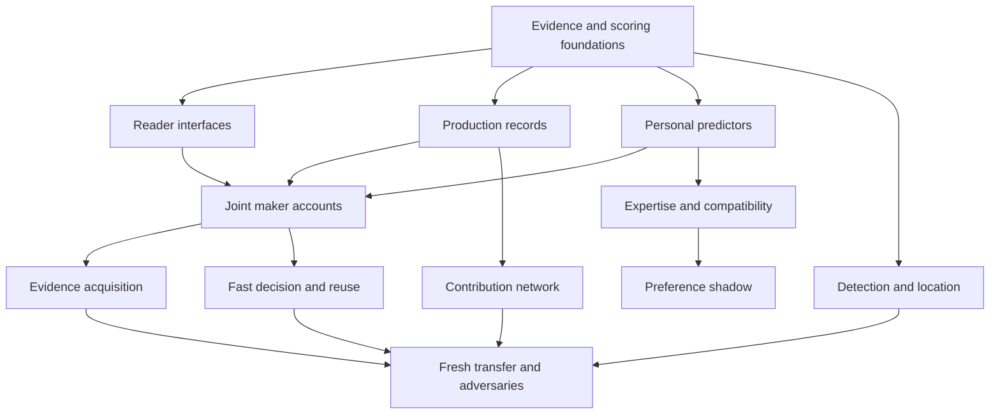

# Sounding Line: historical reconstruction, personal predictors, and joint inference

**Research-informed branching program · prepared 10 October 2026 · principal reporting checkpoint Friday 16 October 2026, 18:00 America/Los_Angeles (PDT).**

**Status:** a new research commissioning package, not a report of experiments run. The implementation, pilot timings, admission results, and new scores below are work to do. This review made no repository changes and launched no research or paid compute. Use a new campaign namespace; do not reopen closed Stage 12 or Stage 13 records.

**Priority:** Sounding Line receives the main effort. Ghost Scale supplies bounded mechanism experiments under the separate companion program. ToMpathy development is outside this package; its revised historical-process target informs the engine's tests.

## 1. The scientific aim and the curator's current model

Build an instrument that reconstructs a revisable account of how a particular maker transformed perceived possibilities into an artifact. The immediate question is whether maker history, explicit process models, shared constraints, and selective investigation can improve **historically corroborated understanding and hidden-choice prediction beyond a strong direct reader**. Binary provenance is a secondary product test, not a substitute for this question.

The following is an analyst paraphrase of the supplied walkthrough, not a curator quotation:

- The process display concerns possible **historical steps of production**. Argument structure can be evidence about those steps but is not the target itself.
- A consequential upstream choice can affect the contribution estimate across the whole document. Local interventions can modify that global estimate. The hover explanation should expose the reasons for both.
- A tiny model adapted to one person's work might supply useful predictions or context to a larger, more capable reader. Whether it helps is testable.
- Public production records, including Git history where available, can provide evidence and withheld targets. More evidence can improve reconstruction; the program should investigate how to use it.
- The requested research is broad, creative, and deliberately larger than one week's likely consumption. It should extend existing work, not replace it with a narrow publishable claim or another short repair sequence.

These decisions permit the post-walkthrough synthesis and branching package required by the Analyst–Curator Epistemic Protocol. No further general design questionnaire is needed to start implementation. A later result that changes the ontology, public meaning, or value-inference ambition still requires a short curator interpretation pause; independent work continues.

### What counts as success

Success is one or more reproducible capabilities: better recovery of independently recorded production events; better prediction of withheld choices after modelling a maker; coherent revisions when new evidence arrives; or equivalent quality at materially lower end-to-end cost. Each has its own metric and claim. A useful reader-enactable route remains a separate output. A successful classifier does not establish historical reconstruction, and a successful historical reconstruction does not establish human empathy or stable values.

**The central engineering bet:** replace a chain of settled classifications with a revisable set of compatible maker accounts, while testing whether the added machinery supplies information the direct model cannot already use. Do not assume a joint model will win: its candidate generator, likelihood estimates, and factorization can each make it worse.

## 2. Evidence and source state at commissioning

### Repository pins and review basis

| Source | Reviewed state | Use in this package |
|---|---|---|
| Sounding Line | [`428b3d944bd94deef325c170061be4ab86b23a38`](https://github.com/EmotiveAutomaton/sounding-line/commit/428b3d944bd94deef325c170061be4ab86b23a38), 10 October 2026 | Current tools inventory, theory, closed-stage status, result packet, and implementation entry points |
| Ghost Scale Sim | [`e347de02aa098b6fb9a905868924cec1b481d5d7`](https://github.com/EmotiveAutomaton/ghost-scale-sim/commit/e347de02aa098b6fb9a905868924cec1b481d5d7) | Closed V20 and supporting mechanism opportunities |
| Attached project context and epistemic protocol | Supplied files read; dated frontier treated as historical | Mission, theory authority, two ledgers, curator-first workflow |
| Supplied transcript and latest user correction | Latest correction controls | Historical process, global/local contribution, personal helper, expansive program; no new ToMpathy spec |
| Prior conversation recovery | Process continuity, checked against repository rules | Prior early-finish causes and operating preferences; not a source of new experimental facts |

The primary analyst reviewed the core inference and alignment theory, contribution definitions, current packet, tools inventory, and relevant reader code. Parallel reviews covered the complete remaining theory files and correction history, operational details, Ghost code, and three literature areas. Source reading was divided across the team; this is not a claim that one reader personally inspected every historical result file. Raw multi-gigabyte results and the user's live workstation were not mounted here. Local readiness below is what the current repository inventory reports, not a new hardware audit in this review environment.

### What the existing evidence changes

| Result cluster | Pursuit ledger | Warrant ledger and design consequence |
|---|---|---|
| Stage 13 named-category reader fails an explicit `none` relation control despite valid syntax | **OPENED:** semantic burden, task decomposition, and readout training deserve a new comparison | **INSTRUMENT FAILED:** do not call the old reader admitted or reinterpret its downstream blocked work as negative reconstruction evidence. The new family must differ materially and retain the original failure. |
| Located detector gains recall over matched windows; exact span recovery remains weak | **PROMISING** for additional provenance features | Bounded same-corpus gain only. Strict span F1 is approximately 0.0075–0.0089, relaxed F1 about 0.132. Test event-aligned location and fixed-human-error utility separately. |
| Corrected memory presentation changes GPT-2-medium forecasts; no memory wins on calibration/reserve | **OPENED** for better readers and personal predictors | A rendering result, not a general failure of personalization. Earlier bounded human session-history benefits (L385/L386) also remain part of the record. No-memory, wrong-person, padding, and duplicated-evidence controls remain mandatory. |
| Historical joint/account approaches often lose to cheap controls or strong direct reading | **STALLED** for unmodified narrative scaffolding | Repeating the same story-first prompt is not a new mechanism. Explicit route generation (G165) is closed in its tested family. New branches need learned state, constrained computation, better evidence, or changed representation. |
| Earlier related-family advantage does not survive stronger independent erasure in the later theory record (L251) | **OPENED** for a discriminating compatibility-versus-style study | Do not cite the initial same-family effect as established shared generative understanding. Cross surface, policy, and reader independently. |
| Learned expertise-law execution transfers in a bounded constructed family (KL-S7) | **PROMISING** for compact conditional predictors | Programmatic, known-family result; full cold maker-state inference remained weak. Test whether a learned helper adds conditional choice information on new records. |
| Ghost V20 structured probabilities improve in one scoped continuation but exact joint accuracy loses | **OPENED** for shared-maker state, dependence, and support tests | Probability quality and exact historical answers are different achievements. The structured arm is a learned conditional-evidence model, not automatically a causal reconstruction engine. |

Primary local evidence: [Stage 13 final packet](https://github.com/EmotiveAutomaton/sounding-line/blob/428b3d944bd94deef325c170061be4ab86b23a38/results/phase_2_4_stage_13/FINAL_PACKET_20260930.md), [triple inference](https://github.com/EmotiveAutomaton/sounding-line/blob/428b3d944bd94deef325c170061be4ab86b23a38/docs/theory/THE_TRIPLE_INFERENCE.md), [reader heuristics](https://github.com/EmotiveAutomaton/sounding-line/blob/428b3d944bd94deef325c170061be4ab86b23a38/docs/theory/READER_HEURISTICS.md), and [decision traces](https://github.com/EmotiveAutomaton/sounding-line/blob/428b3d944bd94deef325c170061be4ab86b23a38/docs/theory/DECISION_TRACES.md). Retain the original uncertainty and source restrictions when importing their results.

### A material correction to the earlier handoff

The overlay is an engineering research target, not a showstopper. The actual unresolved issue is what evidence supports a document-wide contribution change, which participant controlled the upstream decision, and how uncertainty propagates to local estimates. This program tests those questions. It does not equate rewrite volume with consequential human contribution, nor does it prescribe a replacement UI.

## 3. Capabilities to use, and integration work that is genuinely new

The authority is the first current-inventory section of [`docs/TOOLS.md`](https://github.com/EmotiveAutomaton/sounding-line/blob/428b3d944bd94deef325c170061be4ab86b23a38/docs/TOOLS.md), checked 10 October. Later historical entries are not current readiness statements.

| Capability | Available according to current inventory | Consequence |
|---|---|---|
| Local computation | Windows multicore host, about 12 GB CUDA VRAM; project Python 3.13 | One admitted GPU workload at a time. Measure memory and throughput; cached weights do not prove a workload fits. |
| Capable local readers | Ollama `qwen3.5:9b`, `llama3.1:8b`, `llama3.2:3b`, two distinct DeepSeek packages | Qwen and Llama are initial direct-reader candidates. DeepSeek tags are Qwen-derived and are not an independent-family replication by themselves. |
| Tiny model ladder | SmolLM2 360M/1.7B, Qwen2.5 0.5B/1.5B/3B, Pythia and GPT-2 families; instruction variants where listed | Start personal adaptation on cached 360M/0.5B, then 1.5B/1.7B only where the learning curve justifies it. |
| Training | PyTorch, Transformers, Accelerate, PEFT; 105 structurally valid archived LoRA snapshots | LoRA is already technically available. Archive presence is neither task admission nor proof of personalization. Fresh adapters must use permitted pre-cutoff data. |
| Retrieval and compact heads | scikit-learn, XGBoost, cached MiniLM/MPNet and encoder backbones | Implement lexical and embedding retrieval using existing APIs; `sentence-transformers` the Python package is absent. |
| Known limits | No `bitsandbytes`; Qwen2.5-3B snapshot helper refuses missing metadata although explicit snapshot-path loading works | Do not call the existing environment QLoRA-ready. Use regular PEFT on small models; isolate any new dependency environment. Do not modify cache metadata to pretend a check passed. |
| Corpora | CoAuthor and bounded intakes for ScholaWrite, ARIES/revision sources, ArgRewrite, ArXivEdits, IteraTeR, CommitBench, RAID/PAN and OpAI assets | Check actual intake, rights, unit graph and exposure ledger. A directory is not a complete fresh population. |
| References | 17 sibling directories including AutoToM and thought-tracing | Inspect before cloning. Some checkouts are incomplete or unvalidated; Julia, MATLAB, Octave and Rscript are not on the recorded PATH. |
| Cloud | Guarded Modal Gear 3 installed | Optional branch only. Current readiness, exact data scope and a specific per-use budget are still needed. No old approval is an open allocation. |

**Reuse map.** Inspect and adapt the logic of `runners/stage13/healing_reader.py`, `readouts.py`, `reconstruction.py`, `scoring.py`, `located.py`, `detectors.py`, `training.py`, and `healing_memory.py`. Preserve their old results and source bindings. Stage 9 contains actual PEFT training and intake/capsule machinery; Stage 12 contains Git context, finite programs, native/shared-model consumers and evidence-view machinery. Use `soundingline/process_record.py` for event semantics. The exact reuse entry points and traps are specified in §14.

## 4. Measurement contract: separate the questions before composing them

### Four result families

1. **Observed-record extraction:** locate and transcribe a witnessed action. This is an execution/ingestion ceiling, not recovery of a hidden mental state.
2. **Historical reconstruction:** estimate withheld actor, operation, relation, ordering or controlled choice from a frozen visible-evidence snapshot with target records withheld. The finished artifact is legitimate retrospective evidence. Prospective prediction instead requires the snapshot to precede the target event. Annotation purpose, declared intention and actual historical action are separately typed.
3. **Conditional maker prediction:** use strictly earlier episodes to predict an unseen choice or response under changed context. This tests a maker model without claiming the exact past route was recovered.
4. **Persistent preference shadow:** predict recurring costly tradeoffs across contexts after expertise, role, topic and local goal controls. Keep this conditional; no value-recovery claim follows from author identification or style imitation.

Maintain separate outputs for governing goal, local subordinate goals, historical event network, reader-enactable route, and longitudinal preference. Multiple goals can coexist. A list of simultaneous goals is not normalized as if its entries were mutually exclusive. Alternative complete histories can be normalized within a declared candidate space, with explicit unrepresented mass.

### Evidence views

| View | Reader may see | Hidden evaluator target |
|---|---|---|
| E0 | Context/brief and declared opportunities only | Actual artifact/choice, for context baseline |
| E1 | Finished artifact plus same permitted context | Production history and choice records |
| E2 | Artifact plus strictly earlier maker works | Held-out episode and later actions; no target artifact duplication |
| E3 | Selected production records revealed before the query cutoff | Withheld events, alternatives, actor roles or ordering |
| E4 | Full relevant production record | Extraction accuracy only; do not label this blind reconstruction |
| E5 | Supplied true factors/law/state | Privileged diagnostic ceiling, kept outside deployable ranking |

Every direct and structured comparison receives the **same raw evidence, candidate opportunities, and admissible tools**. If a scaffold constructs a graph, give an additional direct arm that same graph or its information-equivalent content; this separates representation assistance from inference machinery. Charge graph construction, retrieval, training and failed attempts. Equal-token, equal-wall-time, and unrestricted-quality comparisons are different analyses and must be labelled.

### Scores and denominator discipline

- Primary historical outcome: proper probability loss for the declared recorded target, paired at independent maker/project/lineage units. Report both Brier loss and logarithmic loss, alongside hard accuracy. Define Brier normalization in the frozen scorer; do not mix half-Brier with full Brier across files.
- Positive event and relation precision/recall, actor-role accuracy, and exact/overlap span scores. Report **positive-event-only** location separately from empty slots; empty correctness cannot dominate useful yield.
- For a graph, score supported edges and ordering separately from node labels, and evaluate compatibility of the full account. A collection of accurate marginals can assemble an impossible history.
- Calibration and risk-versus-coverage are separate from correctness. Report unsupported mental assertions, missing candidate mass, invalid output, and false certainty on deliberately indistinguishable histories.
- For personal helpers, measure held-out decision benefit above identical-history direct reading, the donor/random helper controls, cross-context transfer, and total acquisition plus reuse cost.
- For detection, use frozen human-only calibration, recall at declared false-positive budgets, area under the relevant ROC region, and source-specific human errors. Report 1% and 5% operating points only when the independent human calibration sample supports estimating them; otherwise mark the 1% point underpowered. No equal-error claim from different achieved error rates.
- For speed, include cold initialization, evidence collection, hypothesis construction and all model passes. Report first-page and repeated-query costs separately. A fast local classifier can worsen the whole system.

Invalid replies stay in the attempted population, with valid-only results as a secondary sensitivity. Use an explicit invalid category for system reliability and freeze its task-loss convention. Preserve raw zero probabilities and infinite log losses; any epsilon-smoothed sensitivity is separately labelled and fixed before scoring. Do not silently renormalize a malformed model reply and call it valid.

### Freshness, splits and confirmation

Reused Stage 11–13 examples are diagnostics, even if their old directory says `reserve`. Build an exposure ledger first. Split linked evaluation components containing author, project, session, prompt, revision lineage, duplicated passage and transformation. Fit retrieval, priors, temperatures, heads, adapters and stopping rules inside the training/discovery boundary. Immutable training-only donors may be used at evaluation, including wrong-person controls; shared fixed training data do not by themselves merge every evaluation unit. Never put confirmation targets, outcomes or post-cutoff material in fitting or donor pools. If evaluation makers donate to one another, track the resulting dependence and use component or suitable multiway inference. Declare that evaluation is conditional on the frozen training/donor pool; this does not revise earlier one-component findings.

Use two explicitly different tests: **new-maker transfer** holds authors out; **known-maker future prediction** permits only that maker's past and evaluates a later episode. Never call a random split of one author's edits new-maker transfer. If the component graph collapses into one unit, the comparison remains descriptive. Do not manufacture confidence intervals by resampling its sentences.

Before discovery, quarantine a candidate confirmation pool with unknown targets. Select at most one winner per promoted mechanism and no more than four primary confirmation claims for the Friday packet. Freeze method, data view, prompts, hyperparameters, scores, stopping rule, comparator and practical margin before opening that pool. Calibrate sample size from pilot **unit-level variance**, using separate pilot units. If there is insufficient independent data or time, report a discovery result and the remaining confirmation obligation. A frozen follow-up after a near-threshold exploratory result is legitimate; repeatedly enlarging the same inspected reserve until significant is not.

Default proposed practical margin for historical probability loss is 0.01 absolute Brier units after fixing its normalization, with no material rise in unsupported assertions; this is an analyst planning value, not a curator-ratified universal threshold. Set a task-relevant margin using discovery prevalence and cost before confirmation. Use interval estimates for discovery; if testing multiple confirmation claims, control their family-wise error with a declared procedure. Neither hundreds of cells nor several views of one world count as independent replications.

## 5. Forest topology and independent continuation

The program has eleven trunks and a reserve generator. Trunks share datasets and reliable scoring, not a single all-or-nothing neural gate.



The diagram shows useful dependencies, not a requirement that every predecessor succeed. Exact/CPU H, K, C, D and data-coverage branches continue if every generative reader fails. Personal text adaptation and retrieval can be evaluated with recorded-choice scoring without a historical graph reader. Ghost can test composition and information limits without waiting for Sounding Line. Freeze failure dispositions per family and continue elsewhere.

**Branch status vocabulary:** `READY_TO_IMPLEMENT`, `PILOT`, `ADMITTED_DISCOVERY`, `PROMOTE`, `REPAIR_ONCE`, `EXHAUSTED_FAMILY`, `BLOCKED_DATA`, `BLOCKED_RESOURCE`, `BLOCKED_AUTHORIZATION`, `DESCRIPTIVE_ONLY`, `COMPLETE`. A failed result is not an infrastructure failure; a failed instrument is not a negative result on the underlying mechanism.

Each card below states a question, a manipulation and rival, and the consequence of each outcome. Shared score, data, budget and repair rules in §§4, 12–15 apply unless a card explicitly tightens them. The listed sizes are **design targets to pilot**, not claims that sufficient clean data already exist.

## 6. The exploration cards

### R — Can a capable reader reliably express and use what it knows? (8 cards)

**Start:** existing explicit fixtures plus fresh mechanically generated controls; 64 controls across absence, unknown, unrelated, direct support and conflicting evidence. Add 64 natural development events, independent of the controls. Qwen 9B and Llama 8B are initial packages, not guaranteed admissions. Compare all methods on the same cases. Preserve the original Stage 13 schema as a diagnostic anchor; named keys alone were already tried.

**R01 — Reduce simultaneous semantic load.** Compare the old full response, one compact event at a time, and ranking complete candidate histories. Keep the target content identical; charge extra calls. Cross explicit/implicit evidence and 2/4/8 event bundles. Score absence semantics, changed-fact response and natural target loss. If compact outputs help only explicit copying, admit extraction alone. If gains transfer, use the compact contract downstream. If not, move to R02/R03 and independent CPU work.

**R02 — Compare readout mechanisms.** For identical candidate text, compare sequence likelihood, order-balanced first-token choice, generated probability objects, and an encoder classification head where labels exist. Use alternative label spellings and option permutations; tokenization must not remove an option. Freeze per-method calibration on calibration data. If rankings are useful but probabilities poor, separate ranking from calibrated probability estimation. A repaired likelihood readout is a new method identity, not a rewrite of old claims.

**R03 — Teach the relation contract.** Fit a small task adapter or head on independently generated explicit/implicit relation examples, including `none`, `unknown`, `unrelated`, selection, modification and unresolved attribution. Hold out templates, names, fact order and operation combinations. Compare to equivalent in-context demonstrations. A win restricted to training templates closes that form of instruction; transfer opens a task interface, not a maker-personal model. Keep this adapter distinct from P03's author adapter.

**R04 — Is the direct reader actually strong?** Tune a small development-only set of compact direct prompts, evidence ordering and one bounded reconsideration strategy. Select before reserve access. Compare one pass, equal-budget independent samples, and evidence-checking revision. Do not benchmark all structure against the original failed direct interface. If every direct form loses to a cheap prior on natural data, retain that prior as the principal rival and diagnose the data/readout before interpreting architecture effects.

**R05 — Separate information from execution.** Supply true observable facts, then true candidate set, then true operative state, then an executable rule, one rung at a time. Include a literal-copy arm and an exact executor. Forecast a new event whose answer is not in the input. If supplying answers helps but supplying sufficient state does not, the bottleneck is state use. Keep E5 privileged ceilings outside deployable rankings; this extends rather than repeats Stage 12's supplied-bank findings.

**R06 — Context length and attention to decisive evidence.** Place one independently relevant event early/middle/late in 1k/2k/4k-token histories within admitted native limits. Compare raw, retrieved, source-linked summary and duplicated padding. Hold the decisive fact and target fixed. Gains from shorter input open retrieval/compression work; gains from mere padding are rendering sensitivity. Log the actual model-native token sequence and rejected truncations, not just the submitted prompt length.

**R07 — Bound useful task complexity.** Cross event count 1/2/4/8 with actor count 1/2/3 and one versus several compatible histories, using small exact controls and recorded-event subsets. Plot error by relational load alongside token length. If error grows specifically with relations after length matching, admit a simpler event model and test J01 rather than declaring broad incapacity. If only response size matters, retain the richer ontology with a compact interface.

**R08 — Verify correction instead of merely requesting it.** Present a valid forecast, then a relevant correction, irrelevant addition, repeated input or misleading context. Compare fresh inference to revision of a saved account. A revision succeeds when truth-sensitive scores improve on real corrections and remain stable on repeats; changing the wording is insufficient. Preserve contrary possibilities when a correction increases ambiguity. If a saved account anchors errors, use recomputation as the default and send compact-state work to E05/F05.

**Routing:** one semantic repair successor per reader family after the planned comparison; a second attempt requires a distinct diagnosed failure, not a new synonym for the same prompt. No more than two repair identities before `EXHAUSTED_FAMILY`. R failures do not block H extraction, P non-generative heads, D detector work, or exact Ghost fixtures.

### H — What production records support historical reconstruction? (8 cards)

**Start:** reused CoAuthor/Git data for diagnostics; acquire new permitted project/author components for broader development. Initial targets: 128 CoAuthor episodes, 64 reviewer/edit links, and 8 independently selected document repositories × up to 16 meaningful events. These are ceilings for the first screen; actual clean unit counts control inference. Existing S12-GIT-1 already demonstrated the usefulness of supplied diffs in a controlled repository.

**H01 — Reconstruct the choice opportunities.** Replay logs into before-state, offered alternatives, selected action and after-state. Validate exact replay on a source-selected sample, including dismiss/ignore and accepted-without-edit cases. Compare replay to final-text alignment. Stop an affected loader if it cannot reproduce its source; repair once and continue other datasets. This card creates a reliable ruler, not an inference result. Preserve unavailable alternatives explicitly rather than replacing them with analyst guesses.

**H02 — Withhold parts of a real history.** Use E1/E2/E3/E4 on the same episodes, with evaluator targets withheld in E1–E3. Compare compact direct, alignment/retrieval and the admitted joint reader. Target operation, source selection and pairwise order separately. If full records win by extraction, record that useful gain; ask whether partial records predict unseen events. Expand to new projects when the evidence ladder changes the answer, rather than adding more edits from the same dependent session.

**H03 — Extend Git beyond clean linear histories.** Use existing `git_context.py` semantics on document sources across repositories; retain all parents, author/committer distinction and content licenses. Compare final file, parent-specific diff, message, and selected ancestral records. Include genuine merges, revert, copy and rename. The target is a recorded change or withheld next operation, not private intent. If exact diff dominates, preserve it as a component and spend neural effort on the remaining unresolved relations.

**H04 — Simulate record incompleteness explicitly.** From a complete known stream create squashed, thinned, delayed and branch-hidden views, retaining the original reference. Cross random omission with omission concentrated on rejected alternatives or tool interactions. Estimate how often histories remain compatible and whether the reader confuses missing with absent. If uncertainty is falsely narrow, route to J05/E03; if evidence genuinely cannot separate histories, report the boundary and test acquisition. More training on identical observables is not the successor.

**H05 — External request and distributed edits.** On ARIES, hold review requests and edit bundles apart, then reveal true, topic-matched wrong, partially satisfied and contradictory requests. Compare literal diff, retrieval, direct and coupled reading with equal full-pair evidence. Score annotated request/edit correspondence; do not call that adoption of the request or a private goal. Missing synthetic links are not negatives. A real coupling gain must disappear or reverse under link severing while preserving extraction ability.

**H06 — Preserve annotation disagreement.** On permitted IteraTeR HUMAN/arXivEdits/ScholaWrite subsets, distinguish observed operation from interpretive purpose and retain individual annotator responses where released. Compare hard majority labels with a distribution or explicitly set-valued target. Test whether apparent model error follows ambiguous annotation rather than missed facts. If label uncertainty explains a limit, improve the target and rerun only affected comparisons; do not optimize to one convenient annotator after inspecting results.

**H07 — Predict a genuinely later decision.** Build chronological cutoffs in CoAuthor and Git, using only events available at each cutoff. Forecast next selected alternative, next substantive operation or stop/continue within a declared horizon. Compare generic task model, own-history, matched donor, script and personal helper. Record opportunity sets so an impossible alternative is not scored as a rejected preference. A forecast improvement tests a conditional maker model; historical correspondence still needs H02/C01.

**H08 — Acquire independent confirmation sources.** Attempt one bounded intake each for NIRVANA and additional licensed revision/Git components; use fresh private model-maker logs as an explicit synthetic fallback. Optional human recording requires actual participant authorization and cannot be invented or made a launch blocker. Freeze source IDs before outcomes. If no fresh human component is obtainable, state that limitation and confirm only the narrower synthetic or public-record estimand. Do not rename reused human examples as fresh reserve.

**Routing:** failure to obtain one corpus activates an existing permitted alternative. Spend at most two active hours on each new release's acquisition/format issue before `BLOCKED_DATA`. No author contact, gate circumvention, restricted-data redistribution, or new recording service deployment is implied by this program.

### J — Do maintained alternatives and joint constraints beat direct inference? (8 cards)

**Start:** 64 exact fixtures and 128 human-record development cases across admitted evidence views, with 2–4 values per variable. Start with actor/operation/relation and governing/local goal only where labels support those targets. The neural comparison requires an admitted contract, but exact enumeration and CPU candidate tests can start independently. Research anchors: AutoToM, Thought Tracing, model synthesis, ROTE and the coherence papers (§16).

**J01 — Compare hard cascade, independent estimates and joint accounts.** Give all methods identical evidence and candidates. Compare argmax propagation, uncoupled marginals, exact small joint inference, and direct whole-account ranking. Add the same-candidate and equal-compute direct rivals. Score complete-history compatibility and target marginals. If only the hard cascade loses, retain uncertainty without claiming a graph-specific gain. If the joint model wins, test dependence ablations before scaling it.

**J02 — Find what truly needs to be bespoke.** Compare one fixed event template, selection among a small template library, and artifact-specific variable/edge proposal. Hold the scorer and total proposal budget fixed. Stress coauthors, editor/author differences, unknown tools, unchanged thesis selection and multi-source synthesis. If free synthesis only adds unsupported variables, prefer template selection. If it improves withheld event prediction on new task families, preserve the successful structural change and route to X04.

**J03 — Forward likelihood or direct posterior?** For one shared history bank, compare backward historical probability elicitation with forward scoring of the observed artifact/choice under each candidate plus a declared prior. Calibrate on separate examples and retain a prior-only rival. Add wrong-law and prior-strength interventions. A forward gain that vanishes after prior matching is a prior result. A gain on new makers with correctly responding likelihoods promotes a conditional production model.

**J04 — Preserve candidate diversity before adding iteration.** Compare 4/8/16/32 semantically distinct complete candidates under a fixed total generation budget, then 8/32/128 particles on small enumerable cases. Measure true-compatible coverage, duplicate rate, effective sample size and evidence-order sensitivity. Use an independent semantic audit on a bounded sample. If all particles express one account, iteration has not been tested; redirect proposal generation. This explicitly repairs RV-S7's collapsed proposal space.

**J05 — Detect omitted histories.** Remove a known compatible candidate and test a finite `other_history` option, contradiction-triggered expansion and diversity-directed proposals. Use oracle inclusion only as a ceiling. Score unconditional performance, candidate coverage and calibration when truth is absent. Distinguish “unknown probability” from “other history exists.” If ranking is good only with supplied truth, invest in proposals or return unresolved alternatives; do not scale a closed-set scorer and call it open reconstruction.

**J06 — Do not select the most confident fiction.** With identical candidate structures, compare entropy-minus-complexity selection to held-out observable-event predictive checks, evidence consistency and a complexity penalty. Include a simple confidently wrong structure. This is a deliberate test of an AutoToM design choice, not an accusation about its benchmark results. Use only allowed development evidence for selection. If confidence rises without predictive gain, retain entropy as a diagnostic and select by corroborated performance.

**J07 — Behavioral scripts versus rich goal explanations.** Fit a restricted editing-policy grammar from earlier traces: order of checks, evidence replacement, local repair, polishing and stopping. Compare executable scripts, natural-language scripts, goal-only accounts and script-plus-goal models. Forecast new artifacts and changed contexts. Follow the ROTE distinction: predictive routine is not proven mental program. If scripts beat richer accounts, use them as compact expertise evidence while keeping historical goals uncertain. Generated unrestricted code is unnecessary.

**J08 — Separate genuine dependencies from double-counted evidence.** From one joint distribution derive exact marginals and their product; also compare separately learned marginals. Duplicate paragraphs, mirrored quotes, split commits and source aliases without new facts. Compare naive products with grouped provenance factors. A dependency benefit requires better held-out scores under matched evidence; mathematical coherence alone is insufficient. Send exact diagnostic cases to Ghost and use the learned-versus-derived comparison to isolate optimization from dependence.

**Routing:** one new graph family can consume at most two setup/semantic repair blocks. A local joint gain must survive the same-candidate direct comparator. If it does not, retain useful candidate generation or extraction separately; no general architecture promotion follows. Dynamic models that lack candidate coverage are not eligible for distillation.

### P — Can a tiny personal predictor help a larger reader? (10 cards)

**Start:** 12 eligible makers × 16 later decisions, two history doses, and two cached tiny backbones for a first ceiling of 192 target cases, not 192 independent subjects. Use separate human/model-maker populations. Training starts on SmolLM2-360M or Qwen2.5-0.5B; 135M is an optional new acquisition, not already installed. Independent choice labels, not a strong model's psychological guesses, are the main ruler. Research anchors: HYDRA, LaMP/RAG–PEFT, OPPU, P2P, TAP-PER and PRISM.

**P01 — Is the history itself informative?** Compare no history, true history, wrong maker matched on topic, wrong maker matched on style, irrelevant own history and a directly relevant known record. Balance native tokens and retain unpadded sensitivities. Test unseen actions at the same opportunities. An own-history advantage beyond donors opens personalization; a null with a working oracle sends work to dose/context tests. An oracle-use failure is a reader-interface failure, not evidence that makers have no stable structure.

**P02 — Retrieve and summarize as serious rivals.** Compare lexical retrieval, embedding retrieval, recency, source-linked profile and full admissible history when it fits. Tune retrieval on discovery units, not confirmation queries. Keep the selected evidence fixed when comparing reader methods. If a profile helps because it supplies hidden derived labels, exclude that version. A profile that loses source detail but saves cost may still be useful at a measured quality threshold; score that tradeoff explicitly.

**P03 — Literal author-text LoRA.** Fit next-token adapters to strictly earlier, deduplicated maker text. Compare unchanged base, same-token pooled/topic adapter, true-maker adapter and shuffled-maker adapter. Start ranks 4/16 and two training seeds only after one memory-fit pilot. Score candidate choices using calibrated length-normalized likelihood and the adapted-minus-base likelihood signal. Better perplexity alone is not success. If language fit improves without choice prediction, P04 tests whether the objective rather than the idea is wrong.

**P04 — Learn choices directly.** Compare a regularized head on frozen embeddings, a pooled task head, a partial-pooled maker residual, and a tiny adapter trained on recorded choices. Use available candidate sets and actual selections; include a per-maker frequency baseline. Hold out later episodes and new contexts. If a head matches LoRA more cheaply, it becomes a primary helper candidate. If both only learn popular options, reject the individual-effect claim and test opportunity/goal confounds in P06.

**P05 — The decisive auxiliary-value comparison.** Compare strong reader plus identical history against that reader plus the same history and the learned personal scores. Include small model alone, nonpersonal same-size helper, wrong-maker scores, random scores, source-linked profile and calibrated late fusion. Test a short score vector and an evidence-grounded textual explanation separately. A persuasive explanation that worsens calibration fails. Promote only incremental choice/process gain, or a clearly labelled efficiency gain at comparable quality.

**P06 — Decompose person, family, domain and task.** Fit global, model-family, expertise/domain and maker-residual components with shrinkage. Cross same family/different policy and different family/same logged policy on model-makers; use analogous role/topic controls on human records without claiming exact equivalence. If the individual term adds no information after the others, report which broader prior helped. The branch remains useful for routing while carrying no personal-value claim.

**P07 — Find the evidence and cost crossover.** Use nested histories of 0/2/8/32/128 items where genuinely available, plus fixed-token comparisons. Plot retrieval/profile/head/LoRA choice loss, fit time and storage. Cost at 1/10/100 future decisions must include fitting and refresh. Stop expanding a maker's adapter after held-out deterioration or no remaining discriminator. Sparse-data failure at one dose should neither kill the whole idea nor license arbitrary synthetic history to make it look successful.

**P08 — Test cross-context stability and legitimate change.** Train on one topic/genre or local goal, then test same-maker new contexts and explicit goal reversals. Compare a static adapter, recency-weighted helper and context-conditioned gating. A helper should preserve stable policy where relevant and yield to contradictory current evidence. If it imposes old habits after an actual goal change, route to P09; if it transfers only surface style, retain that as a separate limited capability.

**P09 — Distinguish durable and recent maker state.** Inspired by TAP-PER, compare all-history pooling, separate long-term/recent summaries, and a lightweight gated combination. Include ordered versus shuffled history and a known change point in logged model-makers; use dated human choices only where enough exist. Test future predictions before estimating a preference trajectory. If temporal order adds nothing, keep the cheaper pooled model; if it helps, measure how rapidly it detects real change without chasing random variation.

**P10 — Transfer knowledge into a cheap helper only after benefit exists.** Compare training a choice head from verified teacher distributions, using real recorded choices, and mixed supervision. Reserve P2P checkpoint compatibility or a small population-to-person adapter prototype for after P05. Hold out makers and task families. Charge population training and unsuccessful adaptations. Do not reproduce an eight-A100 research recipe merely because its deployment is called instant. A teacher that has not beaten the baseline is not a useful distillation target.

**Routing:** text-only P03 can run independently of the main graph reader. Correct-author versus matched-donor contrasts and identical-history direct baselines are required for every personalization claim. A single blog can prototype language adaptation; it does not automatically supply rejected alternatives or consequential choice truth.

### K — What part of expertise or similarity actually carries inference? (6 cards)

**Start:** logged model-makers with policy and surface independently controlled, plus permitted human-domain comparisons. Use two maker families and two reader families where cached capabilities permit; grow to a third only after complete crossed cells exist. These are model-side analogues, not human empathy tests.

**K01 — Cross policy with style.** Create paired records where decision policy is preserved and style changed, and where style is preserved while choices change. Verify target evidence survives each transformation. Compare family similarity, lexical familiarity and learned maker predictors. If a gain follows style rather than policy, label it fingerprint. If independent erasure removes relevant evidence, treat that manipulation as evidence destruction, not a decisive negative test of all compatibility.

**K02 — Acquire a domain transition model.** Fit a small conditional operation/transition predictor from earlier demonstrations, compare generic domain knowledge, exact supplied law and direct reading, then test new artifact contexts. This translates the positive KL-S7 program result without supplying hidden simulator laws to the real-data reader. If known-law execution works but learned dynamics do not, diagnose model acquisition. If learned dynamics transfer, route their scores into P05/J03.

**K03 — Distinguish experience from its presentation.** Give identical production episodes as raw traces, declarative procedures, solved examples and supervised training pairs. Compare at matched information and charged compute; do not call replay “practice” if no learner updates differently. Test forward competence and inverse choice recovery separately. If only one representation helps, retain an interface finding. A production gain without historical reconstruction remains valuable but does not establish the full expertise hypothesis.

**K04 — Make the subjective action set a target.** Hide or reveal which options the maker knew about, which were objectively available and which their tools could execute. Use exact constructed controls and records with actual offered options. Compare externally feasible and maker-perceived candidate sets. A model that names the governing goal but assumes unavailable actions should lose on next-choice prediction. Send the ambiguous knowledge/skill cases to Ghost rather than fabricating human mental-state labels.

**K05 — Mistakes, recognition and repair.** Score occurrence, later detection, response and ratification separately in revision/revert logs. Recognition and ratification are targets only when independently witnessed; otherwise mark them unknown. A revert alone cannot establish awareness or endorsement. Compare surprise-only cues with a domain predictor plus response history. Include unusual purposeful choices and ordinary template errors. If raw rarity predicts error but not its handling, close that proxy and preserve the richer hypothesis. A successful correction predictor may provide process evidence even when the original purpose remains uncertain.

**K06 — Test forced constraints before interpreting residue.** Compare the same maker under templates, strict briefs, limited tools and broad opportunity sets. Score only choices the maker controlled. Test whether personal signals reappear when constraints relax and survive topic matching. If an apparent preference is imposed by the task, record the confound and remove the value interpretation. A domain/constraint predictor remains a useful component without being evidence of hidden personal values.

### E — Which observation should the engine acquire next? (6 cards)

**Start:** fixed reveal menus built from H, with one current evidence snapshot per case. Queries reveal existing permitted records, not contact with authors. Cost includes retrieval, reading and model selection. Research anchors: BED-LLM and active inference/design methods; Ghost supplies exact information-gain controls.

**E01 — Compare information gain with ordinary retrieval.** Let selectors choose 1/2/4 records: chronological, random, semantic similarity, direct-reader choice, answer entropy and expected information gain per cost. Cross each selector's chosen records with each reader to separate acquisition from interpretation. Measure realized held-out target improvement, not the selector's own predicted gain. If entropy chooses irreducibly noisy evidence, reject that acquisition objective and retain the best cheap rival.

**E02 — Acquire discriminating context, not more of the same.** Offer same-genre work, a contrasting-context episode, a role record and a direct edit witness at matched cost. Test which resolves competing maker accounts. Include cases where two records are jointly informative but individually weak. If contrasting context helps personal choice prediction, expand diversity before merely increasing history length. If only target-bearing witnesses help, report records utility without claiming a stable maker model.

**E03 — Model evidence reliability and dependence.** Cross source reliability with copied/independent corroboration and contradictory metadata. Compare naive multiplication, known provenance groups and inferred dependence. A truthful commit about a change can still have a wrong semantic explanation; type those separately. If source counts drive certainty without new information, reduce duplicated evidence weight and retest. Do not discard real corroboration simply because its wording resembles another source.

**E04 — Test when to stop investigating.** Compare fixed query budgets, confidence thresholds, expected marginal gain per cost and a learned stopping policy fitted on discovery. Use already-resolved, irreducibly ambiguous and resolvable-after-two-record cases. Score cost-sensitive error and missed useful evidence. A low-entropy wrong answer must not earn a successful stop. If adaptive stopping does not beat a simple budget rule, keep the simple rule and invest in better evidence prediction.

**E05 — Retraction and correction with preserved provenance.** Compare raw-history recomputation, append-only narrative memory and an event/factor ledger that removes a retracted source. Require numerical agreement with recomputation on exact fixtures and truth-sensitive improvement on real correction cases. The ledger must be a distinct incremental implementation, not the same decoder relabelled. If it preserves accuracy but saves time, call that reuse efficiency. If it cannot revise old assumptions, do not pass its certainty to the product.

**E06 — Escalate only the uncertain component.** Compare uniform extra inference with targeted rereading, a second reader family or an extra record for cases selected by disagreement, missing coverage or expected loss. Match overall compute. Evaluate false escalations and high-confidence missed errors. If selective routing wins only after knowing which cases were wrong, the selector leaked. A validated router can feed F07; it is not permission for unrestricted browsing or paid APIs.

### C — Can the engine recover consequential contribution beyond changed words? (6 cards)

**Start:** actual selection/edit logs and a small exact controlled corpus containing decisive selection without wording changes, extensive cosmetic editing, imported thesis with human wording, and human thesis with model wording. Keep generated fixtures, real human records and source annotations separate. Use existing event-graph semantics; a tree is a possible display, not the required data topology.

**C01 — Global choice and local execution.** Recover an upstream selection and its supported descendant scope separately from local edits. Compare global-only, local-only and combined accounts. Use withheld records to establish who selected what; do not derive control from final coherence alone. If one choice predicts many downstream regions while edit count fails, that supports the global-plus-local engine representation. It does not calibrate opacity or produce a total cognitive-work percentage.

**C02 — Distinguish origin, selection and endorsement.** Include source-derived ideas, quoted material, selected model proposals, rejected drafts and unreviewed forwarding where actual records distinguish them. Score each relationship independently. An accepted insertion establishes a selection event but may leave understanding or ratification unobserved. If the model asserts those unseen states, mark them unsupported. Better attribution requires role evidence, not a more elaborate rationale.

**C03 — Multi-parent contribution graphs.** Compare a forced tree with a DAG of source, selection, repair and integration relations on multi-source edits. Score true edges, false edges and temporal order, not exact JSON serialization. If a DAG only increases invented relations, constrain candidate edges by evidence. If it recovers real multi-parent links, export that information while allowing the frontend to choose its own presentation. Reuse typed accounts but test new evidence and constraint mechanisms.

**C04 — Align location to the actual event.** Compare fixed windows, sentence/paragraph anchors, token alignment and event-derived spans on the same annotated changes. Report strict/overlap scores and positive-only yield separately. Include zero-surviving-text events as nonlocalized contributions rather than false empty span successes. If event alignment helps binary detection but not historical attribution, preserve the distinction. Do not tune span boundaries on reserve annotations.

**C05 — Test contribution importance without inventing a gold scalar.** In exact worlds, intervene on an upstream choice and measure changes to declared downstream outcomes. In human records, use observed dependency scope and bounded pairwise importance annotations only if actually available. Compare event counts, changed-character counts and dependency reach. Disagreement is retained. If human importance lacks independent ground truth, return an uncalibrated hypothesis with a clear limit; do not make an LLM's rating the answer key.

**C06 — Separate direction from collective coherence.** Compare single-author, author-plus-editor, shared-brief and distributed collaboration records, matching final coherence where possible. Test whether role evidence changes attribution and whether a model incorrectly assigns all structure to the named author. If roles remain observationally equivalent, retain multiple contribution graphs. A global gradient can express a scoped estimate; the engine must not turn a shared convention into invented individual control.

### D — Does reconstructed structure add practical detection value? (5 cards)

**Start:** preserved Stage 13 detectors as anchors, fresh permitted source/generator components for new evaluation, and fitted/calibrated baselines. This lane is independent and deliberately subordinate to historical reconstruction. Preserve the short-text reversal and human-error tradeoff in the report.

**D01 — Equal-human-error incremental test.** Compare the best admitted surface/embedding detector, full-tuned RoBERTa and their stack with validated event features. Use out-of-fold features for training, then frozen calibration and fresh sources. Set the human-error tolerance before evaluation. If structured features only win against weak windows, do not claim superiority to the strongest detector. Report operating-point uncertainty and equal-source versus pooled weighting separately.

**D02 — New generators, domains and human conditions.** Cross unseen model families, revision intensity and genres; include templates, short texts, expertise variation and second-language material only when genuine source labels support those strata. Track human false positives and abstention. A bounded gain surviving new sources promotes the detector; a shift-specific reversal opens a routing/uncertainty branch. Do not infer any human group from text to manufacture a fairness slice.

**D03 — Mixed control with known histories.** Evaluate selection-only, extensive human revision of a model idea, model revision of human structure and multi-round collaboration. Report AI participation, text origin and event control as separate targets. Compare token ratios to event/dependency features. A classifier that flags participation correctly but misattributes contribution has only solved the first task. Use this failure to improve C rather than hiding it inside one accuracy score.

**D04 — Adversarial erasure and counterfeit decision traces.** Apply permitted paraphrase, style transfer, reformatting and deliberate insertion of plausible decision language, with actual process labels unchanged. Check evidence preservation and fresh transformation seeds. Compare degradation of surface and structural detectors. If the new features are easily spoofed, retain the useful region and test corroborating records; do not describe legibility as causal transparency.

**D05 — Measure the binary wedge's opportunity cost.** On the same available compute, compare extra detector tuning/data with extra historical reconstruction features. Plot accuracy/error improvement versus total training/inference effort. Continue the structural stack only if it supplies incremental utility, interpretable positive events or a separate scientifically useful result. A detector win is welcome but cannot consume the entire week while the historical-process objective remains untouched.

### F — Can faster scoring and reuse preserve complete-system quality? (7 cards)

**Start:** cached encoder/likelihood baselines. Add Intern-Decision 0.8B or 2B in an isolated compatible environment after a bounded installation and semantic check; 4B is a capacity comparison. Clef, InnerJev and larger models are optional reserves. No claim that these weights are already installed. JEV denotes the decision-model approach here, not a verified hidden architecture of the hosted Jev service.

**F01 — Admit a typed decision scorer.** Score the same declared candidate choices with a general decision model and an admitted generative reader. Test option order, equivalent labels, 1/8/32 questions, context length and bundled versus separate requests. Check actual received tokens. Compare target loss, calibration and latency. If speed comes with large semantic degradation, use it only on independently validated subproblems or close that model package; parsing speed is not task success.

**F02 — Test probability coherence separately.** Use complements, partitions, conjunction bounds, coarse/fine labels and equivalent wordings derived from the project ontology. Compare raw probabilities, temperature calibration and constrained projection. Never force mutually compatible goals into an exclusive sum. If coherence repair worsens proper loss, retain that tradeoff rather than endorsing the prettier distribution. A single joint representation should generate related marginals when its underlying assumptions are defensible.

**F03 — Replace one stage at a time.** In a complete admitted reconstruction task, substitute the fast scorer for candidate ranking, factor scoring or event classification separately, then in combination. Hold proposal/evidence generation fixed and count all costs. Compare full-history correctness, unsupported assertions and latency tails. If each local component appears adequate but composition degrades, investigate dependence and calibration in J08/F02 before expanding replacement.

**F04 — Reusable templates versus fresh model construction.** Compare constructing an event model for every artifact, retrieving a tested template and adapting only its variables, and reusing a maker-conditioned state across several artifacts. Hold the evidence view fixed and test new tasks. Count the first-use cost. If reuse saves time without loss, it is an engineering result even without higher accuracy. If template reuse excludes the true route, trigger J05 rather than silently renormalizing.

**F05 — Cache sufficient state and test staleness.** Compare raw history, a source-linked profile, a learned small state and an exact sufficient-state control. Add new evidence, contradictions and retractions between queries. Measure quality at 1/10/100/1,000 queries and include cache refresh. Stage 11.2 already established exact reuse in a declared world; the new claim concerns learned compression and real-data correction. If compression is not sufficient, retain raw-source pointers and price reconstruction cost.

**F06 — Distill only a verified advantage.** After J/P supplies a teacher better than the strongest direct baseline, train a compact head or adapter on discovery-side teacher distributions and independently recorded choices. Compare to direct training on the same gold labels and to untrained fast scoring. Hold out makers, families and domains. A teacher-imitation gain without target gain is not promotion. Stop if acquisition/training cost exceeds the foreseeable reuse benefit.

**F07 — Quality-constrained routing.** Route easy events to a fast model and difficult ones to the strong reader using discovery-trained uncertainty/disagreement features. Compare fixed routing, random routing and all-strong reading at the same average budget. Score missed confident errors and quality by evidence regime. Calibrate routing again only on permitted development data after model changes. If routing depends on hidden target difficulty labels, reject it; if valid, measure a practical first-page latency frontier.

### V — Conditional preference shadow, not a revived alignment program (4 cards)

**Entry:** recorded choices recoverable on held-out units and an expertise/context-conditioned personal remainder with transfer. Until then V01's data audit and exact Ghost counterparts can run, but no human value inference is promoted. The ALIGNMENT dormancy rule remains.

**V01 — Identify actual tradeoff opportunities.** Build a small catalogue of choices involving competing recorded objectives, alternatives and costs. PRISM can supply an adjacent human choice test; revision records need actual opportunity evidence. Keep stated preferences, observed selections and analyst value labels distinct. If no source supports the intended tradeoff, mark it missing and use constructed mechanisms; do not replace human choices with model-rated personality traits.

**V02 — Test the cross-context remainder.** Compare goal/context/domain models with and without a maker-specific residual on unseen contexts. Include author identity, topic and convenience baselines. The residual earns a preference-shadow interpretation only when it predicts recurring tradeoffs after these controls. A stable author vector alone is insufficient. If the effect disappears under role or opportunity control, retain the narrower behavioral predictor and close the broader claim.

**V03 — Present direction versus inherited habit.** On dated sufficient histories, compare old tendency, current goal and recent costly redirection as predictors of later choices. Use changed-goal and concealment alternatives in exact model-makers/Ghost; do not assign human concealment truth without records. A trend line requires a defined coordinate and uncertainty. If recent evidence predicts better without a persistent latent parameter, keep the policy description and leave the deeper value ontology open.

**V04 — Diagnostic contradictions.** Present later information that separates previously compatible preferences, such as a known-error source and alternative repair choices, using genuinely recorded or controlled opportunities. Compare personal, generic and context-only predictions. Score what the maker does next, not how plausible an explanation sounds afterward. A successful result justifies a larger tradeoff study; it does not wake alignment or establish a general value extractor.

### X — Cross-cutting attacks and fresh transfer (6 cards)

**X01 — Blind-evidence audit.** For every promoted method, test that evaluator labels, future events, hidden candidates and exact generator laws cannot be accessed through files, IDs, cache keys or retrieval. Inspect both prompts and code dependencies. Failed isolation voids the affected inference claim; preserve outputs, repair once under a new identity and rerun only affected families. Cheap source-bound audits run throughout rather than becoming a week-long preliminary project.

**X02 — Observationally identical histories.** Use matched endpoints with different recorded routes; reveal one genuinely discriminating observation at a time. Score compatible-history mass and false certainty before revelation, then correct narrowing after it. Include endpoints where decisive selection changes no text. If a model appears to distinguish identical inputs, inspect leaks or dependence on labels. The result is a regime-specific information boundary, not a universal dismissal of maker inference.

**X03 — False context and quoted beliefs.** Add plausible wrong biography, source attribution, external instructions and quoted/rejected views in controlled fixtures. Records are data, never new instructions to the evaluating agent. Test whether the reader revises toward evidence while preserving source ownership. Evaluate expected proper loss under a declared source-reliability and false-report prevalence model, reliability-by-truth interactions, and conflict/abstention behavior. Report false-cue harm separately. A rare convincing false report can rationally mislead a reader; do not impose an arbitrary symmetry between truthful benefit and misinformation harm.

**X04 — Untouched maker, task and family transfer.** Freeze one method and one serious rival, then test distinct author/project components, domain shifts and producer families. Report each axis separately rather than averaging away a failure. If transfer is absent, retain the supported scope and use the failure to select the next mechanism branch. One held-out corpus is not evidence of arbitrary-webpage readiness.

**X05 — Reproducible accounting and adverse slices.** Reaggregate predictions with a separately implemented bounded scorer; check all attempts, missing outputs, zero support and positive-only location. Include short text, sparse history, contradictory evidence and low-coverage slices chosen before results. Any disagreement must be resolved from the frozen definition rather than choosing the favorable arithmetic. Internal AI review remains internal checking, not independent scientific replication.

**X06 — Honest capability packet.** Prepare source-selected cases plus explicitly outcome-selected success/failure illustrations. For each, show visible evidence, withheld reference, candidate histories, uncertainty revision and cost. State whether it demonstrates extraction, prediction, historical recovery or merely an informative failure. Export compatible engine records if useful, but make no live ToMpathy claim from an offline parser pass. Finish the pursuit/warrant ledgers and the remaining frontier even when no branch wins.

## 7. Data plan, source availability and the real independent units

The table assigns each source a job. An impressive number of edits is not evidence of a large maker population. Record release version, source identifiers, dates, license/terms, exclusions, acquisition hash, exposure history and the actual independent-unit graph before fitting.

| Source | Use now | Boundaries and fallback |
|---|---|---|
| Existing CoAuthor logs | Immediate replay, choice prediction, unchanged selection, handling, personal-helper diagnostic | 1,445 sessions/63 writers in the upstream release; local subset may be much smaller or already exposed. Dataset rights are not inferred from the MIT interface code. Respect local intake authority. |
| ARIES | External request versus distributed edit correspondence | Annotation links are not private motives. Missing synthetic links are not verified negatives. Use paper/project clusters; official release commands and terms verified, download not executed in this review. |
| ScholaWrite | Conditional scholarly-process and intention-annotation test | Only five manuscripts in the released study. Gated data terms control use; observer labels do not certify mental states. Current collector is reported broken. Use only permitted existing access and do not make collector repair a critical dependency. |
| IteraTeR HUMAN/R3 and arXivEdits | Specialist edit/intent rivals, exact alignment, annotation disagreement | Separate human from predicted labels. IteraTeR Plus/v2 require additional access; old environments need not be recreated merely to parse released JSON. Preserve per-version source rights for arXivEdits. |
| Public Git document histories | Multi-repository historical events and prospective changes | Commit text is a claim; parent diff is an observed change. Source/publication linkage, off-Git work, squash, coauthorship and training exposure remain uncertain. Select repositories by declared source criteria before outcomes. |
| NIRVANA (2026) | Bounded optional acquisition for full in-platform human/AI logs | Paper and OSF link verified; download and dataset license not verified. One task/77 students, not arbitrary web behavior. Two-hour acquisition limit, then fallback. |
| EarlySciRev (2026) | Alternative-branch retrieval and large weak-supervision reserve | Commented-out LaTeX is not a dated history. Large set is LLM-filtered; 500 human checks are distinct. CC-BY-NC-SA data, unresolved code license; no terabyte-scale source reconstruction. |
| CASIMIR | Revision scale, representation learning, cross-paper transfer | Preserve paper/version groups and verify label provenance. Start with bounded or streaming intake. Do not promote automatic labels to human confirmation. |
| PRISM | Independent adjacent test of individual choice prediction | Whole-conversation and participant/time splits; remove ratings and chosen indicators from inputs. Human/model text have different terms. Not a production-process corpus or personality truth. |
| New logged model-makers | Fresh mechanism fixtures and strong opportunity/action truth | Log actual alternatives, choices, failures and visible context; instructed persona labels are not actual latent values. Keep generator family and synthetic substrate explicit. |
| New optional human logs | Strongest prospective bridge if actual access exists | Minimal authorized recording, limited burden, frozen questions and private holdout. No participant contact or recording launched by this handoff. The whole program does not wait for this source. |

**Sampling order:** existing diagnostic rows → independent source components → additional events within a component only when they resolve a named within-maker question. Do not build a random-row split first and discover afterward that all writers are connected. For Git, hold out whole repositories where author linkage cannot be resolved; this is repository transfer, not proven independent-author transfer.

Public web lookup is allowed during source discovery. Evaluating an E1/E2 sealed task uses only the frozen index and evidence snapshot. A live search can reveal the withheld target in an issue, commit message or later revision; such a case becomes records-assisted analysis, not blind confirmation. Keep acquisition provenance so this transition is visible.

## 8. Three experiments that should become concrete first

These are first executable blocks within the larger forest, not the entire program. Begin them while broader intake and adapters are prepared.

### Block A: compact reader and matched joint inference

1. Build 64 fresh explicit controls and 64 natural development events. Include unchanged selection, `none` versus `unrelated`, actual unknowns and contradictory evidence.
2. Compare two capable local reader packages, three contracts and order/wording checks on a bounded control subset before the full natural screen.
3. Freeze an admitted direct contract, then compare direct, budgeted direct, hard cascade, independent estimates and small joint enumeration on the same **64 natural development events**. Keep the 64 explicit controls as a separately reported diagnostic population; do not pool them into natural performance.
4. Reuse the same candidates in a direct-ranking control. Log candidate coverage and positive event recovery separately.
5. If no generative contract is admitted, do not launch its descendants. Continue the compact trained head, exact/CPU comparisons, personal text learning and detector/data lanes. The delivered finding is interface failure with a bounded error map.

**Proposed admission defaults:** literal exact extraction must reproduce every explicit source fact in the balanced extraction fixtures. Probabilistic readers must return valid support on at least 95% of the full attempted control set, outperform an appropriate fixed prior on the held-out control set, and respond in the correct direction on at least 90% of genuinely distinguishing fact-flip pairs. Distinguish exact-copy admission from inference admission; do not demand a deterministic answer for genuinely ambiguous fixtures. Freeze these defaults or a documented task-specific replacement before running the controls. Natural-data competence remains separately measured and cannot be inferred from fixture success.

### Block B: the tiny personal model in the user's intended role

Use the initial eligible maker roster, train/deduplicate only past text, and keep future decisions hidden. Compare retrieval, a source-linked profile, a supervised frozen-embedding head and an author-text LoRA. For each admitted helper, run strong-reader-plus-history and strong-reader-plus-identical-history-plus-helper. Wrong-author and pooled-topic helpers are matched controls. One model size and one rank can establish whether the full pipeline executes before the planned size/rank comparisons begin.

Fit and score two objectives separately: next-token language prediction and recorded consequential choice. A helper can compress useful personal information without generating a convincing personal voice. Conversely, a fluent imitation with no choice benefit does not pass. Source-linked explanations are a tested presentation of the signal, not assumed evidence.

A concrete initial training ceiling is 12 makers × 2 backbones × 2 ranks × 2 seeds = **96 true-maker fits**, plus only the matched control fits required by the selected contrast. Do not multiply every control across every setting by default. Pilot each model/sequence regime, choose checkpoints on within-training validation, then freeze before comparing later choices. Retain failed fits and full cost.

### Block C: historical evidence and global/local contribution

Replay known choice events, then withhold selected parts of the history. Use final-only, earlier-history and selected-record views on the same target. Include a decisive choice with zero wording changes, an imported idea heavily rewritten, and many local changes preserving an inherited thesis. Test event attribution, supported descendant scope and uncertainty separately. This directly investigates the engine needed for the accepted global-gradient/local-adjustment idea without making the UI itself a research dependency.

Exact replay/diff is the extraction rival. If it solves the witnessed part, use it. The model's unresolved task is to recover hidden relations, discriminate plausible histories and choose useful additional evidence; those remain scored against separate records.

## 9. Common implementation and experiment record

The coding agent chooses the next unused campaign namespace after reading current state. `phase_2_4_stage_14` is a suggestion, not an assertion that it is available. Do not place new live work inside closed stage output roots. Keep theory in the five existing canonical files and preserve curator quotations. This new plan is not authorization to restructure the theory store.

Each branch must have a manually reviewed executable card before it becomes queue capacity. Minimum fields:

```yaml
study_id: new_namespace_P05
question: Does a learned personal signal improve the same strong reader given identical history?
substrate: human_record_or_logged_model_maker
target: held_out_recorded_choice
independent_unit: maker_project_component
evidence_view: E2
training_components: frozen_manifest_reference
calibration_components: separate_manifest_reference
evaluation_components: hidden_target_manifest_reference
methods: [strong_history, strong_history_personal, strong_history_donor, pooled_helper]
primary_contrast: strong_history_personal_minus_strong_history
primary_score: frozen_brier_definition
secondary_scores: [log_loss, accuracy, unsupported_assertions, total_cost]
source_and_model_pins: required
prerequisites: [data_replay, helper_validity, strong_reader_contract]
produces: [raw_forecasts, scored_rows, cost_receipt, terminal_disposition]
repair_successors: finite_named_list
continuation: named_card_and_trigger
resource_estimate: measured_complete_block_with_uncertainty
status: READY_TO_IMPLEMENT
```

This is a schema illustration, not a runnable configuration or invented existing CLI. The actual dispatcher must resolve every path, method and guard to implemented code and validate a small end-to-end card. Distinguish proposal generation, posterior computation, action execution and scoring in stored records; their errors have different meanings.

### Boundaries that must be structural

- Reader inputs and evaluator truth live in separate stores; inference cannot inspect hidden labels, code constants or future events through a helper import.
- A transformation preserves source lineage and records whether it changes style, evidence, opportunities or historical truth. These are different interventions.
- Native model/tokenizer/template/version, quantization, generation settings and actual prompt/response token counts are recorded. Changing a model package is not a pure size intervention.
- Completion requires declared nonempty outputs, correct input/source bindings and a terminal record. File existence alone cannot make a scientifically failed admission successful.
- Reentry reuses complete valid outputs; it does not rerun them merely to refresh reports, timestamps or a nearly empty queue.
- New dependency environments are isolated. No wholesale upgrade of the working research environment to satisfy a newly cloned repository.

## 10. Continuation rules that keep the forest moving

Use the pursuit ledger to allocate effort and the warrant ledger to describe evidence. A null can close an implementation and open a different mechanism; a positive scout can justify confirmation without becoming confirmation.

| Observation | Required interpretation | Automatic next action within the commissioned scope |
|---|---|---|
| Control or replay fails | The instrument cannot answer this question | Preserve failure; run one diagnosed repair successor; continue other independent lanes immediately |
| Valid result rules out the useful margin | Evidence against this specific method/regime | Close that family; run its different-mechanism sibling, not a synonym prompt |
| Valid but imprecise result | Unresolved, not equivalent | One frozen precision expansion on new units if it can change a decision; otherwise defer |
| Strong ranking, poor probabilities | Readout/calibration gap | R02/F02; keep raw and calibrated scores separate |
| Good ranking only when true history is supplied | Candidate-coverage bottleneck | J04/J05/H alternative acquisition; no deployable recovery claim |
| Own-history gain no better than donor | Domain/style/evidence effect remains | K01/P06; preserve broader useful component |
| LoRA helps text prediction but not choices | Objective or information mismatch | P04, then bounded cross-context test; do not train indefinitely |
| Joint model beats weak direct only | Comparator weakness or candidate assistance | R04 and same-candidate/equal-budget direct comparison |
| Better marginal loss, worse complete history | Metric tradeoff | J08, support/decoding tests in Ghost; no unqualified winner |
| Extra records reveal the answer | Useful extraction or records-assisted inference | Score it as such; test withheld events separately |
| More compute produces greater certainty without better scores | Confident error or repeated evidence | J06/E03/X02; do not treat uncertainty shrinkage as progress |
| Promising result survives a serious rival | Engineering flight candidate | Freeze untouched confirmation; broaden only the declared discriminators |
| New result changes a load-bearing definition | Curator theory interrupt | Brief world-model movement and at most three open questions; keep unrelated authorized work running |
| Useful ready queue is low | Capacity shortage | Implement the next predeclared independent reserve; do not inflate timing or fabricate work |

**Repair budget:** two active engineering hours per new integration before a fallback; one new identity for a diagnosed semantic repair; at most two repair identities per implementation family. Infrastructure recovery that preserves identical scientific inputs can resume a valid run, with attempts retained. A changed target, label ontology, evidence view or scoring rule is a new study, not a repair. The agent can resolve routine implementation choices; it need not return to the curator to choose a batch size.

Do not adopt a literature model merely because its framing is familiar. Where it disagrees with the curator's framework, state both and extract a test. A null warrants the narrowest supported conclusion; repeated nulls with competent instruments can close a mechanism family without pretending the umbrella theory was tested in full.

## 11. Deliberately oversized reserve: meaningful work beyond Friday

The 74 cards above are scientific branch definitions. The reserve below adds executable **expansion recipes**, not 74 promised implementations. For each admitted recipe, instantiate finite card identities with exact sources, budgets and stops. Build reserve before its parent finishes, so rapid results do not leave the machine idle.

| Reserve recipe | Parameterized expansion | What it could resolve; when to stop |
|---|---|---|
| Q01 — Independent maker breadth | 12 → 24 → 48 makers; at most 16/32 later opportunities each; separate new-maker and same-maker-future cohorts | Population stability versus a few favorable makers. Stop when sources/independence cannot support another rung. |
| Q02 — Personal learning surface | 360M/0.5B/1.5B/1.7B, ranks 4/16/32, 2/8/32/128 history items, 2–3 seeds; use a staged balanced design | Objective, data or capacity bottleneck. Do not run the full Cartesian grid; eliminate dominated settings before larger fits. |
| Q03 — Competing hypothesis coverage | 4/8/16/32 candidates; diversity proposals versus independent draws; 8/32/128 particles on selected problems | Coverage versus scoring versus approximation. Stop if added candidates are duplicates or no new target-supporting evidence exists. |
| Q04 — Independent production domains | Argument, creative writing, technical revision, document/code edits; whole-domain holdout | Expertise/policy transfer versus vocabulary. Admit new domains only with real opportunities and event truth. |
| Q05 — History composition | True same-maker, topic donor, style donor, mixed-author, copied history; 0/25/50/75% contamination | Whether a compact personal model handles realistic authorship uncertainty. Stop if source labels cannot support the mixture. |
| Q06 — Record missingness | Random thinning, squash 2/4/8 events, hidden branch, missing rejected options, delayed evidence | Which history losses matter and whether modelling observation helps. Preserve a complete reference stream. |
| Q07 — Reader/scorer families | Second/third independent family with identical evidence and contract; complete small matrix before size ladder | Method transfer versus family-specific readout. Do not count multiple Qwen-derived packages as independent families. |
| Q08 — Decision depth and scope | 1/2/4/8 events, local versus upstream choices, 2/4/8 descendants, partial-order versus linear histories | Relational complexity, global scope and failure of local-only models. Do not impose a single importance scalar. |
| Q09 — Active investigation horizon | 1/2/4/8 reveals; one-step versus two-step acquisition; source reliability 0.6/0.8/1 on controlled data | Myopic acquisition versus useful information combinations. Stop if extra selection compute costs more than its benefit. |
| Q10 — Compression and lifecycle | 1/10/100/1,000 queries, history update/retraction intervals, raw/profile/head/adapter state | Amortization and staleness. Repeated calls without changed reuse conditions are not scientific breadth. |
| Q11 — Natural source expansion | New CoAuthor components where unexposed; ARIES/CASIMIR papers; licensed document repos; conditional NIRVANA | Substrate diversity and source-specific limits. Rights/access/independence failures close only that intake. |
| Q12 — Independent confirmation and adverse transfer | Frozen winners on untouched makers/laws/domains; one predeclared adversary per mechanism | Warrant, not another tuning opportunity. If the required units do not exist, report incomplete confirmation. |

### Workload that is large on purpose

For a selected personalization regime, 24 makers × 2 backbones × 2 ranks × 3 history doses × 2 seeds yields 576 true-maker fits before necessary controls. A later justified expansion to 48 makers, three selected backbones, two ranks, three doses and three seeds yields 2,592 fits. These are **conditional capacity reservoirs**, not requirements to train every cell. Run learning-curve and control evidence first. If training takes minutes, the resulting fit/inference workload can exceed a week; if it takes seconds or admits few makers, it cannot honestly be priced as one.

A separate reconstruction reserve can contain 512 development episodes × 6 methods × 3 views × 2 wording/order realizations = 18,432 forecast units, provided each contrast is meaningful and source counts support it. A bundled request is not six independent observations; count forecast units and actual calls separately. Larger natural-source or model-maker populations extend this without resampling the same artifact into fake replication.

**Required depletion test:** after measured pilots, remove every descendant of the worst plausible gate failure and estimate how much useful work remains on each resource. If failure of one reader deletes nearly all GPU work, report a runway shortfall and implement independent successors. By the end of the first implementation day, target six independent families with complete runnable first blocks: CPU/data, non-generative personal predictor, text-adapter fit, direct-reader comparison, historical records and detector/transfer. An admitted non-generative direct choice scorer can fill the direct-reader comparison when generative readers fail. This is a rolling coverage target, not a global gate that prevents already valid experiments from starting.

## 12. Runtime, resources and why “six days” must be measured

The historical failure was concrete. The operations record describes a Stage 7 forecast of roughly 56 base hours plus 3.5 ladder hours, against a 54-hour floor, that exhausted locked work around hour 15 after faster throughput and failed gates. Stage 13's roughly 159.5 summed original worker-hours did not mean 159.5 elapsed hours with six CPU slots. Do not repeat either arithmetic mistake.

### Pilot and forecast two different risks

Pilot complete blocks, including model load, data preparation, generation, fitting, scoring, failure handling and report/receipt work. Record at least a short and a representative-context block for each expensive package. Measure GPU occupancy, process-tree CPU, wall time, memory, disk growth, tokens and failed attempts. Reuse existing calibrated timings only for genuinely identical settings; old timing is a prior, not a fresh measurement.

Maintain two forecasts:

1. **Fast depletion:** lower duration estimates and gate-pruned capacity. This tells us whether the useful queue will empty too early.
2. **Slow completion:** upper duration/tail estimates, dependencies and consumer overhead. This tells us whether a selected full comparison can finish before its checkpoint.

For resource lane r, a rough occupancy check is the sum of eligible measured block durations divided by its admitted parallel capacity; the actual calendar forecast must also respect dependency critical paths, one-GPU exclusion, model-switching overhead and shared CPU/RAM. Never add GPU hours and CPU hours as one elapsed estimate.

**Reserve target:** maintain 24–36 hours of implemented, admitted runnable work ahead of each busy lane, and a finite conditional forest whose fast-depletion estimate is approximately **2–3 times the remaining usable capacity**. At commissioning, six fully available days on a one-worker lane imply a target reservoir of 12–18 lane-days; three days remaining imply 6–9 lane-days. Subtract reporting and unavailable time before applying the multiplier. A lane-day means 24 occupancy hours at that lane's admitted parallel capacity, not one day summed across all workers. Report `CAPACITY_SHORTFALL` if the justified forest is smaller; do not lengthen estimates to satisfy the target. A large unimplemented manuscript is not ready work.

### Local planning defaults

- Preserve the current authorized gear and native resource contract. For this proposed week, the last six-single-thread CPU/one-GPU Gear 2 configuration is a conservative starting candidate, **not an automatically renewed historical allocation**. The local execution agent reconciles actual current headroom and scope before dispatch.
- Sounding Line gets primary GPU use and approximately 85–90% of shared experimental attention. Ghost normally uses one low-priority CPU worker with no GPU requirement, counted **inside** the chosen host CPU cap: a six-worker shared cap means at most five Sounding Line workers plus one Ghost worker when both run. Reduce Ghost concurrency before delaying a core Sounding Line comparison.
- Reserve about 20–25% of the usable allocation for frozen confirmation, uncertainty estimation, scoring replay, failures and final reporting. Infrastructure is necessary but must not be counted as scientific coverage.
- Setup should produce first scored cheap blocks in the first 4–8 active hours and usable core runners within one day. Optional dependencies have a two-hour active integration cap. Start meaningful tests during setup; do not turn “setup complete” into a week-long global gate.
- The admission unit is a finite complete comparison block containing every required arm, control and consumer. Admit it only if that block fits the current bounded allocation or explicit continuation scope. Later blocks in a large conditional reservoir use prospectively declared continuation and analysis rules; the entire reservoir need not finish before its first block starts. Do not truncate an unfavorable arm to make a block fit.
- Use the durable non-LLM watcher for completion/failure/disappearance and verified native ownership. Preserve the current four-hour health-inspection rule where applicable. No repeated agent polling or restart merely because background work is healthy.

### Optional Gear 3 burst: concrete but not launched

The user's openness to some data-center work makes a bounded cloud branch appropriate to prepare. `AGENTS.md` requires explicit per-use approval through `runners/gear3.py`, and detailed final approval before exceeding $10. This review has no specific cloud job or dollar allocation approved, so **all core work has a local path** and no paid request is made here.

Prepare a cloud proposal only after a local pilot identifies a bottleneck that changes a scientific decision. Preferred uses are one stronger-reader matched comparison, a capacity anchor that cannot fit 12 GB, or an already justified parallel adapter batch. Do not use cloud merely to occupy the requested week. The proposal must give exact study/card IDs, data/rights scope, model/license, image and dependency versions, measured local comparator, expected full cost including setup/failure margin, hard stop, output destination and named fallback.

The generic Gear 3 image currently omits PEFT despite local PEFT availability, and its historical price constants are dated. Rebuild/readmit the exact proposed image and obtain current rates before pricing a burst. A successful SDK import or an old receipt is not cloud readiness. Until this concrete approval exists, mark that optional branch `BLOCKED_AUTHORIZATION` and keep local branches running.

## 13. Calendar and queue policy through Friday 16 October

The user said roughly six days and next Friday. The calendar uses **Saturday 10 October for preparation and early tests, Sunday 11 through Friday 16 as the six-day principal research period**, with a Friday 18:00 PDT evidence snapshot. If launch occurs later, preserve the Friday date and report the shorter actual allocation; do not silently reset it to six days from whenever setup finishes.

| Date | Priority work | Ready fallback when the priority closes early |
|---|---|---|
| Sat 10 | Read current authority, exposure/rights map, source pins, minimal replay, R/P/GPU pilots; first cheap results | H01/H03, R02 CPU head, C04 alignment; no optional environment can block these |
| Sun 11 | R01–R05 complete contract comparison; P01/P02/P03; H02 and first joint exact fixtures | Detector baseline transfer, Git missingness, P04 heads, Ghost fixtures |
| Mon 12 | J01–J05; P04/P05; H05/H07 and C01/C02 | K01/K02, annotation uncertainty, independent corpus intake |
| Tue 13 | J06–J08; P06–P09; E01/E03; C03/C04 | F01/F02 admission, K03–K06; expand only informative first screens |
| Wed 14 | Cross-method/evidence synthesis; choose bounded promotion candidates; freeze confirmation by evening | Continue independent Q recipes; no confirmation tuning |
| Thu 15 | Confirmation, X02/X04, E02/E04/E05; F03–F07 where parents qualify | Fresh-source breadth and negative-result boundary tests; conditional V only if prerequisites pass |
| Fri 16 | Complete selected families, adverse slices, replay, ledgers, case packet and 18:00 snapshot | Preserve useful ready overflow with exact remaining demands and native owners |

Friday is a **reporting checkpoint, not evidence that every branch must be exhausted**. Reserve the final 6–8 hours of the reporting path for consumers and delivery. Ongoing healthy work can continue through a snapshot when the actual execution allocation allows it; its partial outcomes are not interpreted as complete comparisons. If the commissioning instruction imposes an execution cutoff, stop new admissions in time and preserve checkpointed overflow. The reserve itself does not override resource/spending limits or renew expired stages.

The runtime agent should not wake every few minutes. A queue-low-water or completed-family event can request implementation/landing work; deterministic monitoring owns waiting. Each accepted completion receives its internal write-through before acknowledgment. The curator receives concise meaningful updates and the final packet, rather than hundreds of worker-level messages.

## 14. Concrete reuse and first implementation obligations

Paths in this table are verified in the reviewed Sounding Line snapshot. They are **existing components**, not permission to run their old live contracts unchanged.

| Existing path | Reuse | Required adaptation / trap |
|---|---|---|
| `runners/stage9/train.py` | BF16 PEFT training, target masks, checkpoint/RNG/resume semantics, validation selection | Hardcodes Stage 9 output scope and six Torch threads. Port/wrap into new namespace, choose the correct new task target, and obey current resource slots. |
| `runners/stage13/gpu.py` and `healing_reader.py` | Local transport, native token counts, model identity, raw receipts, named-probability validation | Old semantic gate failed; new compact schema and controls need a separate identity. Do not hide failure with a more tolerant post-hoc parser. |
| `runners/stage13/readouts.py` | Conditional likelihood and readout diagnostics | Freeze full candidate/token behavior; no target-omitting convenience helper. |
| `runners/stage13/reconstruction.py` | Exact offer matching, simple declared transforms, char-ngram retrieval, supported unknown floor and cheap controls | Current transforms are narrow, similarity likelihood heuristic, and goal ablation is uninformative without actual goal support. Broader historical inference is new implementation. |
| `runners/stage12/git_context.py` | Parent-specific diffs, rename/copy/delete/create, merge/shallow-history fixtures, author/committer distinction | Extend to independent document repos and withheld targets; supplied message/diff is evidence, not inferred mental origin. |
| `runners/stage13/training.py` | Exact full-tuned RoBERTa anchor | Keep the original fitted model/recipe distinguished from capacity pilots; new out-of-fold stacking is separate. |
| `runners/stage13/located.py` and `scoring.py` | Located detector references, loss and span scorer checks | Add separately versioned positive-event and event-aligned measures; never silently alter the old scorer. |
| `runners/stage13/dispatch.py`, `worker.py`, queue infrastructure | Source/contract/card hashes, CPU/GPU admission, dependencies, terminal receipts | Source-bound to old stage. Validate a new independent-failure/reentry rehearsal before science. |
| `soundingline/process_record.py` | Typed event/contribution semantics | Preserve actor roles, parents, downstream scope and evidence; don't replace the event network with a human/model count. |
| `tools/verify_locks.py`, `tools/codex_watch.py` | Research locks and native event supervision | Preserve locked files and owner identity; do not edit locks or ACK unseen operational events. |

### First coding-agent pass

1. Read the current repository head, `AGENTS.md`, theory index, current state and newest findings/lessons relevant to each proposed method. Compare the reviewed SHA with the live head; reconcile only material changes before implementation.
2. Record the new campaign scope, current local gear/resource authority, Friday checkpoint, closed-stage preservation, branch priority and no-paid-default. The existence of this plan does not restart an expired queue.
3. Build the exposure/component/rights inventory and small exact replay fixtures while running cheap baseline blocks. Freeze raw records and evaluator separation before extraction experiments.
4. Implement one compact reader block, one personal head/adapter block and one records block end to end, including scoring and receipts. Test failed dependency isolation and resume on a tiny rehearsal.
5. Measure complete-block runtime, then instantiate the near-term queue and its independent fallback/reserve. Do not claim all 74 cards are executable before their handlers exist.
6. Run the scientific comparisons. At each completed-family event, land result, update the two ledgers and execute the named successor. Retain the current five-file theory format and quote rules; load the repository's operational skill when actually operating its queue.

## 15. Final packet and public claim ceiling

Write results as hypothesis → method → finding → meaning. Lead the curator packet with theory-level movement rather than a chronology of cards. Include:

- A clear answer to whether any personal predictor, joint mechanism, records strategy or fast scorer adds useful accuracy/efficiency over the strongest matched rival.
- A complete score table with independent units, attempted denominator, evidence view, calibration source, uncertainty and adverse slices. Separate marginal probability quality from complete-history correctness.
- A pursuit ledger (`OPENED`, `PROMISING`, `STALLED`, `EXHAUSTED`, `PROMOTE`) and warrant ledger (`DESCRIPTIVE ONLY`, `ANALOGUE EVIDENCE`, `MECHANISM CANDIDATE`, `CONFIRMATORY SUPPORT`, `BOUNDARY ESTABLISHED`, `INSTRUMENT FAILED`, `VOID`). Do not invent a composite positivity score.
- A readable case set showing global/local contribution, a history-assisted correction, an ambiguous pair, a personalization success or failure, and a fast-score composition failure if observed. Declare how each case was selected.
- Accounting by implemented/admitted/attempted/completed/verified/confirmed/deferred branch and by actual resource use, including setup, failures and reuse. Distinguish elapsed campaign time from summed worker time.
- A finite remaining frontier with runnable identities, remaining measured demand, dependency status and explicit unresolved questions. A drained queue is not a completed scientific program.

No general historical maker reconstruction, human-readable decision ratio, human empathy mechanism, universal detector or value extractor is established by the present evidence. A successful week can raise that ceiling only for the target, evidence regime, maker population and method actually confirmed. The ambition stays broad; the new evidence must say exactly where it made progress.


## 16. Research landscape and reusable-source ledger

The sources below explain why the forest contains these comparisons. Recent work is included through the review date, alongside older methods that still supply strong rivals. Availability, scientific fit and actual local admission are separate states. Pin the selected repository commit, data version, model revision and terms in each implemented card. Inspect existing reference checkouts first; the program does not require cloning every link.

### Joint inference, acquisition and fast scoring: research-to-experiment map

Checked against primary papers and author/provider repositories on 10 October 2026. Repository availability means the linked files were readable; these methods were not installed or reproduced during this review. Numerical advantages in their original tasks motivate the experiments below, rather than establishing transfer to artifact histories.

1. **AutoToM — model structure as an inference-time choice.** [Paper, January 2026 revision](https://arxiv.org/html/2502.15676v3); [official code, Apache-2.0](https://github.com/SCAI-JHU/AutoToM). An LLM proposes agent variables, hypotheses and local conditionals; explicit inference combines them while model discovery adjusts variables and temporal scope. Its structure utility rewards reduced posterior entropy minus complexity. That motivates **J02/J03**, and makes **J06** a necessary comparison against predictive checks. The reported ToM benchmarks do not demonstrate historical authorship recovery. Confidence is useful evidence of neither candidate completeness nor historical truth by itself.

2. **Model Synthesis Architectures — small models built around novel situations.** [CogSci 2025 paper](https://arxiv.org/html/2507.12547v1); [authors' data repository](https://github.com/lio-wong/msa-cogsci-2025-data). Language models retrieve relevant knowledge and synthesize probabilistic programs; evaluation measures correspondence with human judgments about novel causal vignettes. This supports **J02/F04** as alternatives to constructing new neural weights per page. Human-judgment agreement is a different endpoint from recovering recorded history. The repository's academic-use restriction excludes commercial-model training without permission; its presence should not be mistaken for an unrestricted implementation/training package.

3. **Thought Tracing — preserve multiple evolving accounts.** [COLM 2025 paper](https://arxiv.org/html/2502.11881v2); [official code](https://github.com/skywalker023/thought-tracing). Sequential-Monte-Carlo-inspired inference generates and reweights mental-state hypotheses against observations. It supplies a useful intermediate competitor between direct reading and full graph synthesis for **J01/J04/J05**. Its benchmarks provide events that ordinary webpages may omit, so retaining hypotheses cannot replace missing historical observations. The repository exposes custom-agent interfaces and several benchmark adapters; code access was verified, but its license was not established in this review.

4. **ROTE — behavioral scripts as a rival to rich goal models.** [ICLR 2026 proceedings](https://proceedings.iclr.cc/paper_files/paper/2026/hash/6edd46d69ef91f4555d67f7b321d6902-Abstract-Conference.html); [official code](https://github.com/KJha02/mindsAsCode). LLM-generated behavioral programs are weighted using observed trajectories and used to predict subsequent actions. This motivates **J07/K02/K03**: a compact editing routine may capture useful expertise without repeated goal reconstruction. Evaluations include constrained human tasks and simulators. A successful predictive script does not prove that the maker followed that mental program. Public generation/evaluation code was inspected; license status was not verified.

5. **BED-LLM — acquire evidence that separates alternatives.** [ICLR 2026 paper](https://arxiv.org/html/2508.21184v3); [official MIT code](https://github.com/DeeproChoudhury/BED-LLM). Expected information gain selects questions using a maintained, filtered hypothesis pool and model-derived answer probabilities. Its distinction between answer entropy and information gain informs **E01/E02/E04**: an unpredictable observation can remain uninformative about the historical target. Original tests concern guessing and preference elicitation. Acquisition forecasts inherit model misspecification, so compare realized target improvement with ordinary retrieval and direct-reader selection; charge proposal and scoring costs.

6. **Intern-Decision and Clef — reusable typed scorers.** [Intern-Decision official code](https://github.com/InternLM/Intern-Decision), [weights](https://huggingface.co/internlm/Intern-Decision-4B); [Clef official model/code card, Apache-2.0](https://huggingface.co/Cloudflare/clef), [provider documentation](https://developers.cloudflare.com/workers-ai/models/clef/). Both score supplied alternatives without ordinary free-form answer generation; their implementations differ. Intern-Decision reads legal answer-symbol logits from a causal skeleton; Clef adds a joint schema head. They motivate **F01/F03/F06/F07**, not fresh training per artifact. Benchmark latency is not full-page latency. Joint question processing does not guarantee probability coherence, and long-input handling must be checked. The official Intern-Decision model card lists Apache-2.0; pin and check the particular weight/code release at intake.

7. **Beyond Calibration — probability identities are separate tests.** [September 2026 preprint](https://arxiv.org/html/2609.33209v1); [authors' MIT code and recorded responses](https://github.com/bro789/typed-decision-coherence). Tests negation, label partitions, equivalent disjunctions and question interfaces on 160 three-label NLI/PubMed examples. The transferable result is a cheap diagnostic design for **F02/J08/E03**, not a ranking applicable to every future model. Rebuild controls around the project's ontology and distinguish incompatible alternatives from jointly possible goals. Dataset texts retain upstream terms; code licensing does not automatically cover unrestricted training use of all stimuli.

8. **Do System One Decisions Add Up? — decomposition can reverse model rankings.** [September 2026 preprint](https://arxiv.org/html/2609.33971v1); [authors' records and code](https://github.com/samanjoy2/system-one-coherence). Compares flat and hierarchical classifications over TREC, CLINC150 and MASSIVE; decomposition helps one tested system and harms another. This motivates **J01/F02/F03**, particularly complete-system scoring after local substitutions. These are recorded taxonomies and interfaces, not general goal/process graphs. The repository explicitly grants no open-source code license: inspect its methods/results and independently implement the simple identities rather than incorporating its source as licensed code.

9. **General Decision Models — speed and complete-task success can diverge.** [October 2026 preprint](https://arxiv.org/html/2610.03935v1); [InnerJev official Apache-2.0 code](https://github.com/amazingljy1206/InnerJev). Its reported Jev+LLM agent success falls from 77.6% to 64.2% despite lower median latency; this corrects the earlier attribution to **2609.33209**, which concerns coherence. **F03/F06/F07** should measure full-task quality and latency tails. InnerJev also provides teacher-distribution distillation and released scorers. The study is recent and task-bounded; BF16 benchmark scores cannot be assigned to quantized deployment without testing.

10. **Model Discovery Agent — reserve reference for failed-model expansion.** [September 2026 revision](https://arxiv.org/html/2608.09696v5); [author's MIT NeuronBench repository](https://github.com/murphyk/neuronbench). Combines new model proposals, predictive checks and value-of-information acquisition, relevant to **J05/J06/E01/X02**. It explicitly acknowledges that normalization over discovered candidates omits unproposed model mass. The public repository contains the benchmark and direct baseline, **not the MDA solver**. Its baseline receives reduced observations where model-based solvers may use fuller traces, so it is not an equal-evidence demonstration for Sounding Line. Keep it a methods reserve, not a setup dependency.

### Personal predictors, history representations and human choice records

The following sources motivate experiments, not a settled architecture. Repository availability and documented interfaces were checked; none of these external implementations was installed or benchmarked for this review. Public code with no visible license is an inspection lead, not an assumed permission to incorporate it.

**LaMP — history retrieval and reproducible rivals.** [Paper](https://arxiv.org/abs/2304.11406); [official code](https://github.com/LaMP-Benchmark/LaMP). Its personalized classification/generation tasks and BM25, semantic, recency and learned retrieval implementations motivate **P01/P02/P07**. They provide practical tests of whether history helps and how to select it. They do not establish historical production recovery. The repository supplies training/evaluation commands; code and data-creation methods are CC-BY-NC-SA-4.0, while constituent data retain their licenses. The Avocado-based email task requires separately accessible data and should not block this campaign.

**Retrieval versus per-user PEFT — an empirical sparse-history warning.** [Paper](https://arxiv.org/html/2409.09510v2); [official code](https://github.com/LaMP-Benchmark/LaMP). Reported average improvements favor retrieval over personal adapters, motivating **P02/P03/P07** and their data-dose comparisons. These are relative improvements aggregated across task metrics, not accuracy percentage points. The experiments used FlanT5-XXL with limited context, so their ranking is not universal. Full reproduction involved 37,560 adapters and over 10,000 GPU-hours; borrow the discriminator, not the entire workload. Code licensing follows LaMP; campaign costs require local pilots.

**OPPU — personal adapters after task adaptation.** [Paper](https://arxiv.org/abs/2402.04401); [official code](https://github.com/TamSiuhin/OPPU). One-PEFT-Per-User motivates **P03/P04/P08**: personal parameters can encode patterns alongside retrieval and profiles. The documented sequence first adapts the shared model to the task, then trains personal adapters. Its positive results and the preceding comparison therefore differ in more than the word “LoRA.” Neither validates tiny unsupervised essay models as historical readers. Training/evaluation scripts are public; no code license was visible in the checked root/README, and installation was not attempted.

**HYDRA — compact helpers around a black-box reader.** [Paper](https://arxiv.org/html/2406.02888v2); [official code](https://github.com/night-chen/HYDRA). Shared models with user-specific heads rerank historical evidence and score candidate outputs. This directly motivates **P04/P05/P06**: a small personal component need not generate the full analysis. Reported LaMP improvements concern personalized outputs, not historical truth. Match candidate-generation budgets before attributing a gain to personalization. The repository contains reranker/adapter modules and commands; no license was visible in the checked root/README. Training and candidate-generation costs remain unmeasured locally.

**Profile-to-PEFT — adaptation amortized across makers.** [Paper](https://arxiv.org/html/2510.16282v2); [official code](https://github.com/TamSiuhin/P2P); [checkpoint](https://huggingface.co/Zhaoxuan/P2P_ckpt). A trained hypernetwork converts profiles into adapter weights, motivating the conditional **P10** reserve. Fast deployment follows population training; it does not make useful personalization free from one blog. Code/checkpoint list Apache-2.0. The paper reports an eight-A100-80GB experimental node, while the repository documents a one-A100-80GB recipe. The checkpoint card lacks descriptive content, so task compatibility remains to be checked before reuse.

**TAP-PER — durable state plus recent evidence.** [September 2026 revision](https://arxiv.org/html/2606.04547v3); [official code](https://github.com/heng380/TAP-PER). Persistent user prefixes and query-conditioned temporal history motivate **P09/P08/V03**. First test that distinction with inexpensive summaries or heads. Smaller per-user storage does not remove shared training costs, and soft prefixes require compatible local model access. The repository includes training/evaluation scripts, a Llama-3.1-8B default and distributed examples; no license was visible in its checked root/README. No throughput or installation claim is made here.

**PRISM — independently recorded human preferences.** [Paper](https://arxiv.org/abs/2404.16019); [official repository](https://github.com/HannahKirk/prism-alignment); [dataset](https://huggingface.co/datasets/HannahRoseKirk/prism-alignment). Participant-linked conversations, ratings and selections motivate **P04/P05/V01/V02** with real behavioral targets. They test response preferences, not creative production histories or complete values. Hold out entire conversations and exclude target ratings and chosen indicators from inputs. Human text is CC-BY-4.0; model responses are CC-BY-NC-4.0 plus provider terms. Data availability was verified, but no dataset intake or training was performed.

### Production records, historical reconstruction and consequential contribution

These sources motivate H/C/E experiments; they do not validate the proposed engine. Papers, official release pages and selected repository files were inspected on 10 October 2026. **Ready** means ready for bounded intake, subject to the local rights/exposure check; no dataset was downloaded or executed during this review. **Conditional** means a specific access or implementation dependency remains.

1. **CoAuthor — ready for intake; strongest recorded-choice starting point.** [Paper](https://arxiv.org/abs/2201.06796), [official data/replay](https://coauthor.stanford.edu/), [interface code](https://github.com/minalee-research/coauthor-interface). Offered, dismissed and selected suggestions make H01/H07 possible; accepted-without-edit cases anchor C01/C02. Forecast selections using only preceding author history, then test whether inferred process improves prediction. Its GPT-3-era sessions are a domain-specific public benchmark. Interface code is MIT; confirm the dataset's own terms separately rather than inheriting that license.

2. **ScholaWrite — conditional.** [Paper](https://arxiv.org/abs/2502.02904), [code](https://github.com/minnesotanlp/scholawrite), [data/terms](https://huggingface.co/datasets/minnesotanlp/scholawrite). Long scholarly trajectories motivate H02/H06 and C06's multi-author analysis. Intention annotations are observer interpretations; the public preprocessing excludes some complex events. Five manuscripts provide few independent clusters. Data are gated, forbid reverse-identification and impose additional use restrictions. Current code documentation says the Overleaf recorder is broken after UI changes; repair must not block the other history lanes.

3. **NIRVANA, April 2026 — conditional intake.** [Paper](https://arxiv.org/html/2604.07344v1), [official paper-linked release](https://osf.io/3a8uh/overview?view_only=1f1af82b22384961b682d9cba5d1661f). Full in-platform conversations and writing events motivate H08 and C02's distinction between copied wording and reexpressed ideas. The 77-student, single-task study adds a different interaction setting, not broad population confirmation. The release URL is verified in the paper; download accessibility and dataset-specific licensing remain unverified. Do not substitute paper licensing for data permission.

4. **arXivEdits — ready for bounded inspection.** [Paper](https://aclanthology.org/2022.emnlp-main.641/), [official data/pipeline](https://github.com/chaojiang06/arXivEdits). Sentence alignment, edit extraction and intent models supply strong specialist rivals for H06/C04. This tests whether exact event anchors resolve apparent localization failures. Preserve source-version licensing and separate late-stage revision labels from private motives. The repository records heterogeneous source licenses; there is no verified blanket permission covering every paper or code component.

5. **IteraTeR/R3 — base data ready; extensions conditional.** [Paper](https://aclanthology.org/2022.acl-long.250/), [code/data](https://github.com/vipulraheja/iterater), [dataset details](https://github.com/vipulraheja/iterater/blob/main/dataset/README.md). Individual HUMAN annotations make disagreement-sensitive H06 practical; revision depth supports H02. FULL labels are model predictions, unsuitable as independent confirmation. Apache-2.0 code does not remove the additional Newsela/access requirement stated for Plus/v2. Prefer a minimal loader over rebuilding the older training environment.

6. **ARIES — ready for bounded intake.** [Paper](https://aclanthology.org/2024.acl-long.377/), [official code/release](https://github.com/allenai/aries). Reviewer requests linked to changes provide H05's key external-objective test and C01's distributed-scope cases. Reveal true versus matched wrong requests; coupling should respond to correspondence. Missing synthetic train/dev links are not negatives, and generated edits are not historical actions. Data are ODC-BY 1.0; code is Apache-2.0. Official release instructions use a public S3 bucket.

7. **CASIMIR — ready overflow reservoir.** [Paper](https://arxiv.org/abs/2403.00241), [official data](https://huggingface.co/datasets/taln-ls2n/CASIMIR). Multiple article versions, reviews and paragraph-aware alignments enlarge H02/H05 and E01 retrieval experiments. Expand to new documents before increasing dependent sentence counts. The card displays MIT licensing; audit annotation provenance and source handling during intake. Scale is useful for training and transfer, not evidence that millions of rows are independent human judgments.

8. **EarlySciRev, March 2026 — conditional research lane.** [Paper](https://arxiv.org/html/2603.28515v1), [data](https://huggingface.co/datasets/taln-ls2n/EarlySciRev), [pipeline](https://github.com/JourdanL/EarlySciRev). Commented LaTeX alternatives motivate C03 candidate graphs and E02's discriminating-context search. They do not establish chronological order. Large-scale pairs are LLM-filtered; use the human-annotated subset for independent pair checks. Dataset terms are CC-BY-NC-SA-4.0; no code license was identified. Use released pairs rather than reproduce terabyte-scale source acquisition.

9. **Humanly, July 2026 — optional collection infrastructure.** [Paper](https://arxiv.org/html/2607.21758v1), [current code](https://github.com/WriteHumanly/humanly). H08 can borrow prospective recording; H04/E03 should adopt its explicit observation boundary. In-platform traces do not exclude outside assistance or establish mental endorsement. MIT core and separately licensed enterprise components require distinction; private typing-detector weights are absent. A platform deployment is unnecessary if an existing recorder already supplies the required events.

10. **Git/PyDriller — ready tooling, source-specific evidence.** [PyDriller paper](https://doi.org/10.1145/3236024.3264598), [official code](https://github.com/ishepard/pydriller), [GitHub merge semantics](https://docs.github.com/en/pull-requests/reference/pull-request-merges). H03/H04 retain parent relationships, author/committer distinctions, merges and squash missingness. E03 separates an observed commit from its possibly inaccurate explanation. PyDriller is Apache-2.0; each mined document retains its own rights. Public commit history is useful evidence, not a complete cognitive history or uncontaminated private test.

## 17. The decisions this allocation should make possible

By Friday, the most valuable result is a discriminating answer to several engineering choices, even when no complete architecture wins:

| Decision | Evidence needed | Consequence of a negative or unresolved result |
|---|---|---|
| Can a tiny author-adapted LLM help? | Future-choice improvement above a strong reader given the identical history; donor/topic controls; full training and reuse costs | Prefer retrieval or a compact supervised head where they win. Retain any language-prediction benefit as a separate capability. |
| Does joint inference add value? | Candidate-shared, same-evidence comparison; hard-cascade and budgeted-direct rivals; candidate-omission stress | Locate the loss in proposals, likelihoods, composition or computation before expanding the architecture. |
| How much does history availability matter? | Matched E1/E2/E3 comparisons, realistic missing records, extraction ceiling and withheld targets | Investigate additional evidence or retain alternative histories where the distinction is unsupported. |
| Can global contribution be grounded? | Recorded upstream decisions, supported descendant scope, selection without edits and imported ideas with rewrites | Expose event-specific evidence and uncertainty; do not substitute edit volume for the user's intended quantity. |
| Is a fast scorer worth integrating? | End-to-end quality/cost frontier with joint coherence, complete-task failures and cold setup charged | Use it only on demonstrated subproblems, or keep the stronger reader. |
| What should the next allocation fund? | Confirmed or clearly bounded discoveries, measured bottlenecks and a runnable remaining frontier | Spend on the evidence or computation that changes a decision; preserve useful nulls and information boundaries. |

This is intentionally a larger research forest than a six-day commitment can exhaust. Its first blocks are concrete enough to implement, its reserve expands through different scientific questions, and its continuation rules keep a failed early branch from becoming an empty week. The executing campaign must still measure how much useful work is truly ready.
