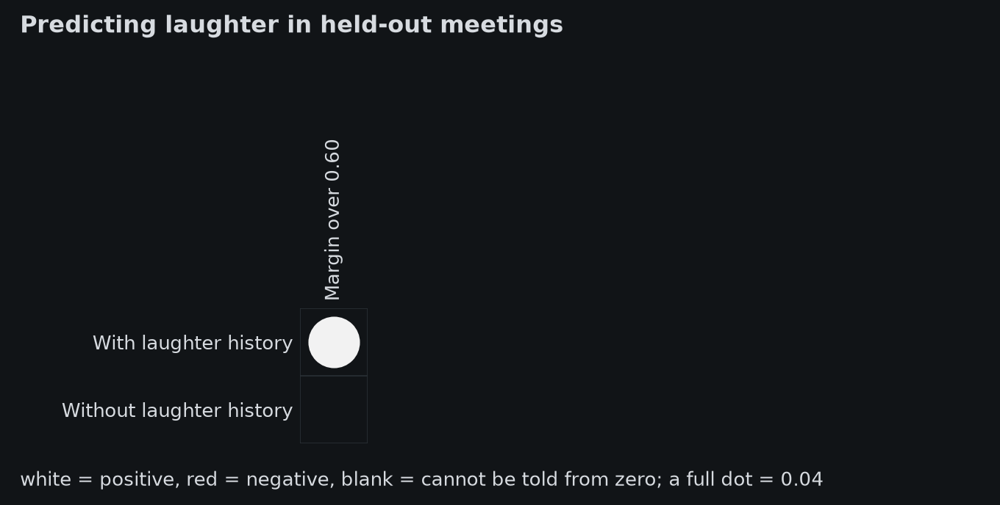

# Predicting laughter in held-out meetings

Across 213 held-out meetings, the model with laughter history cleared the registered prediction bar of 0.60. Its area was 0.639, with a 95% interval from 0.614 to 0.663. Without laughter history the area was 0.621 and its interval crossed the bar, so that cell is blank. The two arms were scored separately and their difference remains untested.

This tests an observable context prediction relevant to PLAY, not the proposed channel or its causal trigger.

[Full result](LA6_COMPLETE_20261119.md) · [Plotted margins](LA6_RESULT_SHEET_CELLS_20261120.csv)
