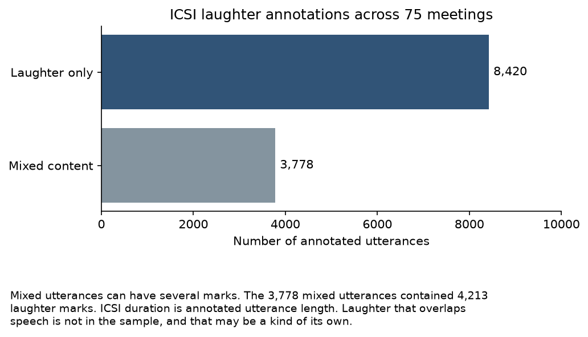

# ICSI SOURCE AND OPEN BINDINGS 20261122

Seventy-five distinct original ICSI meeting transcripts matched all 468 assigned microphones. The preambles file was excluded. There were 8,420 laughter-only utterances. There were also 3,778 mixed utterances containing 4,213 laughter marks. The companion internal CSV contains one mixed-mark share per speaker with marked laughter, sorted by share with neither identifiers nor ordering by identity. The verified checksum is in this receipt. The first original run stopped before waveform measurement because its parser accepted decimal microphone numbers. The provider also uses chanA and chanB. The failed terminal and its measured cost are preserved. The recording binding fixes annotated utterance length, the cross-corpus active-frame denominator and the figure limit. Janin et al. (2003), The ICSI Meeting Corpus, CC BY 4.0.

TRX1 needs the event condition for the person-level appraisal slope. Member 0011 supplies affect, day and beep. Member 0027 supplies coping and affect. Neither release supplies a qualifying event contrast. The 0056 and 0057 key mapping remains a separate question.

UGM1 needs offer-linked felt valence and arousal. All 8,000 eligible offer rows lacked both fields. The source dictionary identifies valence and arousal prediction errors separately. Those errors and the independent feeling-task ratings do not identify the required trial-level contrast. Both diary and game dispositions concern source support.

