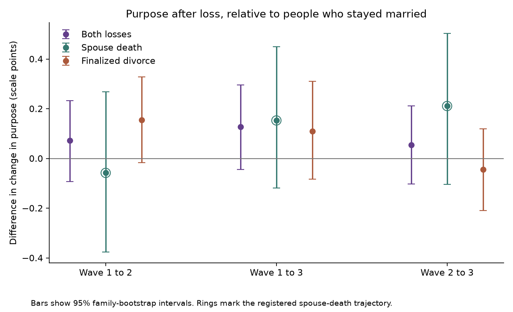

# Purpose after a marital loss

We followed people who reported a spouse’s death or a finalized divorce between their first two MIDUS interviews. At each wave we compared their change in reported purpose with that of people in the same age decades who stayed married.

**Undecided for spouse death, finalized divorce and both losses pooled.** After a spouse’s death, the estimated change in purpose relative to continuously married people was −0.058 points by wave two (95% interval −0.376 to 0.269). Both a lasting drop and recovery remain unresolved in this sample. The pooled result and the pre-loss check also span zero.

The table gives differences in change in questionnaire points. Intervals use 2,000 whole-family bootstrap draws. A positive value means purpose rose more, or fell less, in the loss group. The final column holds the earlier score as well as age decade and is descriptive. The count is the number of people whose change was benchmarked.

| Loss | People | Interval between waves | Registered change [95% interval] | Earlier-score-adjusted [95% interval] |
|---|---:|---|---|---|
| Both losses | 207 | Wave 1 to 2 | 0.072 [−0.092, 0.233] | −0.103 [−0.243, 0.035] |
| Both losses | 207 | Wave 1 to 3 | 0.127 [−0.044, 0.296] | −0.066 [−0.211, 0.076] |
| Both losses | 207 | Wave 2 to 3 | 0.054 [−0.102, 0.211] | −0.077 [−0.209, 0.056] |
| Spouse death | 80 | Wave 1 to 2 | −0.058 [−0.376, 0.269] | −0.387 [−0.657, −0.123] |
| Spouse death | 80 | Wave 1 to 3 | 0.153 [−0.118, 0.449] | −0.179 [−0.394, 0.062] |
| Spouse death | 80 | Wave 2 to 3 | 0.211 [−0.104, 0.502] | −0.149 [−0.388, 0.094] |
| Finalized divorce | 127 | Wave 1 to 2 | 0.155 [−0.017, 0.328] | 0.056 [−0.101, 0.212] |
| Finalized divorce | 127 | Wave 1 to 3 | 0.110 [−0.084, 0.311] | −0.007 [−0.171, 0.165] |
| Finalized divorce | 127 | Wave 2 to 3 | −0.044 [−0.210, 0.119] | −0.071 [−0.217, 0.084] |
| Loss between waves 2 and 3 | 195 | Wave 1 to 2 | −0.025 [−0.192, 0.147] | 0.004 [−0.140, 0.149] |

The later-loss group’s wave-one to wave-two change was measured before its loss. The descriptive earlier-score-adjusted result for spouse death at wave two is below zero. The packet’s constructed panels showed that stable differences between groups could produce this pattern, so the registered verdict uses the change scores. The pooled estimate uses the 207 distinct people in the two loss groups and the same comparison roster. Pooling the overlapping pooled and subgroup estimates a second time would duplicate observations.

Divorce may be chosen. Wave one had no neutral midpoint. Three items measure purpose, and the main comparison includes only people who stayed for all three waves. The differing use of the midpoint between groups could affect even the comparison-adjusted change. The first and most-recent marriage histories can miss intervening losses.

The sealed entry projected only the reviewed columns, reconstructed the six historical rosters, reapplied the joint disclosure check and reproduced all 20 aggregate rows on a fresh read. One sealed invocation returned code 0. Its conservative charge was 3,600 CPU-seconds. [Full numerical table](SLD5_purpose.csv). [Frozen design](../../../docs/design/stage-15/week8/SLD5.md).

**Source credit.** Brim and colleagues, *Midlife in the United States (MIDUS 1), 1995–1996*, ICPSR 2760 v19. Ryff and colleagues, *MIDUS 2, 2004–2006*, core survey release dated July 20, 2020. Ryff and colleagues, *MIDUS 3, 2013–2014*, core survey release dated October 29, 2025. MIDUS received support from the John D. and Catherine T. MacArthur Foundation Research Network and the National Institute on Aging through P01-AG020166 and U19-AG051426. [Wave one](https://doi.org/10.3886/ICPSR02760.v19). [Wave two](https://doi.org/10.3886/ICPSR04652). [Wave three](https://doi.org/10.3886/ICPSR36346). [Study acknowledgements](https://midus.wisc.edu/citation-acknowledgement/).
